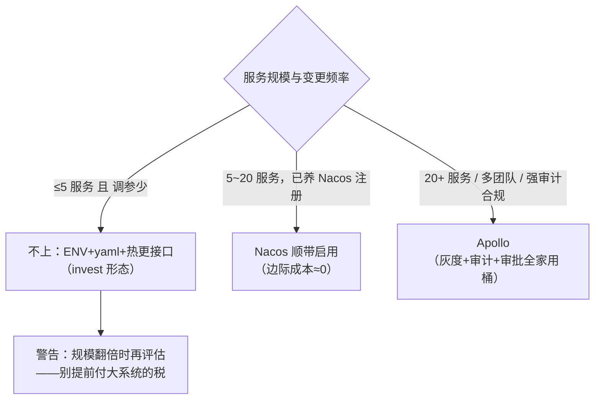

配置中心选型-Apollo对比Nacos与SpringCloudConfig
====

配置中心的真正价值不是"集中存配置"，是**用可控的变更流程换取变更速度**：环境变量改一次要重启发布，配置中心让"调个阈值"从 30 分钟发布窗口变成 10 秒推送——但同时它自己成了需要运维的有状态组件。本篇按竞品矩阵 + 推送模型 + **ROI 测算**选型，并给出"不上配置中心"这一档的成立条件。协调类中间件的分层背景见 [协调中间件选型-ZooKeeper对比etcd与Nacos](../zookeeper/协调中间件选型-ZooKeeper对比etcd与Nacos.md)。

1 竞品矩阵：四档选手
------

| | Apollo | Nacos | Spring Cloud Config | 不上（ENV+yaml+热更接口） |
|---|---|---|---|---|
| 出身 | 携程（2016，纯配置中心深耕） | 阿里（注册+配置一体） | Spring 官方（git 为源） | 自建轻量形态 |
| 部署重量 | **最重**：Config+Admin+Portal+DB 三服务一库 | 单进程（已养注册中心则**零新增**） | 配合 git+bus（MQ） | 零 |
| 推送模型 | 客户端长轮询 Release 版本化 | 1.x 长轮询 / 2.x gRPC 推送 | git webhook+bus 刷新（要拼装） | 自定义（配置接口+内存热更） |
| 灰度发布 | **最强**（按实例/集群/标签灰度） | 按 namespace+group 简单灰度 | 无（git 分支变通） | 无 |
| 审计与回滚 | 版本化+发布审计+**一键回滚** | 历史版本可回滚 | git 本身即是 | 看自建程度 |
| 多环境权限 | 环境×集群×namespace×细粒度审批 | namespace 隔离+账号权限 | 弱 | 弱 |
| 客户端 | 独立 SDK（无 Spring 绑定，多语言） | Spring Cloud Alibaba 生态 | 原生 starter | 自写 |

一句话画像：**Apollo 是配置中心的"专业相机"，Nacos 是微服务套件里的"顺手功能"，SCC 是 git 原教旨主义，不上是规模未到的诚实**。etcd 不入表——它是②层原语，当配置中心要自建全部产品语义（分层模型见姊妹篇）。

2 推送模型为什么决定体验
------

配置中心的灵魂是**变更怎么到达实例**：

* **长轮询/推送**（Apollo/Nacos）：改完 1~10 秒全集群生效——"发布"语义完整：版本号、diff 预览、灰度批次、失败回滚；
* **SCC 的 git+bus**：本质是"git 提交 + 广播刷新"，省了存储但要养 MQ，且无灰度/审计的产品语义——把工程问题留给了你；
* **环境变量的天花板**：改了要重启——配置中心买的正是"**免重启的受控变更**"这一件事。

3 ROI 测算：什么时候配置中心是正收益
------

**收益侧**（可量化的四项）：

```
①免发布窗口：调参类变更 n 次/周 × 发布窗口 30min × 涉及服务数
  ——20 服务 × 3 次/周 ≈ 30 人时/周，全年 1500+ 人时
②错配事故恢复：配置错误是 TOP 故障源之一
  ——无版本化：定位+修复+发布 ~1h；有回滚：diff+回滚 ~3min
③多环境收敛：dev/stest/prod × N 服务的散落 yaml → 统一视图
④灰度能力：新阈值先放 1 台观察——把"赌"变成"试"
```

**成本侧**：Apollo 三服务一库的运维与学习成本（团队要专职理解）；Nacos 若已养注册中心则**边际成本≈0**（这也是它国内市占第一的真实原因）；自建档的隐藏成本是"审计与回滚永远排不上优先级"。

**决策线**（经验刻度，别当圣旨）：



4 实战反哺：两个真实形态各得其所
------

* **star-site（Nacos 档）**：13 个 Spring Boot 服务，注册发现是刚需——Nacos 已在，配置中心**顺带启用零边际成本**，环境配置从散落 yml 收进控制台，多环境 namespace 隔离；
* **invest（不上档）**：单用户双容器，配置 = yaml + 环境变量 + 设置页写库热更（GLM key 运行期可改）——**配置中心的全部收益项在 1 个服务的量级下都趋近于零，而成本项（新组件运维）是实打实的**，负 ROI 的教科书样本。

两个形态都是对的——**配置中心不是微服务必选项，是规模函数**：`收益 ∝ 服务数 × 变更频率 × 团队数`，过线才付钱。

面试追问链
------

* Apollo 和 Nacos 配置怎么选？→ 专业深度（灰度/审批/审计）选 Apollo，已养 Nacos 注册则配置顺带启用（边际成本为零）；
* 配置中心的核心价值一句话？→ 免重启的受控变更：版本化+推送+回滚，存储只是载体；
* SCC 为什么在国内没成主流？→ 产品语义（灰度/审计/推送）要自己用 git+bus+MQ 拼装，拼完约等于重造半个 Apollo；
* 配置和 DB 里的业务开关怎么分？→ 起动期要用的（数据源/依赖地址）进配置中心，运行期业务规则（风控阈值）落库+热更接口——**起动配置与运行配置分轨**；
* 不上配置中心怎么活？→ ENV+yaml+设置页热更（invest 形态），代价是审计灰度没有——规模过线要认账迁移；
* 配置推送的一致性语义？→ 最终一致（秒级全量到达），别拿配置中心当强一致存储用——它连的是发布流程不是共识协议。

面试官视角小结
------

配置中心题的高分信号是**规模意识**：能说出"不上也是一档选型"并给出成立条件（服务数×变更频率的收益函数），比背 Apollo 功能列表高两个段位；追问灰度发布怎么做，Apollo 用户讲按实例分批，自建用户讲"先改一台观察"——真做过的都答得出流程与回滚，只在 PPT 里见过的只答得出"实时推送很方便"。

> 2026-11 新增（config 轨首篇，star-site/Nacos 与 invest/零配置中心双形态实战反哺）。姊妹篇：[协调中间件选型-ZooKeeper对比etcd与Nacos](../zookeeper/协调中间件选型-ZooKeeper对比etcd与Nacos.md)、[缓存架构选型-本地Caffeine对比分布式Redis与多级缓存](../redis/缓存架构选型-本地Caffeine对比分布式Redis与多级缓存.md)。
