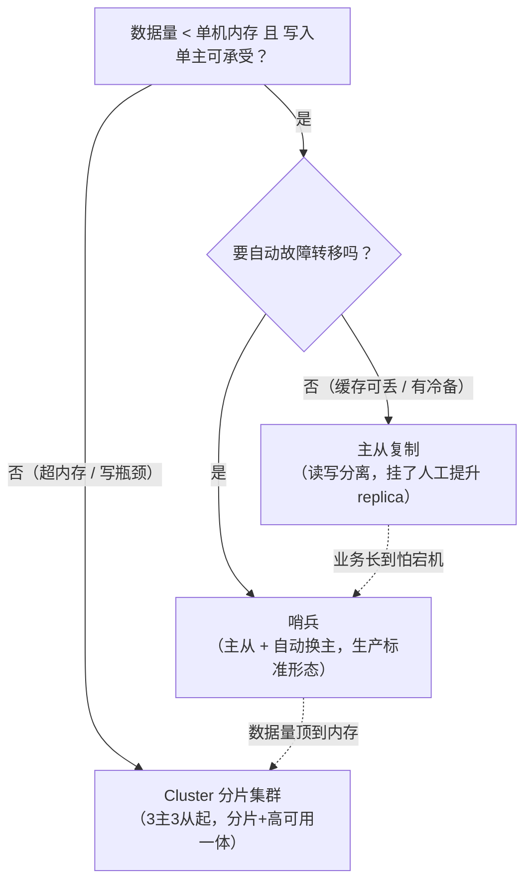

高可用与部署选型-主从哨兵与集群
===========

看在前面
----

[缓存穿透-击穿-雪崩](../02-缓存实战/缓存穿透-击穿-雪崩.md)里说过：雪崩的成因 B 是「Redis 本身不可用」。这篇就是成因 B 的正面战场：**主从复制是高可用的原材料，哨兵解决「自动换主」，Cluster 解决「容量与写扩展」**。姊妹篇：[数据类型与底层编码](../01-基础内功/数据类型与底层编码.md)、[持久化-RDB与AOF](../01-基础内功/持久化-RDB与AOF.md)、[过期删除与内存淘汰](../01-基础内功/过期删除与内存淘汰.md)。

部署方案全景：四种拓扑怎么选
----

先给部署形态的全景，机制原理往下翻——「选哪种方案」是**容量与运维**问题，「为什么这样工作」才是机制问题，两层分开决策。



四（+2）种方案对照——**最小规格**是面试与立项都常问的硬信息：

| 方案 | 拓扑 | 最小规格 | 故障转移 | 容量 | 多 key 命令 |
|---|---|---|---|---|---|
| 单机 | 1 实例 | 1 | 无（人工拉起） | 单机内存 | 全支持 |
| 主从复制 | 1 主 N 从 | 2 实例 | 无自动（人工 `REPLICAOF NO ONE` 提升） | 单机内存（读可扩展） | 全支持 |
| 哨兵 | 主从 + 哨兵进程 | 1主2从 + **3哨兵** | 自动（判下线→选 leader→换主） | 单机内存 | 全支持 |
| Cluster | 分片×(主+从) | **3主3从** | 自动（分片内切换） | 水平扩展 | 仅同槽（hash tag 缝合） |
| Proxy 代理层 | Proxy 池 + 后端 Redis 组 | 2 proxy + 后端 | 取决于后端形态 | 预分片扩展 | 代理层尽量兼容 |
| 云托管 | 厂商托管主从/集群版 | 按规格购买 | 厂商 SLA | 按规格 | 同对应形态 |

两个「边缘选项」的诚实评价：**Proxy 层**（twemproxy/Codis）是 Cluster 普及前的主流——客户端当单机用、分片逻辑收进代理，代价是多一跳延迟 + 代理自己是新的故障点，且 Codis 已停维护，**新项目不建议再引入**（存量另说）；**云托管**省掉的是哨兵/集群的运维面（监控、切换演练、版本升级），换来的是规格溢价与灵活性上限——「值不值得为不养运维买 SLA」与本库一贯的选型哲学同款（见[协调中间件选型](../../zookeeper/协调中间件选型-ZooKeeper对比etcd与Nacos.md)§4）。

**部署实操最小清单**（每种方案的 conf 三件套）：

* **主从**：replica 上 `replicaof <master-ip> 6379` + `masterauth <密码>`；读写分离开 `replica-read-only yes`（默认）；验证 `INFO replication` 看 `slave0` 在线、offset 增长；
* **哨兵**：`sentinel monitor mymaster <ip> 6379 2`（末位 quorum=2）；**哨兵至少 3 个且分散宿主**（奇数防选主僵局，详见下文 quorum 与 majority）；调 `down-after-milliseconds`（判下线灵敏度）与 `failover-timeout`；
* **Cluster**：每节点 `cluster-enabled yes` + `cluster-config-file nodes-6379.conf` + `cluster-node-timeout 15000`；用 `redis-cli --cluster create <6节点> --cluster-replicas 1` 一键建 3主3从；验证 `CLUSTER INFO` 的 `state:ok` + `CLUSTER NODES` 槽位全覆盖；
* **通用纪律**：全部节点 `requirepass` + `masterauth` 同密码（哨兵换主后 replica 要能连上新主）；生产哨兵/Cluster 的节点**跨宿主机/可用区部署**——同宿主放三哨兵，宿主一挂投票团灭。

与 star-site 的实战呼应：当前 `star-redis` 单实例 + RDB 快照——按上表是「单机」档，规模未到、缓存可丢，先不为高可用付 5 实例的税；升档触发条件就是决策图的两个分叉（怕宕机→哨兵，顶内存→Cluster）。

进阶部署形态：分片位置、级联复制与多活
----

主干四拓扑之外，工程里还有一批形态——多数不是「更高级」，是**约束条件变了**的产物。最值得展开的是**分片逻辑放哪一层**这个经典架构题：


| 维度 | 客户端分片 | 代理分片 | 服务端分片（Cluster） |
|---|---|---|---|
| 分片逻辑位置 | 业务依赖里 | 独立 Proxy 进程 | Redis 内核（槽） |
| 扩容 | **迁移自己写**（一致性哈希只减抖动，数据要搬） | Codis 支持槽迁移 | 官方 `--cluster reshard` 原生 |
| 延迟 | 零额外一跳 | **多一跳**（Proxy 是新故障点） | 无（直连） |
| 客户端要求 | 语言生态自带 | 无（当单机用） | smart client（集群协议） |
| 现状 | 老系统存量 | Codis 停维护 | **新系统默认答案** |

其余形态各一句话说清适用条件：

* **级联复制（链式主从）**：master → replica-A → replica-B1/B2——全量同步与 backlog 的扇出压力从 master 摘走，适合「读副本一大把」的报表/缓存场景；代价是**复制延迟沿链累积**、上游挂则下游全断（哨兵要按链分层监控）；
* **跨机房灾备**：主从异步复制跨 DC，**丢数据窗口 = 网络往返延迟**，机房断链后提升 replica 是人工决策——灾备演进的第一站；机房级断链的预案体系见[多活容灾与单元化](../../../../C-架构/DDD与方法论/方法论/多活容灾与单元化.md)，其中「单元化」形态是每个单元本地 Redis 完整服务、数据按归属分片不跨单元同步；
* **商业多写（Redis Enterprise CRDB）**：Active-Active 多地域双写，CRDT 冲突消解——开源版没有等价物，多写是它的专利场景（License 风险见[版本演进-Redis8新特性与Valkey分叉](../04-版本与生态/版本演进-Redis8新特性与Valkey分叉.md)）；
* **K8s Operator 部署**（redis-operator / StatefulSet）：哨兵与 Cluster 的现成 chart，PVC 绑定 + 故障自愈——与 star-site 的 `docker run` 同哲学：平台在 K8s 上就别手搓容器，平台在 Docker 就直跑；
* **Serverless Redis**（ElastiCache Serverless / Upstash）：按请求计费，低流量/突发型场景 ROI 高，常态大流量反而贵——把它当「计费模型」而非「部署拓扑」理解；
* **兼容引擎替换**（Dragonfly / KeyDB）：多线程单机大内存，部署形态与单机/主从完全一致——**换引擎不换拓扑**，缓存场景垂直扩展的新选项。

主从复制：全量、增量与 replicaId
----

先立大局：**Redis 的主从复制是异步的**——master 执行完命令立刻回 OK，不等 replica 确认。性能好。但 master 宕机时最后若干毫秒的写入可能没同步出去。缓存场景可接受，存储场景要算账（见文末脑裂防护）。

全量同步（首次连接 / 无法增量时）
----

```
replica                                    master
   │── PSYNC ? -1 ──────────────────────────►│  没有复制 ID → 请求全量
   │◄─ +FULLRESYNC <replid> <offset> ────────┤  登记从库
   │                                         │  BGSAVE 生成 RDB（复用持久化的 fork+COW，
   │                                         │  见[持久化-RDB与AOF](../01-基础内功/持久化-RDB与AOF.md)）
   │                                         │  期间新写命令积压在「复制缓冲区」
   │◄──── RDB 全量数据 ───────────────────────┤
   │  清空旧数据，载入 RDB                     │
   │◄──── 积压的增量命令 ──────────────────────┤
   │  之后进入命令传播：持续接收写命令流          │◄─ replica 每秒 REPLCONF ACK <offset> 心跳
```

增量与 backlog
----

断线重连后 replica 带着 `PSYNC <replid> <offset>` 回来。master 查 **repl_backlog（环形缓冲区，默认 1MB）**：offset 差的部分还在 backlog 里 → 只补差量（**部分重同步**，最理想）。已被覆盖 → 退化为全量。**backlog 按「断线时长 × 写入速率」调大**：写入 10MB/s、要扛 30 秒网络抖动，至少 300MB。

replicaId（psync2，4.0）：全量重同步的止血贴
----

每个实例持有 **replid + replid2** 两个复制 ID。正常只有 replid 生效。**故障切换后，新 master 把旧 master 的 replid 记为 replid2**。其他从库重连时若自己的 replid 等于新 master 的 replid2 且 offset 在范围内，仍可部分重同步。

4.0 之前切主 = replid 变了 = 所有从库全量重同步。故障瞬间再叠加 RDB 生成 + 全量传输，雪上加霜。这是 psync2 解决的核心难题。

哨兵：判下线、选 leader、换主
----

```
 Sentinel-1      Sentinel-2      Sentinel-3    ← ≥3 台、奇数、独立部署（与 Redis 分机）
     │               │               │
     └───── 每秒 PING master / replicas / 其他哨兵 ─────┘
                        │
              ┌─────────┴─────────┐
            master              replica-1 / replica-2
```

主观下线与客观下线
----

- **主观下线（SDOWN）**：单个哨兵在 `down-after-milliseconds` 内没收到有效回复（PONG / -LOADING / -MASTERDOWN 都算活着），**单方面**标 master 下线；
- **客观下线（ODOWN）**：该哨兵向其他哨兵发 `SENTINEL is-master-down-by-addr` 求证，**≥ quorum** 个都判 SDOWN → ODOWN。quorum 只用于这一步的判定。

leader 选举：quorum 与 majority 的关系
----

> **面试官：quorum 和「过半」是什么关系？为什么选举要过半而不是凑够 quorum？**

哨兵 leader 选举仿 Raft。发现 ODOWN 的哨兵自增 epoch 并向同伴拉票，**每个哨兵每个 epoch 只投一票、先到先得**。拿到 **majority（> n/2）** 票者当选并执行故障转移。

**quorum 决定「要不要动手」，majority 决定「谁能动手」**。quorum 可以配 1（快速判死），但票数永远要过半。这样同一 epoch 不可能选出两个 leader，这是选举层的防脑裂保证。这也是哨兵至少 3 台的原因：2 台挂 1 台就永远到不了 majority。

故障转移四步与新主挑选
----

1. **挑新主**，依次比较。①与旧 master 断连过久的先淘汰。②`replica-priority` 数值小的优先（0 = 永不参选，可用来保护弱机）。③**复制偏移量 offset 大的优先**（数据最全）。④runid 字典序小（纯决胜）。
2. 向新主发 `SLAVEOF NO ONE`；
3. 其余从库逐个 `SLAVEOF 新主`（有节奏地切，不是瞬时）；
4. 旧 master 恢复上线后也被改成新主的从库。哨兵广播 `+switch-master` 事件，客户端订阅它感知换主。

脑裂防护
----

旧 master 与多数派分区时，哨兵已选出新主，但**仍有客户端往旧 master 写**。分区恢复后旧 master 降级为从库、清空自身同步新主，分区期间那些写全部蒸发。防护配置：

```conf
min-replicas-to-write 1     # 至少 1 个从库延迟在阈值内，才接受写
min-replicas-max-lag 10     # 延迟阈值 10 秒
```

旧 master 被分区后身边没有「延迟合格的从库」，写命令直接返回错误——**牺牲分区期间的可用性，换不丢已确认的写**。这也是[缓存穿透-击穿-雪崩](../02-缓存实战/缓存穿透-击穿-雪崩.md)里「failover 期间请求报错」的另一来源，客户端必须有快速失败 + 重试预案。

Cluster：16384 槽、MOVED/ASK、gossip
----

哨兵解决可用性，不解决容量——写仍是单点、内存受单机上限。Cluster 把数据分片到多个主节点。**每个节点负责 16384 个槽的一部分，key 落在 `CRC16(key) mod 16384` 号槽，槽再映射到节点**。客户端可连任意节点，不持有该 key 时返回重定向。

为什么 16384、为什么不用一致性哈希
----

三条（antirez 本人的回答）。①节点间心跳携带「我负责哪些槽」的 bitmap，16384 bit = **2KB** 刚好，65536 要 8KB 太浪费。②集群规模建议 ≤1000 节点，16384 足够分。③槽是**显式映射表**而非一致性哈希的虚拟环——扩缩容时「迁移哪些槽」完全可控（精确到槽的命令）。客户端也能缓存精确槽表。一致性哈希的负载与迁移量都不可控。

MOVED 与 ASK：槽迁移的两种重定向
----

| | MOVED | ASK |
|---|---|---|
| 含义 | 槽已**彻底**属于目标节点 | 槽**正在迁移**，这个 key 恰好已搬过去 |
| 客户端动作 | **更新**本地槽映射，后续直连新节点 | **不更新**映射，先向目标节点发 `ASKING` 再重试这一次 |
| 协议示例 | `-MOVED 3999 127.0.0.1:6381` | `-ASK 3999 127.0.0.1:6381` |

槽迁移流程：目标节点 `SETSLOT <n> IMPORTING <源id>` → 源节点 `SETSLOT <n> MIGRATING <目标id>` → 逐批搬 key（源节点找不到的 key 才返回 ASK）→ 双方 `SETSLOT <n> NODE <目标id>` 广播新归属。**全程在线，业务只感知到偶发一次 ASK 重定向**。

gossip 与集群自治下线
----

节点间每秒互发 PING/PONG/MEET（偏向最久未联系的节点，消息头捎带随机部分节点的状态段），无中心元数据。某节点 `cluster-node-timeout` 无响应 → 标 **PFAIL（主观下线）**。**过半 master 认为某主节点 PFAIL** → 第一个发现的节点把它标 **FAIL 并广播**——不需要哨兵，集群自己完成判定。持有它槽的从库发起选举（同样过半 master 授权）接槽换主。

hash tag 与 Cluster 的边界
----

`{user1000}:orders` 与 `{user1000}:profile` 按 `user1000` 算槽，**强制同槽**——MSET/事务/Lua/多 key 命令要求所有 key 同槽。代价是倾斜：hash tag 打得太热就是自己造单点（配合 BigKey 治理，见[数据类型与底层编码](../01-基础内功/数据类型与底层编码.md)）。

边界要主动交代：只有 db0。跨槽多 key 命令受限（MGET 需客户端按槽分组拆分后 pipeline）。事务/Lua 仅限同槽。运维复杂度高于哨兵。**经验线：单实例内存够用（≤25GB 量级）先用哨兵，容量/写吞吐真不够再上 Cluster**。

客户端侧：Redisson 的连接拓扑
----

服务端拓扑在变，客户端必须跟上。Redisson 的做法（Lettuce 同理）：

```
初始化：解析配置 → 拉拓扑（哨兵：SENTINEL get-master-addr-by-name；
        集群：CLUSTER SLOTS）→ 按节点建连接池（master 写 / slave 读）
拓扑维护：① 定时扫描（scanInterval，集群默认 1s 刷一次槽映射）
         ② 事件驱动：订阅哨兵 +switch-master 频道、集群节点 pub/sub，
           收到换主/故障事件立刻重拉拓扑、重建连接池
命令路由：CRC16 算槽 → 查本地槽表直连目标节点；
         收到 MOVED/ASK 自动重定向（对业务透明）
```

```java
// 哨兵模式：读走从库分摊，订阅连接独立池
Config c = new Config();
c.useSentinelServers().setMasterName("mymaster")
    .addSentinelAddress("s1:26379", "s2:26379", "s3:26379")
    .setReadMode(ReadMode.MASTER_SLAVES)   // 读请求可走从库
    .setSubscriptionMode(SubscriptionMode.MASTER);

// 集群模式：定时 + 事件双通道刷新槽映射
c.useClusterServers().addNodeAddress("n1:6379", "n2:6379", "n3:6379")
    .setScanInterval(1000)                 // 毫秒，槽表刷新周期
    .setReadMode(ReadMode.MASTER_SLAVES);
```

读写分离的代价要接得上：从库读有复制延迟 + 过期判断在主库。见[过期删除与内存淘汰](../01-基础内功/过期删除与内存淘汰.md)从库一节。敏感读走 `ReadMode.MASTER`。

追问链
----

> **面试官：主从、哨兵、Cluster 怎么选型？**

一个维度判断：**只要「不丢可用性」→ 主从 + 哨兵（数据量 < 单机内存、写 QPS 单机扛得住）；还要容量/写扩展 → Cluster**。Cluster 的多 key/事务限制会反向约束业务设计，它不是「更高级」，是「另一种取舍」。

> **面试官：客户端分片、代理分片、Cluster——三种分片位置怎么选？**

分片逻辑放哪层的问题：客户端分片零延迟但**扩容迁移自己写**；代理层业务无感但多一跳且 Proxy 高可用要自建（Codis 已停维护）；Cluster 内核原生 reshard 但约束多 key、要求 smart client。**新系统默认 Cluster**；存量 twemproxy/Codis 的迁移按「业务改造量 vs 代理退役」算账，而不是比功能清单。

> **面试官：怎么监控复制延迟？**

对比 `INFO replication` 里 master 的 `master_repl_offset` 与各 slave 的 `slave_repl_offset` 差值。按业务一致性要求设告警。长期高延迟先查 master 出口带宽——全量重同步风暴比延迟本身更常见，backlog 调大 + `client-output-buffer-limit replica` 限制失控从库。

> **面试官：全量同步把 master 打挂过，怎么避免？**

多台从库同时重连 = 同时请求全量 = 多次 bgsave + RDB 网络风暴。手段：`repl-diskless-sync yes` 无盘复制（RDB 直接走网络不落盘，磁盘慢网络快时收益大）。从库逐台错峰拉起。按上文口径调大 backlog，让闪断走部分重同步而不是全量。

> **面试官：除 +switch-master 外，客户端还要处理哪些哨兵事件？**

`+odown`（客观下线，可触发业务告警/预案预热）、`+switch-master`（换主，重建写连接）、`-sdown`（恢复）。把「客户端感知故障转移」答成事件清单，说明你真处理过 failover 抖动。

面试官视角小结
----

1. **复制**：异步。全量 = PSYNC ? -1 → RDB（复用 fork+COW）→ 积压增量 → 命令传播。部分重同步靠 backlog 环形缓冲（按断线时长 × 写速率调大）。psync2 双 replid 让切主后从库免全量。
2. **哨兵**：SDOWN 单哨兵判 → ODOWN 凑 quorum → leader 选举要 majority（quorum 管「要不要」，majority 管「谁能」，至少 3 台奇数）。挑新主：priority → offset → runid。
3. **脑裂**：`min-replicas-to-write` + `min-replicas-max-lag` 让身边没有合格从库的旧 master 拒写。用分区内的可用性换已确认写不丢。
4. **Cluster**：CRC16 mod 16384 定槽（心跳 bitmap 2KB、显式槽表可控迁移）。MOVED 改映射 / ASK 临时重定向。gossip 里 PFAIL → 过半 → FAIL 的自治下线。hash tag 换同槽但防倾斜。
5. **客户端**：Redisson 初始化拉拓扑 + 定时/事件双通道刷新 + MOVED/ASK 透明重定向。读写分离要兜住复制延迟与「从库不判过期」两个语义。

> 2026-10 新增（P0 补全）。
