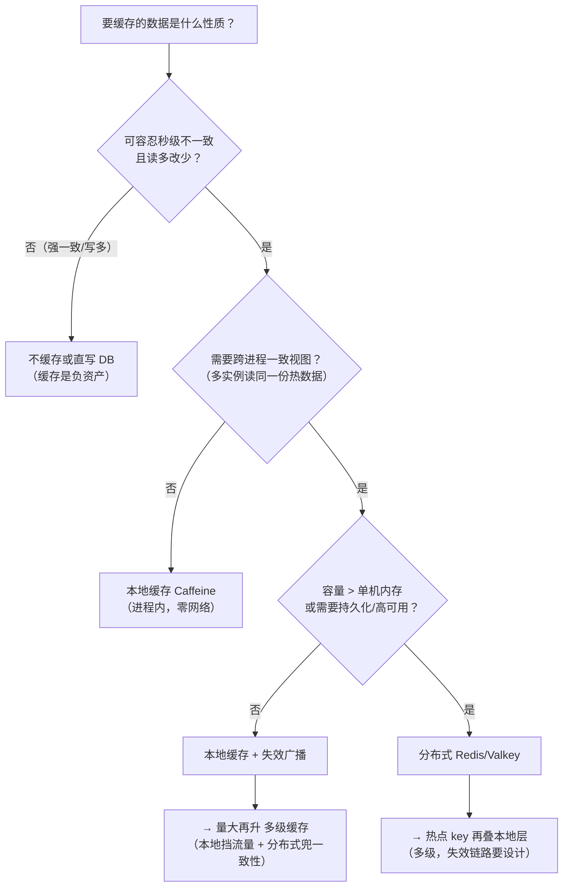

缓存架构选型-本地Caffeine对比分布式Redis与多级缓存
====

缓存选型其实是**两层问题**：先用架构层（本地/分布式/多级）定形态，再谈中间件（Redis vs Memcached vs Valkey）选品牌——顺序反了就会"为了一个字典表上一套 Redis 集群"。本篇把两层选型加 **ROI 测算**一起讲透：缓存不是免费午餐，投不投要用数字回答。机制基础见本目录[穿透-击穿-雪崩](缓存穿透-击穿-雪崩.md)与[高可用](高可用-主从哨兵与集群.md)两篇。

1 架构层：本地 / 分布式 / 多级怎么选
------

决策只看三个数据性质：**一致性容忍度、容量、是否跨进程共享**：



三形态对照（十年 Java 视角的成本表）：

| 维度 | 本地 Caffeine | 分布式 Redis/Valkey | 多级（本地+分布式） |
|---|---|---|---|
| 读延迟 | **~100ns**（方法调用级） | ~0.5-2ms（网络一跳） | 热点 ns 级、冷点 ms 级 |
| 容量 | 受限于 JVM 堆（百 MB 级） | 集群可到 TB | 两层叠加 |
| 一致性视图 | **每实例各一份**（不一致是常态） | 集中一份（强视图） | 失效链路复杂（广播/TTL 兜底） |
| 故障模式 | 随进程生死，无依赖 | 新依赖：抖动即读放大到 DB | Redis 挂→本地层挡住雪崩 |
| GC 影响 | 堆内对象（大缓存要压 TuneLFU 上限） | 堆外 | 本地层仍占堆 |
| 典型场景 | 字典/规则/菜单/权限 | 会话/热点商品/计数/锁 | 秒级热点读（商品详情页） |

本地缓存的纪律一条：**它只是性能提示，不是事实源**——组件仓 D4 决策的原话（Pod 本地缓存必须带自愈路径，未命中回源校验），否则实例重启间的不一致窗口会变成幽灵数据。

2 中间件层：Redis vs Memcached vs Valkey（+Caffeine vs Guava）
------

| | Redis | Memcached | Valkey |
|---|---|---|---|
| 线程模型 | 单线程命令执行（6.0+ IO 多线程） | **多线程**（纯 KV 下吞吐稳） | Redis 7.2 fork，延续 |
| 数据结构 | 丰富（hash/zset/stream/...） | 纯 string KV | 同 Redis |
| 持久化/高可用 | RDB/AOF + 哨兵/集群 | **无**（挂了就冷启动） | 同 Redis |
| License | 7.4 起转 RSALv2/SSPL（**非 OSI 开源**） | BSD | **BSD**（分叉主因） |
| 适用 | 需要结构/持久化/生态 | 纯 KV 大容量、可丢 | 想要 Redis 但要真开源 |

Valkey 的存在提醒选型要看**法务层**：Redis 换协议后 AWS/Google 云产品集体切 Valkey——自建无感，但"开源合规"敏感的团队已默认 Valkey。Caffeine vs Guava Cache 一句话：W-TinyLFU 的命中率碾压 LRU，Spring Boot 5.x 起默认实现就是 Caffeine——**新项目没有理由再选 Guava Cache**。

3 ROI 测算：投不投缓存，用数字回答
------

**收益侧的算式**（面试和立项都能用）：

```
DB 有效 QPS = 总读 QPS × (1 − 命中率 h)
需要 h > 1 − DB容量 / 总读QPS

例：读 10,000 QPS，DB 单机安全容量 3,000
→ h > 70% 才免扩容；h = 95% 时 DB 仅承压 500 QPS（一台降到半台）
延迟：DB 查询 P99 ~50ms → 缓存命中 P99 ~2ms
→ 交易链路省 48ms，下单转化率的提升是业务侧真金白银
```

**成本侧**（常被低估的三项）：一致性复杂度（写后失效链路的 bug 率）、雪崩三件套的治理成本（穿透/击穿/雪崩——本目录专文）、新组件运维（监控/容量/版本）。**ROI 为正的条件**：读多写少 + 热点集中 + 秒级不一致可容忍；写多读少、强一致、低 QPS 三种场景上缓存是负 ROI——最后一类最常见：**日活几千的系统加 Redis 集群，省的 DB 还不够付缓存运维**。

4 实战反哺：三个真实形态
------

* **invest（零缓存组件）**：SQLite 本地读 + `series_updated_at` 判新鲜度——数据量 MB 级、单用户，任何缓存中间件都是负 ROI，**本地文件+索引就是缓存**；
* **starsite-lock（本地缓存纪律样本）**：ownerId→锁状态的 Pod 本地提示缓存，命中只做快路径，未命中必回 DB 校验自愈（D4）——本地缓存的正确姿态范本；
* **star-site（配置型数据走推送不走缓存）**：路由/开关类数据由 Nacos 推送维护本地视图——**可推送的配置别用缓存轮询**，推送语义免掉失效链路。

一句话收束：**缓存选型的答案常常是"更少缓存"——先问数据性质，再算 ROI，最后才是挑品牌**。

面试追问链
------

* 本地缓存和分布式缓存怎么选？→ 三性质：一致性容忍/容量/跨进程共享；什么时候多级？→ 分布式层扛不住热点读且可设计失效链路时；
* Caffeine 为什么比 Guava Cache 强？→ W-TinyLFU：以频率为主的准入+驱逐，抗偶发扫描，同内存命中率显著高于 LRU；
* 多级缓存一致性怎么保证？→ 写路径删分布式层+广播失效本地层（MQ/redis pubsub），兜底给本地层短 TTL——**最终一致，不做强一致**；
* Redis 和 Memcached 还会选谁？→ 纯 KV 可丢大容量多线程选 Memcached，要结构/持久化/高可用选 Redis；Valkey 什么时候进选项？→ 开源合规敏感或云托管默认；
* 缓存一定提升性能吗？→ 不命中率高的场景反而加一跳；什么时候坚决不缓存？→ 写多读少/强一致/低 QPS（负 ROI 三件套）；
* 怎么向老板论证缓存投入？→ h > 1−DB容量/总QPS 的免扩容算式 + 延迟对转化的量化——把缓存讲成成本节约项目而不是技术升级。

面试官视角小结
------

缓存题人人会答"Redis 快"，区分度在**克制**：能说清"什么不该缓存"（负 ROI 三件套）、能把命中率换算成 DB 扩容账、知道本地缓存必须带自愈纪律的，是做过真实容量规划；张口就"加个缓存"而不问数据性质和写路径的，是把缓存当银弹。多级缓存追问失效一致性——答"广播删除就一致了"的没踩过坑，答"最终一致+短 TTL 兜底"的下过场。

> 2026-11 新增（redis 轨第 7 篇，starsite-lock D4/invest 零缓存/star-site 推送三形态实战反哺）。姊妹篇：[缓存穿透-击穿-雪崩](缓存穿透-击穿-雪崩.md)、[高可用-主从哨兵与集群](高可用-主从哨兵与集群.md)。
