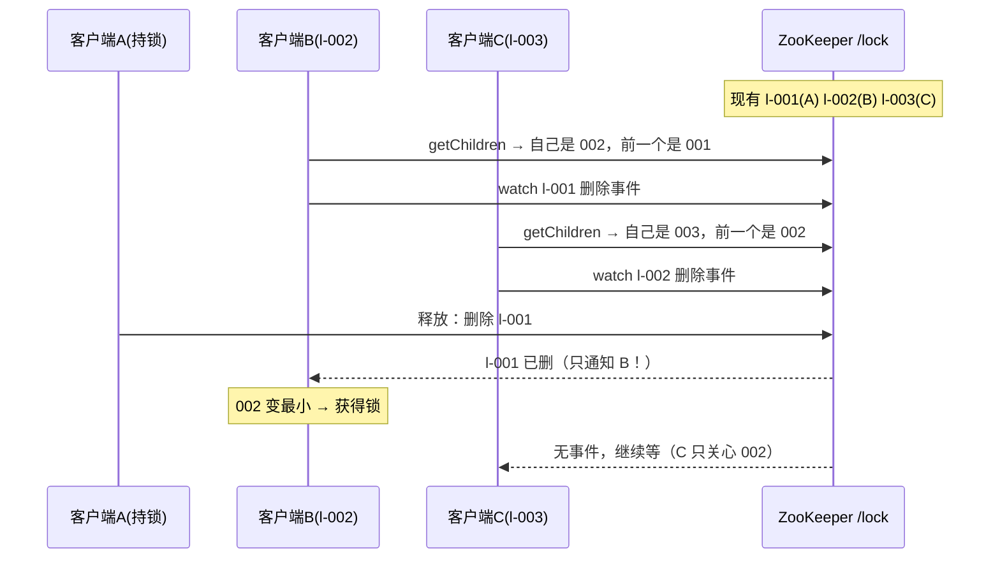

ZooKeeper分布式锁实战-Curator与羊群效应
====

分布式锁的三个流派——DB 行锁/唯一键、Redis SET NX、ZK 临时节点——我们组件仓刚用 MySQL 落了第二个（`starsite-lock`，见 [异步命令框架-从令牌认领到三模式执行](../../../C-架构/分布式系统/异步命令框架-从令牌认领到三模式执行.md) 的同系列叙事）。本篇讲 ZK 流派：**为什么临时顺序节点是它的标准答案、羊群效应怎么被消除、以及 GC 停顿撕开的时序裂缝**。原理篇见 [ZooKeeper核心机制-ZAB数据模型与Watcher](ZooKeeper核心机制-ZAB数据模型与Watcher.md)。

1 临时节点版 v1：死锁自愈，但惊群
------

最直觉的做法：抢锁 = 在 `/lock` 下建 **EPHEMERAL** 节点，建成功即持锁；释放 = 删节点或断开会话。

两个天然优点是 DB 锁流派对不上的：

* **死锁自愈不需要 TTL**——客户端进程死了，会话超时节点自动消失（DB 锁要靠 `locked_until` 过期接管，Redis 要靠过期时间+续期）；
* **锁释放即通知**——别人可以 watch 这个节点，删了立刻知道（DB 锁只能轮询重试）。

致命伤：**所有等待者 watch 同一个锁节点**——持有者一释放，全体被唤醒抢一次，一个成功 N-1 个失败再挂回去。100 个等待者 = 每次释放 100 次 zk 写放大，这就是**羊群效应（herd effect）**：惊的是羊群，压的是 ZK。

2 临时顺序节点版 v2：排队 + 只盯前一个
------

标准解法：EPHEMERAL **_SEQUENTIAL**——每人建节点拿到递增序号，**只 watch 自己前面那一个**：



等待者变成**链式排队**：释放只唤醒下一个人，惊群归零。判定"自己是最小"用 `getChildren` + 比较，两步之间有竞态但**结果安全**——就算刚判定完前面的人删了，watch 已注册（注册先于判定则更稳：Curator 的实现是先 watch 再复查），顶多多等一轮。

**锁语义对照**（和我们 DB 锁组件同表比较，类名是组件仓真实代码）：

| 维度 | ZK 顺序节点锁 | starsite-lock（MySQL 唯一键） |
|---|---|---|
| 自愈方式 | 会话超时节点自动删（秒级，随 sessionTimeout） | `locked_until` TTL 过期接管（毫秒级可控） |
| 释放通知 | watch 即时唤醒 | 轮询/限时等待（`tryLock(name, waitMillis)` 退避重试） |
| 重入 | Curator 在本地 map 计数（同会话同路径） | `hold_count` 列存储端计数（`DbLockClient` UPDATE 内 CASE 递增） |
| 看门狗 | 无需（会话即心跳）；但要防"会话漂移" | `WatchdogLockClient` 后台续期 |
| 性能 | 写走 leader + 过半广播，吞吐万级 | 单行 UPDATE，走主库即可数万级 |
| 新增依赖 | 要一套 ZK 集群（3/5 节点） | 复用业务 MySQL，**零新中间件** |

最后一行正是组件仓 D9 决策的落点：个人/小团队形态下，DB 锁零新部署是最优解；已经养着 ZK 的公司里，顺序节点锁的"释放即通知 + 免 TTL"是真优势——**选型看养没养，不看谁先进**。

3 Curator InterProcessMutex：工程上的标准姿势
------

裸 API 拼锁的坑（重注册、可重入、连接挂起时的状态机）都被 Curator 封掉了：

```java
InterProcessMutex lock = new InterProcessMutex(client, "/locks/order-pay");
if (lock.acquire(3, TimeUnit.SECONDS)) {          // 带超时的 tryLock
    try {
        doBusiness();                              // 业务体必须幂等——见下节
    } finally {
        lock.release();                            // 可重入计数归零才真删节点
    }
}
```

三个实现要点值得知道（面试常抠）：**可重入**靠 `ConcurrentMap<Thread, LockData>` 计数，同线程 acquire N 次要 release N 次；**acquire 超时**后节点已删、watch 已清，不留垃圾；**连接丢失/挂起**时（`ConnectionLossException`）锁状态未知——Curator 的立场是抛异常让你自己决定重试还是放弃，**不替你假装安全**。

4 时序裂缝：GC 停顿比进程崩溃更危险
------

进程崩溃是良性的（会话断、节点删、锁立即让位）。真正危险的是**stop-the-world 停顿**：

```
T0  客户端 A 获得锁，进入业务
T1  A 发生 8s full GC（心跳线程也停了）
T2  sessionTimeout=5s 到 → ZK 清理 A 的临时节点 → B 获得锁开始业务
T3  A 的 GC 结束，对"锁已丢"毫不知情，继续写共享资源 → 双写
```

这不是 ZK 的 bug，是**所有租约型锁的共同裂缝**（DB 锁的 TTL 接管同样有这个窗口）。工程兜底三条：业务写操作带** fencing token**（单调令牌，存储侧拒绝旧令牌的写——Martin Kleppmann 的经典方案）；sessionTimeout 给足余量并压 GC 停顿目标；写操作天然幂等（我们组件契约"任务体必须幂等"就是同一哲学：fail-open 极端双跑可容忍，靠幂等兜）。

面试追问链
------

* 羊群效应是什么？怎么解？→ 全员 watch 锁节点导致释放时惊群；顺序节点 + 只 watch 前一个，唤醒链式化；
* ZK 锁和 Redis 锁的本质区别？→ 自愈机制（会话 vs TTL+续期）与通知机制（watch vs 轮询）；主从切换时的安全性：Redis 异步复制可能丢锁（RedLock 争议），ZK 过半提交不丢已确认节点；
* 可重入怎么实现？→ 会话内 thread-local 计数（Curator LockData）/ 存储端计数列（DbLockClient hold_count）；
* 为什么说 GC 停顿比崩溃危险？→ 崩溃会话断锁自愈；停顿后客户端不知道锁丢了继续跑——双写窗口；怎么兜？→ fencing token / 幂等；
* Curator acquire 期间连接断了怎么办？→ 抛异常交业务决策，不假设成功——分布式锁框架不该替用户隐藏不确定性；
* watch 前一个之前节点被删了怎么办？→ 注册与复查的竞态只影响"多等一轮"不影响正确性——最小性判定以 getChildren 结果为准。

面试官视角小结
------

分布式锁题的层次感极强：讲得出"临时节点自动删"是用过；主动讲羊群效应和顺序节点排队是理解了；能把 **GC 停顿撕开的租约裂缝 + fencing token** 讲成通用问题（顺手对比 Redis 主从切换丢锁）的，是有真实交易系统审美的。反过来，只会"Redis setnx 更快"而不谈安全性的，属于在面试里背营销文案。

> 2026-11 新增（框架与中间件/zookeeper 三篇之二，starsite-lock 组件实战反哺）。姊妹篇：[ZooKeeper核心机制-ZAB数据模型与Watcher](ZooKeeper核心机制-ZAB数据模型与Watcher.md)、[协调中间件选型-ZooKeeper对比etcd与Nacos](协调中间件选型-ZooKeeper对比etcd与Nacos.md)。
