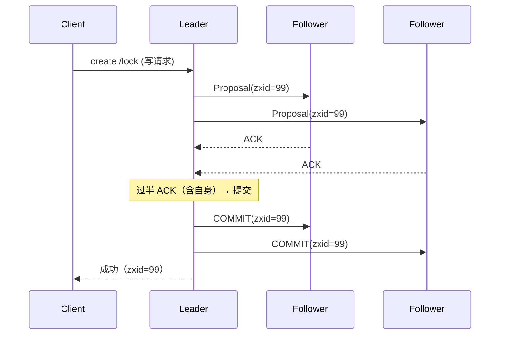

ZooKeeper核心机制-ZAB数据模型与Watcher
====

Kafka 3.x 之前靠它管元数据、Dubbo 老生态靠它做注册中心、大量交易系统的分布式锁跑在它上面——ZooKeeper 是**分布式协调服务的鼻祖**，也是面试里"一致性理解深度"的试金石：能把 ZAB 讲清楚的人，Raft/Paxos 都是顺手的。本篇按"数据模型 → ZAB 协议 → 会话与 Watcher"三层展开，实战篇见 [ZooKeeper分布式锁实战-Curator与羊群效应](ZooKeeper分布式锁实战-Curator与羊群效应.md)，选型视角见 [协调中间件选型-ZooKeeper对比etcd与Nacos](协调中间件选型-ZooKeeper对比etcd与Nacos.md)。

1 数据模型：一棵有版本号的 znode 树
------

**Java 直觉**：ZK 不是数据库，是一个** replicated 的小型文件系统**——树上的每个节点（znode）既存数据（默认 1MB 上限）又是路径。它的价值不在存储，在于**节点类型 × 通知机制**组合出的协调语义。

四种节点类型（持久/临时 × 普通/顺序）：

| 类型 | 创建 | 生命周期 | 典型用途 |
|---|---|---|---|
| PERSISTENT | `create /cfg` | 显式删除前永存 | 配置、元数据 |
| EPHEMERAL | `create -e /locks/t1` | **会话断开自动删除** | 锁、临时成员（心跳存在性） |
| PERSISTENT_SEQUENTIAL | `create -s /queue/q-` | 永存，名字自动加递增序号 | 队列、全局有序 |
| EPHEMERAL_SEQUENTIAL | `create -e -s /lock/l-` | 会话断删 + 序号 | **分布式锁的标准款**（实战篇主角） |

每个 znode 携带三个版本号（`version` 数据版、`cversion` 子节点版、`aversion` ACL 版）和一组事务 id（`czxid` 创建 / `mzxid` 修改 / `pzxid` 子节点变更）——**CAS 更新靠 version**（`setData` 带 expectedVersion，不匹配报 BadVersion），这是无锁配置更新的基础。

2 ZAB 协议：写广播 + 崩溃恢复
------

ZAB（ZooKeeper Atomic Broadcast）不是 Paxos，是为 ZK 的"主从写转发"模型定制的一致性协议，两个子协议：

### 2.1 消息广播（正常写路径）：简化版两阶段

所有写请求转发给 **leader**（ follower 收到也转发），leader 按序广播：

与标准 2PC 的关键差异：**过半即提交，不等全体**——这就是 ZK 写性能的边界（`2f+1` 节点容忍 `f` 个故障），也是它 CP 语义的来源。zxid 是 64 位（高 32 位 epoch + 低 32 位计数），**全局单调**，构成 ZK 的全序。

### 2.2 崩溃恢复：选出"最全"的新 leader

leader 挂了，剩余节点进入恢复模式，两条铁律：**已提交的提案不能丢，未过半的提案要丢弃**。选举按 (epoch, zxid) 比较——票投给事务日志最全的节点；新 leader epoch+1，把自己的日志对齐给所有 follower（过半确认后退出恢复模式）。

一句话记 ZAB：**写全走 leader、过半提交、zxid 定全序、崩溃后按日志完整度选主**。和 Raft 的对照：term≈epoch、日志匹配≈ zxid 比较、都是"强 leader + 过半提交"——ZAB 早 Raft 十年落地了同款思想，差异在细节（ZAB 有同步阶段显式对齐，Raft 靠日志匹配约束）。

3 会话与 Watcher：一次性通知的坑
------

**会话**：客户端与 server 间的心跳契约（sessionTimeout 协商值），会话期内客户端存活；断连后在 timeout 内重连上任意节点，**会话与临时节点都保住**——这是"用 ZK 做存活探测"的语义基础（对照：Redis 主从故障切换后的锁安全问题是另一流派，见 [高可用-主从哨兵与集群](../redis/高可用-主从哨兵与集群.md) 的对照讨论）。

**Watcher** 三条要背的：

* **一次性触发**：注册的 watch 在事件发生后即失效——想持续监听必须"收到通知后重新注册"，这个空窗期可能丢事件，所以生产端都用 **Curator 的 Cache 系列**（`PathChildrenCache`/`TreeCache`/`CuratorCache`）帮你做重注册+本地视图；
* **轻量通知**：只告诉你"变了"，不带变化后的数据——客户端要自己再 `getData`（避免大 payload 广播）；
* **顺序保证**：客户端看到的事件顺序与 ZK 上的全局顺序（zxid 序）一致。

| 对照项 | ZK Watcher | Redis pub/sub | MQ 订阅 |
|---|---|---|---|
| 触发语义 | 数据变更一次一发 | 发布即达（无持久） | 持久化+重试 |
| 丢通知空窗 | 重注册空窗（Cache 解决） | 订阅断线即丢 | offset 兜底 |
| 有序性 | zxid 全序 | 无 | 分区内有序 |

面试追问链
------

* ZK 怎么保证写线性一致？→ 写全走 leader、zxid 全序、过半提交；读呢？→ 默认读到的是本 follower 的旧数据（顺序一致性而非线性一致），要线性读用 `sync()` 先同步；
* 临时节点什么时候删？→ 会话关闭或超时；客户端 GC 停顿导致心跳断了会怎样？→ 会话过期临时节点被清——**锁被别人抢走但客户端自己不知道**，这是 ZK 锁最经典的脑裂隐患（解法见实战篇的 sessionTimeout 与重入校验）；
* ZAB 和 Raft 区别？→ epoch≈term、都是强 leader+过半；ZAB 有显式同步阶段、Raft 靠日志匹配约束；ZAB 提交在过半 ACK 后立即 COMMIT、Raft 是追加即视为提交（跟随者借 heartbeat 确认）；
* 过半为什么是 (n/2)+1？→ 容错 f 个故障需要 2f+1，任两个过半集合必有交集——选举与提交的"多数派交叉"是不丢已提交数据的根基；
* Watcher 为什么要设计成一次性？→ 简化语义与实现（通知与注册解耦，避免海量重复注册的内存压力），代价交给客户端框架（Curator Cache）兜；
* zxid 为什么要带 epoch？→ 防脑裂期旧 leader 的提案污染新纪元——epoch 不同直接拒绝。

面试官视角小结
------

ZK 题的区分度在三个层次：只会背"ZK 是注册中心/配置中心"的是用过；能讲清 ZAB 过半提交与 zxid 全序的是读懂了；能主动讲"GC 停顿导致会话过期→锁被抢→客户端还在跑"这类时序裂缝、并知道 Curator 怎么兜的，是真在交易系统里用过。追问"ZK 的读是线性一致吗"是最好用的试纸——答"是"的基本没看过一致性语义那章。

> 2026-11 新增（框架与中间件/zookeeper 三篇之一，star-site 组件实战反哺）。姊妹篇：[ZooKeeper分布式锁实战-Curator与羊群效应](ZooKeeper分布式锁实战-Curator与羊群效应.md)、[协调中间件选型-ZooKeeper对比etcd与Nacos](协调中间件选型-ZooKeeper对比etcd与Nacos.md)。
