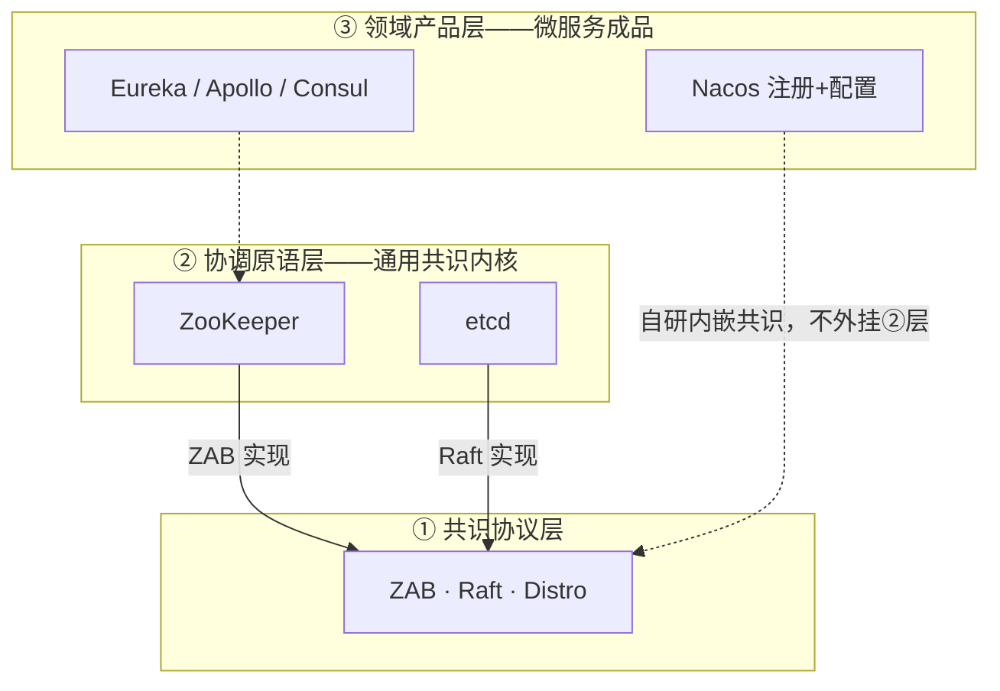
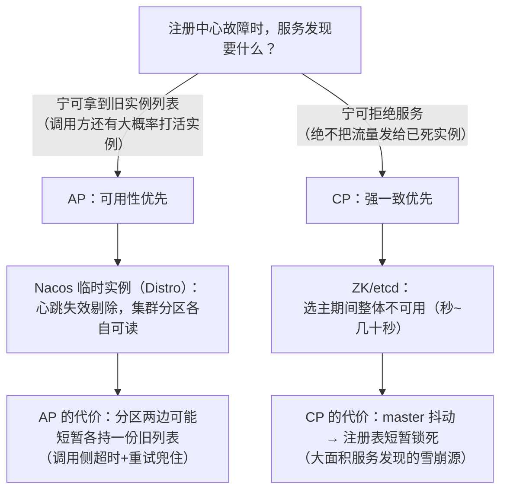

协调中间件选型-ZooKeeper对比etcd与Nacos
====

"注册中心/配置中心/分布式协调选谁"是十年 Java 后端绕不开的架构题——而且三个答案在业内各占山头：老牌交易系统养 ZK、云原生世界全员 etcd（K8s 的地基）、国内新微服务栈默认 Nacos。本篇不讲"谁更好"，讲**按场景的取舍矩阵**，并给出我们自己的两次真实选型：star-site 注册中心用 Nacos、starsite-lock 恰一执行用 MySQL——选型依据全部可追溯。原理篇见 [ZooKeeper核心机制-ZAB数据模型与Watcher](ZooKeeper核心机制-ZAB数据模型与Watcher.md)。

1 分层模型：先说清它们不在同一维度
------

把三者并排比较前必须先立一个观念：**ZK 和 Nacos 不是一层的东西**——生态位重叠（都能当注册中心）不等于抽象层级相同。

### 1.1 三层模型

* **ZK 在②层**：交付的是"共识 + 临时节点 + watch"这套**通用协调积木**，注册中心/配置中心/锁/选主都要在它上面自己搭；
* **Nacos 在③层**：把②层能力**内嵌自研**（CP 走 Raft、AP 走 Distro），直接交付领域成品——单机起 Docker 就能用，不需要外挂任何协调件；
* 类比：**ZK : Nacos ≈ InnoDB : 跑在数据库上的调度系统**——后者自带引擎所以自成一体，前者是给"别人造系统"用的地基。

**同维度对照的真实名单**：ZK ↔ etcd（②层之争）；Nacos ↔ Eureka/Consul（注册产品之争）、Nacos ↔ Apollo（配置产品之争）。本篇的对比表之所以能并排，前提是**限定在"当注册中心/配置中心用"这个场景**——换成"我要分布式锁/选主"，Nacos 根本不接这活，只剩②层同台。

### 1.2 去 ZK 化：分层差异的历史证据

"去 ZK 化"这十年的趋势本身就是上述分层的证明——②层产品被依赖方**内嵌替代**，而不是被同层打败：

| 系统 | 曾经 | 现在 |
|---|---|---|
| Dubbo 老生态 | 注册中心**建在** ZK 上（②层用法） | 迁 Nacos/ZK 任选 |
| Kafka 2.x | 元数据**建在** ZK 上 | 3.x KRaft 自嵌 Raft，**甩掉 ZK** |
| HBase / Hadoop | 协调全靠 ZK | 仍是 ZK（重资产跑不动的典型） |

为什么依赖方纷纷把地基内嵌？五条动因：

* **运维与故障域**：跑 Kafka 要多养一套有状态集群，故障域 1→2；ZK session 抖动会放大成 controller 频繁切换 + 全量分区 leader 选举风暴（Kafka 经典事故模式）；
* **性能天花板**：ZK 写走 leader+过半广播，吞吐万级封顶——Kafka 从几万分区迈向百万分区时，元数据写入与 watch 风暴全被 ZK 卡死，KRaft 把元数据放进自家 Raft log 是最硬的去 ZK 理由；
* **CP 语义过重**：注册中心要 AP（旧列表好过不可用），ZK 给的是全家桶 CP——为 20% 的需求付 100% 的代价（见 §3 的取向分析）；
* **客户端与会话负担**：session 状态机、watch 一次性重注册、GC 停顿撕开的时序裂缝（见[实战篇](ZooKeeper分布式锁实战-Curator与羊群效应.md)第 4 节）——自嵌协议可以按需裁剪；
* **Raft 库抹平门槛**：当年用 ZK 是因为实现共识太难；Raft 库生态（etcd/raft、Kafka raft queue、Nacos 内嵌 JRaft）把"引入共识"从组件依赖降级成库依赖——**ZAB 没输给 Raft 的正确性，输给了可嵌入的工程形态**。

反面平衡：去 ZK 化改变的是"新系统的默认选项"，不是"ZK 被证伪"——HBase 的树形元数据天然契合 znode，迁移风险远大于收益；已稳定运行的 ZK 别为迁而迁（立场见 §5 共存与退役）。

2 三者的出身决定了取向
------

| | ZooKeeper | etcd | Nacos |
|---|---|---|---|
| 出身 | Hadoop 生态（2008，协调服务鼻祖） | CoreOS（2014，专做 K8s 的分布式 KV） | 阿里（2018，注册+配置一体化） |
| 一致性协议 | ZAB | **Raft** | AP 模式 Distro + CP 模式 Raft（可切） |
| 定位 | 通用协调（锁/选举/命名） | 强一致 KV + watch | 服务发现 + 配置管理（为微服务而生） |
| 数据形态 | znode 树（1MB/节点） | KV（版本化 MVCC） | 服务实例/配置（领域模型） |
| watch 语义 | 一次性（重注册交给客户端） | **持续 watch**（基于 MVCC revision 推送） | 推拉结合（UDP/TCP+长轮询） |
| 接口 | 私有客户端协议 | gRPC + HTTP/JSON | HTTP/OpenAPI + SDK |
| 健康 | 会话（心跳） | lease（TTL 租约） | 心跳 + 探测双通道 |

一句话画像：**ZK 是"给分布式系统做协调的文件系统"，etcd 是"云原生的强一致 KV"，Nacos 是"微服务的注册配置台"**。

3 CP 还是 AP：注册中心的灵魂拷问
------

服务发现场景的一致性取舍是本篇最重要的一题：

K8s 选 etcd（CP）是因为**调度决策必须基于强一致的集群状态**；服务发现大多选 AP——因为"拿到 3 秒前的实例列表"的代价远小于"注册中心 30 秒不可用"。Nacos 的答案最工程化：**临时实例走 AP（心跳即存在性，与 ZK 临时节点同哲学），持久实例与配置走 Raft CP**——一个产品两种语义按场景取。

4 能力对照与选型决策
------

| 场景 | 首选 | 硬理由 |
|---|---|---|
| K8s 生态/云原生配置 | etcd | 地基本身就是它，Operator/CRD 生态全在这 |
| Java 老微服务（Dubbo/HSF 存量） | ZK | 存量客户端兼容；但新项目不建议再引入 |
| Spring Cloud 新栈 | Nacos | 注册+配置一站、AP/CP 可切、控制台友好 |
| 分布式锁/选主（已有 ZK） | ZK 顺序节点 | 复用现有设施，释放即通知（见[实战篇](ZooKeeper分布式锁实战-Curator与羊群效应.md)） |
| 分布式锁/定时恰一（只有 MySQL） | DB 锁 | 零新中间件——starsite-lock 的选择（下节） |

**实战反哺一：star-site 注册中心选 Nacos**。13 个 Spring Boot 服务，注册发现 + 配置集中是刚需；Nacos 一个组件双职能，AP 模式对"服务发现可用性优先"的取向吻合，Docker 自建单节点起步、平滑扩集群——对照方案 ZK（无控制台、要写 Curator）与 etcd（要自建注册语义层）都多出一截自维护成本。

**实战反哺二：starsite-lock 恰一执行选 MySQL**（组件仓 D9 决策）。定时任务"全集群恰一执行"需要的是**一个共识点**，而不是一套协调服务——`starsite_lock` 表一行原子 UPDATE 就是共识点（`UPDATE ... WHERE locked_until IS NULL OR locked_until < now`），零新部署、零运维；等规模到需要"中心调度服务 + 分片 + web 控制台"（SchedulerX/XXL-JOB 形态）时，锁协议不变直接升级触发层。**中间件选型的第一问不是"谁最强"，是"这个共识/协调需求值不值得为它多养一个有状态集群"**。

5 迁移与共存现实
------

存量系统的真实形态是三者共存：ZK 上跑着老锁和选举，Nacos 管新服务注册，etcd 在 K8s 里——治理思路是**按域封存**：老 ZK 只出不进（新需求不许上），新协调需求按 §4 决策表走；K8s 的 etcd 不碰（平台域）；配置逐步向 Nacos/环境变量收敛。面试里讲得出"共存与退役路径"比讲"我会选 XXX"高一个段位。

面试追问链
------

* 为什么 K8s 用 etcd 而不是 ZK？→ 强一致 KV + 持续 watch 契合控制器模式（list-watch）；gRPC 现代接口；Go 生态同源——ZK 的会话模型和客户端重量都是负担；
* 注册中心为什么倾向 AP？→ 分区期间拿旧列表大概率还能调用成功，CP 选主期间全站发现不可用是更大的雪崩源；那配置中心呢？→ 配置变更要尽快一致，偏 CP（Nacos 配置走 Raft 的原因）；
* Nacos 的 AP 和 CP 怎么共存的？→ 临时实例 Distro（分区可用，心跳剔除）、持久实例与配置 Raft——按数据性质分流，一个产品两种语义；
* ZK 还值得新项目用吗？→ 新引入不建议（运维重、客户端老、社区重心转移）；存量跑得好好的也别为迁而迁——协调中间件替换的回归风险远大于收益；
* watch 语义差异有什么实际影响？→ ZK 一次性 watch 要客户端重注册（Curator Cache 兜）；etcd/Nacos 持续订阅——写配置监听代码时的心智负担差一截；
* ZK 和 Nacos 是一个维度的东西吗？→ 不是：ZK 在协调原语层（通用共识内核），Nacos 在领域产品层（内嵌共识的注册配置成品）——生态位重叠不等于层级相同，并排比较要限定场景；
* 为什么大家都在去 ZK 化？→ 外挂地基的总拥有成本压过收益：故障域翻倍、万级写天花板（Kafka 百万分区的死因）、CP 语义对注册场景过重、session 客户端负担、Raft 库抹平自研门槛——ZK 没被证伪，是新系统默认项变了；
* 只需要"定时任务恰一执行"，要上 ZK 吗？→ 不需要——共识点用 DB 行级原子更新就够（starsite-lock 实证），为单一需求养 ZK 集群是过度设计。

面试官视角小结
------

选型题最见工程审美：报菜名式背"ZK 成熟 etcd 现代化 Nacos 全家桶"的是没做过决策；能从**数据性质倒推一致性取向**（服务发现 AP、配置 CP、调度共识强一致）、并且能讲出一两个自己亲历的取舍与代价（哪怕结论是"不用中间件"）的，是真正的架构参与者。反套路信号：候选人主动说"我们最后没引入它，因为..."——知道什么时候不用，比知道怎么用值钱。

> 2026-11 新增（框架与中间件/zookeeper 三篇之三，star-site/Nacos 与 starsite-lock/MySQL 选型实战反哺）。姊妹篇：[ZooKeeper核心机制-ZAB数据模型与Watcher](ZooKeeper核心机制-ZAB数据模型与Watcher.md)、[ZooKeeper分布式锁实战-Curator与羊群效应](ZooKeeper分布式锁实战-Curator与羊群效应.md)。
