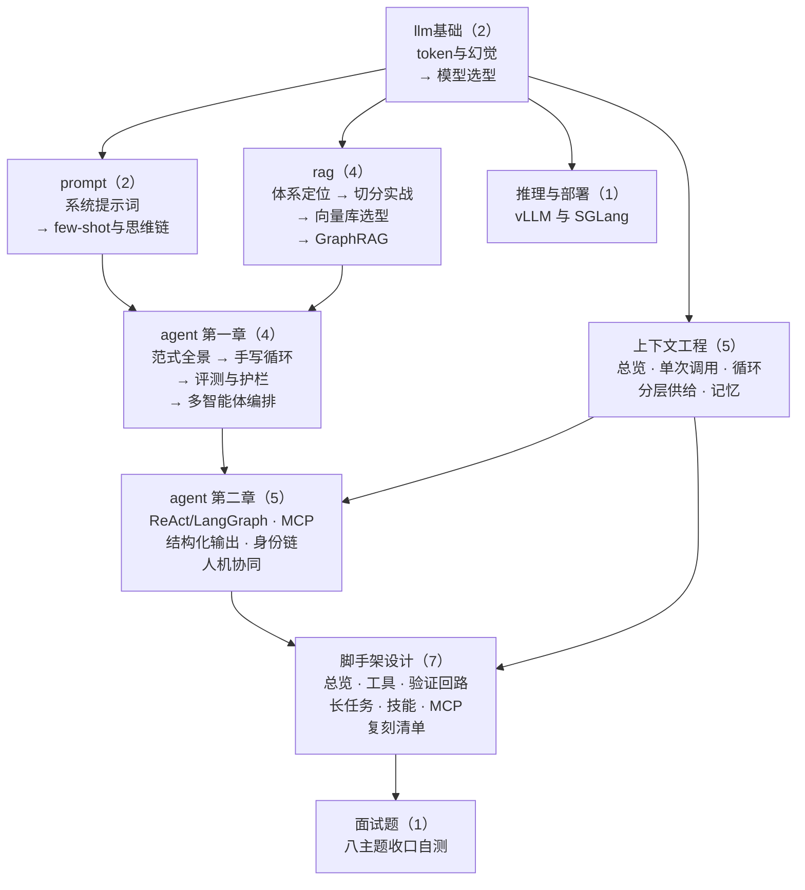

# B 轨 · AI 应用工程（阅读导航）

> 2026-10 新建，与 star-site ai-service（Python/LangChain）和 voice-zcode 实战滚动同步。
> 定位：面试深度标准的 AI 工程知识体系。**实况 33 篇（2026-11-27）**。
> 本页是 B 轨总导航：先给**怎么读**（一图依赖 + 四条路径），再给**读什么**（全量篇目索引）。

## 一图看依赖：先读什么，后读什么

旁路参考（不在主线依赖里，随用随读）：`python/`（语言面）、`工程工具/`（AI 编码智能体的使用面，见路径 D）。

## 路径 A · 体系主线（零基础 → 能上线，建议顺序）

| 步 | 篇目 | 这一步解决什么 |
|---|---|---|
| 1 | [LLM基础-Token上下文与幻觉](llm基础/LLM基础-Token上下文与幻觉.md) | 第一性：token 三账、窗口、幻觉成因——全 track 的地基 |
| 2 | [2026-10模型生态与选型](llm基础/2026-10模型生态与选型-没有全能冠军.md) | 没有全能冠军：三极格局与 30 倍价差的选型决策表 |
| 3 | [系统提示词工程-从财务诊断说起](prompt/系统提示词工程-从财务诊断说起.md) | 指令怎么写：角色/规则/输出契约的演进 |
| 4 | [Few-shot与思维链](prompt/Few-shot与思维链.md) | 示例怎么给、推理链怎么引 |
| 5 | [RAG体系与项目定位](rag/RAG体系与项目定位.md) | 检索链路四步与"何时不用 RAG" |
| 6 | [RAG切分策略实战](rag/RAG切分策略实战.md) | 切分决定召回：chunk 权衡、表格不切 |
| 7 | [向量检索选型](rag/向量检索选型-pgvector-Redis-Milvus-Qdrant.md) | pgvector/Redis/Milvus/Qdrant 三轴选型 |
| 8 | [GraphRAG与知识图谱检索](rag/GraphRAG与知识图谱检索-多跳问题的解法.md) | 向量连不上"点"：多跳与全局概括什么时候上图谱 |
| 9-12 | [agent 第一章 1→4](agent/)（[范式](agent/Agent范式全景-workflow与agent的边界.md)→[手写](agent/从零手写最小Agent-无框架的模型循环.md)→[评测](agent/Agent评测与可观测-guards与成本.md)→[编排](agent/多智能体编排与框架选型.md)） | 从"该不该用 agent"到多代理架构 |
| 13-17 | [agent 第二章 5→9](agent/) 按序深潜 | 五个专项：ReAct 落地、MCP、结构化输出、身份链、人机协同 |
| 18-22 | [上下文工程 1→5](上下文工程/) 顺序读 | 窗口里该放什么：总览地图、单次调用的预算、循环里的四板斧、脚手架的分层供给、跨会话的记忆 |
| 23-29 | [脚手架设计 1→7](脚手架设计/) 顺序读 | 同一个模型，为什么放进 Claude Code 就好用：总览、工具、验证回路、长任务，再加技能与 MCP 两种扩展机制，最后收成复刻清单 |
| 30 | [自托管LLM推理-vLLM与SGLang](推理与部署/自托管LLM推理-vLLM与SGLang.md) | 服务化：KV cache、批调度、显存账 |
| 31 | [LLM应用面试题合集](面试题/LLM应用面试题合集.md) | 收口：八主题自测 + 深读映射表 |

## 路径 B · 面试冲刺（1-2 天）

以 [LLM应用面试题合集](面试题/LLM应用面试题合集.md) 为纲，错哪补哪（文内有"问题 → 深读篇目"映射表）。高频深读四件套：[模型选型](llm基础/2026-10模型生态与选型-没有全能冠军.md)、[RAG体系](rag/RAG体系与项目定位.md)、[Agent范式](agent/Agent范式全景-workflow与agent的边界.md)、[评测三巨头](agent/Agent评测与可观测-guards与成本.md)。

## 路径 C · 生产救火（按症状直达）

| 症状 | 直达篇目 |
|---|---|
| 模型输出下游不敢用 | [结构化输出工程](agent/结构化输出工程-Pydantic与LLM.md) |
| 越权 / 提示注入担忧 | [身份链与工具安全](agent/智能体的身份链与工具安全.md) |
| agent 不收敛、步数失控 | [多智能体编排与框架选型](agent/多智能体编排与框架选型.md) |
| 窗口膨胀 / token 成本失控 | [上下文工程四板斧](上下文工程/Agent上下文工程-注意力预算与四板斧.md) |
| 跨会话失忆 / 记忆污染 | [记忆系统](上下文工程/Agent记忆系统-从会话状态到跨会话记忆.md) |
| 高危操作不敢放手 / 确认框弹个不停 | [人机协同与审批设计](agent/Agent人机协同-从头部智能体看审批与权限设计.md) |
| 工具老被调错 / 返回太大 / 报错看不懂 | [工具设计](脚手架设计/Agent工具设计-写给模型看的接口.md) |
| 上下文太乱 / 工具太多塞不下 | [上下文分层](上下文工程/Agent上下文分层-常驻按需与工具太多怎么办.md) |
| 做完不自查 / 说完成了其实没好 | [验证回路](脚手架设计/Agent验证回路-让智能体自己发现错了.md) |
| 长任务跑偏 / 做一半断了 | [长任务](脚手架设计/Agent长任务-进度状态与增量交付.md) |
| 一段规范不知道该写进 CLAUDE.md、技能还是钩子 | [技能入门](脚手架设计/Agent技能入门-按需加载的知识与流程.md) |
| 要接外部工具 / 自己写 MCP server | [MCP 入门](脚手架设计/MCP协议入门-原理、安全与第一个Server.md)；上线前的网关、鉴权、审计见 [MCP 企业落地](agent/MCP协议与企业落地.md) |
| 检索不准 / 召回差 | [RAG切分](rag/RAG切分策略实战.md)、[向量选型](rag/向量检索选型-pgvector-Redis-Milvus-Qdrant.md) |
| 多跳关联 / 全局概括答不好 | [GraphRAG与知识图谱检索](rag/GraphRAG与知识图谱检索-多跳问题的解法.md) |
| 推理延迟 / 吞吐不够 | [vLLM与SGLang](推理与部署/自托管LLM推理-vLLM与SGLang.md) |
| 选型纠结 / 价差敏感 | [模型生态与选型](llm基础/2026-10模型生态与选型-没有全能冠军.md) |
| 长对话答非所问 | [上下文工程（单次调用）](上下文工程/上下文工程-Context%20Engineering.md) |

## 路径 D · AI 编码工具线（用好你的编码智能体）

[ClaudeCode使用实践](工程工具/ClaudeCode使用实践.md)（CLAUDE.md/Skills/Sub-agents 配置资产）→ [上下文工程（单次调用）](上下文工程/上下文工程-Context%20Engineering.md)（单次调用预算）→ [Agent上下文工程](上下文工程/Agent上下文工程-注意力预算与四板斧.md)（循环里的四板斧）→ [记忆系统](上下文工程/Agent记忆系统-从会话状态到跨会话记忆.md)（MEMORY.md 形态与 dreaming）→ [人机协同](agent/Agent人机协同-从头部智能体看审批与权限设计.md)（Claude Code 的权限模式与审批设计）→ [脚手架总览](脚手架设计/Agent脚手架总览-ClaudeCode好用在模型之外.md)（换个视角：Claude Code 为什么好用，怎么造一个）→ [技能入门](脚手架设计/Agent技能入门-按需加载的知识与流程.md)（技能怎么写、怎么评测）。

## 全量篇目索引（33 篇）

### llm基础/（2）

| 篇目 | 一句话 |
|---|---|
| [LLM基础-Token上下文与幻觉](llm基础/LLM基础-Token上下文与幻觉.md) | token 三账、上下文窗口、幻觉三成因四缓解 |
| [2026-10模型生态与选型-没有全能冠军](llm基础/2026-10模型生态与选型-没有全能冠军.md) | 三极格局 + 30 倍价差的可复用选型决策表 |

### 上下文工程/（5，系列导读见 [上下文工程系列导读](上下文工程/)）

| # | 篇目 | 一句话 |
|---|---|---|
| 1 | [上下文工程总览-窗口里该放什么](上下文工程/上下文工程总览-窗口里该放什么.md) | 窗口、上下文、记忆、缓存怎么区分；每样东西放什么、何时放、留多久、多少钱 |
| 2 | [上下文工程-Context Engineering](上下文工程/上下文工程-Context%20Engineering.md) | 单次调用视角：窗口预算配比、长对话三级压缩、位置效应 |
| 3 | [Agent上下文工程-注意力预算与四板斧](上下文工程/Agent上下文工程-注意力预算与四板斧.md) | 注意力预算 / JIT 检索 / 压缩 / 笔记 / 子代理 |
| 4 | [Agent上下文分层-常驻按需与工具太多怎么办](上下文工程/Agent上下文分层-常驻按需与工具太多怎么办.md) | 常驻层写小 / 技能三层 / 工具搜索 / 为缓存排序 |
| 5 | [Agent记忆系统-从会话状态到跨会话记忆](上下文工程/Agent记忆系统-从会话状态到跨会话记忆.md) | 分层记忆栈 / dreaming 整理 / 记忆污染治理 |

### rag/（4）

| 篇目 | 一句话 |
|---|---|
| [RAG体系与项目定位](rag/RAG体系与项目定位.md) | 检索链路四步（改写/混合/重排/组装）与何时不用 RAG |
| [RAG切分策略实战](rag/RAG切分策略实战.md) | 结构化切分、chunk 大小与 overlap 权衡、表格不切 |
| [向量检索选型-pgvector-Redis-Milvus-Qdrant](rag/向量检索选型-pgvector-Redis-Milvus-Qdrant.md) | 规模/过滤/运维三轴挑 ANNS 引擎 |
| [GraphRAG与知识图谱检索-多跳问题的解法](rag/GraphRAG与知识图谱检索-多跳问题的解法.md) | 向量连不上"点"：社区摘要 vs 双层检索、增量更新、上图谱的决策线 |

### agent/（9，两章——系列导读见 [agent 系列导读](agent/)）

| # | 篇目 | 一句话 |
|---|---|---|
| 1 | [Agent范式全景-workflow与agent的边界](agent/Agent范式全景-workflow与agent的边界.md) | 该不该用 agent？五种 workflow 模式怎么选 |
| 2 | [从零手写最小Agent-无框架的模型循环](agent/从零手写最小Agent-无框架的模型循环.md) | agent 的本质：60 行无框架循环跑通 |
| 3 | [Agent评测与可观测-guards与成本](agent/Agent评测与可观测-guards与成本.md) | 三层评测 / 四道护栏 / 成本三巨头 |
| 4 | [多智能体编排与框架选型](agent/多智能体编排与框架选型.md) | 什么时候多代理、Supervisor 拓扑、框架决策表 |
| 5 | [ReAct与LangGraph工程实践](agent/ReAct与LangGraph工程实践.md) | ReAct 图落生产：状态机/记忆隔离/SSE 流式 |
| 6 | [MCP协议与企业落地](agent/MCP协议与企业落地.md) | 工具生态协议与企业落地四件套 |
| 7 | [结构化输出工程-Pydantic与LLM](agent/结构化输出工程-Pydantic与LLM.md) | 模型输出变成下游敢用的强类型契约 |
| 8 | [智能体的身份链与工具安全](agent/智能体的身份链与工具安全.md) | 身份链"模型无法伪造"设计与工具权限边界 |
| 9 | [Agent人机协同-从头部智能体看审批与权限设计](agent/Agent人机协同-从头部智能体看审批与权限设计.md) | 审批疲劳 / 权限模式 / 沙箱 / 审查者：什么时候问人、怎么少问 |

### 脚手架设计/（7，agent 系列的延伸——系列导读见 [脚手架设计系列导读](脚手架设计/)）

| # | 篇目 | 一句话 |
|---|---|---|
| 1 | [Agent脚手架总览-ClaudeCode好用在模型之外](脚手架设计/Agent脚手架总览-ClaudeCode好用在模型之外.md) | 模型之外的那层：三段循环 / 五种扩展部件 / 让模型决定还是强制 |
| 2 | [Agent工具设计-写给模型看的接口](脚手架设计/Agent工具设计-写给模型看的接口.md) | 少而准 / 高信号返回 / 报错带修法 / 描述即提示词 |
| 3 | [Agent验证回路-让智能体自己发现错了](脚手架设计/Agent验证回路-让智能体自己发现错了.md) | 可跑的通过/失败检查 / Stop 钩子 / 三类测试 / 检查不被篡改 |
| 4 | [Agent长任务-进度状态与增量交付](脚手架设计/Agent长任务-进度状态与增量交付.md) | 进度文件与功能清单 / 一次一个 / 常驻智能体五个原语 |
| 5 | [Agent技能入门-按需加载的知识与流程](脚手架设计/Agent技能入门-按需加载的知识与流程.md) | 技能是什么 / 三层加载 / 描述怎么写 / 和 CLAUDE.md、钩子、MCP 的分界 / 评测 |
| 6 | [MCP协议入门-原理、安全与第一个Server](脚手架设计/MCP协议入门-原理、安全与第一个Server.md) | 两代协议 / 三种原语 / 传输与授权 / 安全清单 / 动手写 server |
| 7 | [Agent脚手架复刻清单与面试追问](脚手架设计/Agent脚手架复刻清单与面试追问.md) | 复刻清单 / 从症状出发的落地顺序 / 十四个连环追问 |

### prompt/（2）

| 篇目 | 一句话 |
|---|---|
| [系统提示词工程-从财务诊断说起](prompt/系统提示词工程-从财务诊断说起.md) | 财务诊断场景的提示词演进（ai-service 实战反哺） |
| [Few-shot与思维链](prompt/Few-shot与思维链.md) | 示例设计与 CoT 的适用边界 |

### 推理与部署/（1）

| 篇目 | 一句话 |
|---|---|
| [自托管LLM推理-vLLM与SGLang](推理与部署/自托管LLM推理-vLLM与SGLang.md) | PagedAttention vs RadixAttention、KV cache、显存账 |

### python/（1）

| 篇目 | 一句话 |
|---|---|
| [Python3.14-3.15双版本要点](python/Python3.14-3.15双版本要点-自由线程与tstring.md) | 自由线程（PEP 779）与 t-string（PEP 750）对 AI 工程的意义 |

### 工程工具/（1）

| 篇目 | 一句话 |
|---|---|
| [ClaudeCode使用实践](工程工具/ClaudeCode使用实践.md) | CLAUDE.md、Skills、Slash Commands、Sub-agents 配置资产 |

### 面试题/（1）

| 篇目 | 一句话 |
|---|---|
| [LLM应用面试题合集](面试题/LLM应用面试题合集.md) | 八主题 Q&A 收口，附"问题 → 深读篇目"映射表 |

## 写作规范

1. 每篇遵循 A 轨深度标准：原理 + 真实代码 + 追问链 + "面试官视角小结"；学习整理篇须标注内容来源。
2. 实战反哺的文章必须引用真实类名/文件路径（如 `app/agents/assistant.py`），可追溯。
3. **导航四同步（强制）**——B 轨新增或移动文章时，以下四处缺一不可：
   * 本页：顶部实况篇数、全量篇目索引、涉及的阅读路径/救火表；
   * 所属子目录 `README.md`（没有则先建）；
   * 仓库根 `README.md` 的 B 轨篇数；
   * agent、上下文工程、脚手架设计三个成系列的目录，另需更新各自目录 `README.md` 的章表与篇数。
4. 空目录不建：写出第一篇时再建目录，避免占位噪音。
