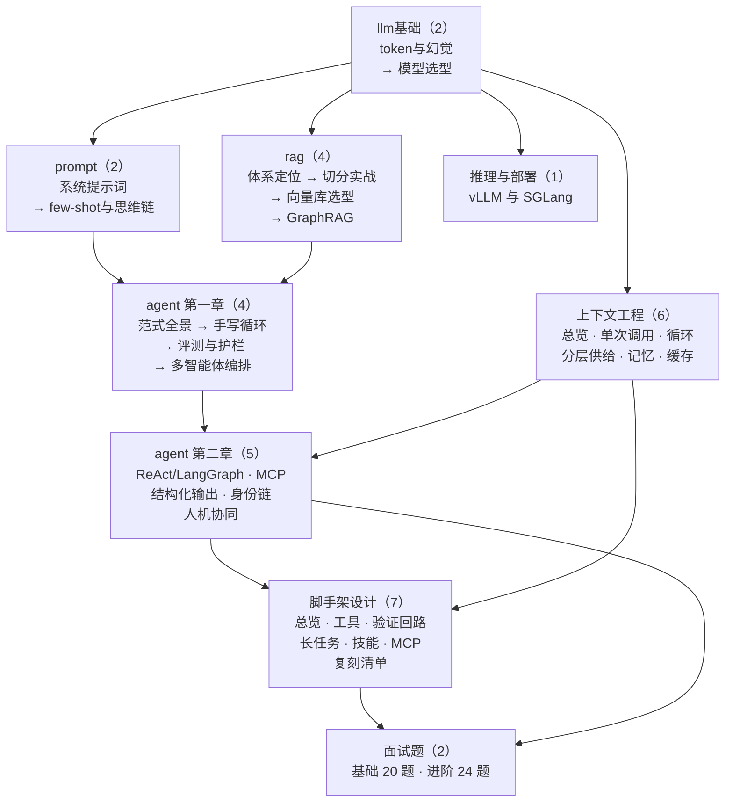

# B 轨 · AI 应用工程（阅读导航）

> 2026-10 新建，与 star-site ai-service（Python/LangChain）和 voice-zcode 实战滚动同步。
> 定位：面试深度标准的 AI 工程知识体系。**实况 35 篇（2026-11-27）**。
> 这条轨服务两个目标：**学会构建智能体**，和**应对 AI 工程面试**。本页先给一张依赖图，再给两条路：目标一是五步的学习线，每步写明读什么、动手做什么、怎样算过关；目标二是题库入口和冲刺路线。已经知道去哪的，直接看文末的全量篇目索引。

## 一图看依赖：先读什么，后读什么

旁路参考（不在主线依赖里，随用随读）：`工程工具/`（AI 编码智能体的使用面，见下面的编码工具线）、`python/`（语言面）。

## 目标一 · 学会构建智能体（五步，零基础 → 能上线）

每一步三件事：读什么，动手做什么，怎样算过关。"动手"一栏是建议的练习，不依赖某个特定项目。

### 第 1 步 · 地基：一次调用怎么写好

* **读**：[LLM基础-Token上下文与幻觉](llm基础/LLM基础-Token上下文与幻觉.md)（token 三账、窗口、幻觉成因）→ [2026-10模型生态与选型](llm基础/2026-10模型生态与选型-没有全能冠军.md)（选型决策表）→ [系统提示词工程](prompt/系统提示词工程-从财务诊断说起.md)（角色、输出契约、红线怎么演进）→ [Few-shot与思维链](prompt/Few-shot与思维链.md)（示例和推理链的适用边界）。
* **动手**：用任意一家模型的 API 写一个单轮问答，把系统提示词按角色、规则、输出契约分成三块；改其中一块，对比同一批问题的输出变化。
* **过关**：说得清 token 怎么计费、幻觉的三类成因、系统提示词里每一行防的是哪类坏输出。

### 第 2 步 · 知识与上下文：让模型看到对的东西

* **读**：rag 四篇（[体系定位](rag/RAG体系与项目定位.md) → [切分实战](rag/RAG切分策略实战.md) → [向量检索选型](rag/向量检索选型-pgvector-Redis-Milvus-Qdrant.md) → [GraphRAG](rag/GraphRAG与知识图谱检索-多跳问题的解法.md)）；再读上下文工程系列的[总览篇](上下文工程/上下文工程总览-窗口里该放什么.md)和[单次调用篇](上下文工程/上下文工程-Context%20Engineering.md)。
* **动手**：给一份自己的文档搭一条检索链路——切分、向量化、重排、组装，换两种切分策略比较召回；把长对话的三级压缩（滑窗、摘要、外置）各实现一遍。
* **过关**：说得清检索链路四步、什么时候不该用 RAG、窗口预算怎么配比、进窗口的东西要回答哪四个问题。

### 第 3 步 · 用工具：从 workflow 到 agent

* **读**：agent 系列的[第一章](agent/)（范式 → 手写最小循环 → 评测与护栏 → 多智能体编排）和[第二章](agent/)（ReAct、MCP、结构化输出、身份链、人机协同）；配上上下文工程系列的[四板斧篇](上下文工程/Agent上下文工程-注意力预算与四板斧.md)。
* **动手**：不用框架，手写一个带两三个工具的 agent 循环，加上轮数上限和预算熔断；故意让它跑一个长任务，看上下文怎么膨胀。
* **过关**：说得清 workflow 和 agent 的边界、循环失控的三道保险、身份链为什么模型无法伪造、膨胀的上下文有哪四种手段可选。

### 第 4 步 · 做可靠：验证、分层、记忆

* **读**：脚手架设计系列的[总览篇](脚手架设计/Agent脚手架总览-ClaudeCode好用在模型之外.md)和[验证回路篇](脚手架设计/Agent验证回路-让智能体自己发现错了.md)；上下文工程系列的[上下文分层篇](上下文工程/Agent上下文分层-常驻按需与工具太多怎么办.md)和[记忆系统篇](上下文工程/Agent记忆系统-从会话状态到跨会话记忆.md)。
* **动手**：给自己的 agent 加一条能跑出通过或失败的检查，最关键的那条做成硬门禁；把常驻指令压到 200 行以内，其余改成按需加载。
* **过关**：说得清脚手架管哪四件事、规则什么时候做成钩子、常驻/按需/隔离三层各放什么、记忆和会话状态持久化的区别。

### 第 5 步 · 做好用、能省钱、能上线

* **读**：脚手架设计系列余下五篇（[工具设计](脚手架设计/Agent工具设计-写给模型看的接口.md) → [长任务](脚手架设计/Agent长任务-进度状态与增量交付.md) → [技能](脚手架设计/Agent技能入门-按需加载的知识与流程.md) → [MCP](脚手架设计/MCP协议入门-原理、安全与第一个Server.md) → [复刻清单](脚手架设计/Agent脚手架复刻清单与面试追问.md)）；上下文工程系列的[提示词缓存篇](上下文工程/提示词缓存-让重复的上下文变便宜.md)；[推理与部署篇](推理与部署/自托管LLM推理-vLLM与SGLang.md)。
* **动手**：改一个工具的描述，前后各跑一遍评测看误调率；写一个 MCP server 接进去；从用量字段里读出一次会话的缓存命中率和写入量。
* **过关**：复刻清单的十四问能连环答下来；缓存命中率低知道怎么查；自托管时 KV cache 和显存账算得清。

## 目标二 · 应对 AI 工程面试

题库有三处入口：

| 入口 | 内容 | 什么时候用 |
|---|---|---|
| [LLM应用面试题合集](面试题/LLM应用面试题合集.md) | 基础篇，20 题：上下文工程、多轮状态、RAG、Agent 与工具、幻觉、注入防护、成本、流式 | 必过。每题 30 秒版答案，例子来自 ai-service |
| [智能体工程面试题-上下文与脚手架](面试题/智能体工程面试题-上下文与脚手架.md) | 进阶篇，24 题：循环里的上下文、记忆、提示词缓存、脚手架、人机协同、评测与成本 | 被问"说说上下文工程""怎么做才像 Claude Code 一样好用"时靠它 |
| [复刻清单的十四问](脚手架设计/Agent脚手架复刻清单与面试追问.md) | 脚手架这个话题的完整连环追问，每题链到讲细节的篇目 | 面试前一个晚上过一遍 |

三条冲刺路线（半天、两天、一周，逐项列了读什么）在[面试题导读](面试题/)；按题打勾自测在[自测清单](../自测清单.md)的「AI 应用工程」一节，45 题。答题的骨架不变：先结论，再机制，最后给一个自己项目的例子——"我们生产上是……"是区分背题与实战的分水岭。

## 按症状直达 · 生产救火

| 症状 | 直达篇目 |
|---|---|
| 模型输出下游不敢用 | [结构化输出工程](agent/结构化输出工程-Pydantic与LLM.md) |
| 越权 / 提示注入担忧 | [身份链与工具安全](agent/智能体的身份链与工具安全.md) |
| agent 不收敛、步数失控 | [多智能体编排与框架选型](agent/多智能体编排与框架选型.md) |
| 窗口膨胀 / token 成本失控 | [上下文工程四板斧](上下文工程/Agent上下文工程-注意力预算与四板斧.md) |
| 跨会话失忆 / 记忆污染 | [记忆系统](上下文工程/Agent记忆系统-从会话状态到跨会话记忆.md) |
| 高危操作不敢放手 / 确认框弹个不停 | [人机协同与审批设计](agent/Agent人机协同-从头部智能体看审批与权限设计.md) |
| 工具老被调错 / 返回太大 / 报错看不懂 | [工具设计](脚手架设计/Agent工具设计-写给模型看的接口.md) |
| 上下文太乱 / 工具太多塞不下 | [上下文分层](上下文工程/Agent上下文分层-常驻按需与工具太多怎么办.md) |
| 账单高 / 缓存命中率低 / 改了工具定义后下一轮变慢变贵 | [提示词缓存](上下文工程/提示词缓存-让重复的上下文变便宜.md) |
| 做完不自查 / 说完成了其实没好 | [验证回路](脚手架设计/Agent验证回路-让智能体自己发现错了.md) |
| 长任务跑偏 / 做一半断了 | [长任务](脚手架设计/Agent长任务-进度状态与增量交付.md) |
| 一段规范不知道该写进 CLAUDE.md、技能还是钩子 | [技能入门](脚手架设计/Agent技能入门-按需加载的知识与流程.md) |
| 要接外部工具 / 自己写 MCP server | [MCP 入门](脚手架设计/MCP协议入门-原理、安全与第一个Server.md)；上线前的网关、鉴权、审计见 [MCP 企业落地](agent/MCP协议与企业落地.md) |
| 检索不准 / 召回差 | [RAG切分](rag/RAG切分策略实战.md)、[向量选型](rag/向量检索选型-pgvector-Redis-Milvus-Qdrant.md) |
| 多跳关联 / 全局概括答不好 | [GraphRAG与知识图谱检索](rag/GraphRAG与知识图谱检索-多跳问题的解法.md) |
| 推理延迟 / 吞吐不够 | [vLLM与SGLang](推理与部署/自托管LLM推理-vLLM与SGLang.md) |
| 选型纠结 / 价差敏感 | [模型生态与选型](llm基础/2026-10模型生态与选型-没有全能冠军.md) |
| 长对话答非所问 | [上下文工程（单次调用）](上下文工程/上下文工程-Context%20Engineering.md) |

## 旁路线 · AI 编码工具线（用好你的编码智能体）

[ClaudeCode使用实践](工程工具/ClaudeCode使用实践.md)（CLAUDE.md/Skills/Sub-agents 配置资产）→ [上下文工程（单次调用）](上下文工程/上下文工程-Context%20Engineering.md)（单次调用预算）→ [Agent上下文工程](上下文工程/Agent上下文工程-注意力预算与四板斧.md)（循环里的四板斧）→ [记忆系统](上下文工程/Agent记忆系统-从会话状态到跨会话记忆.md)（MEMORY.md 形态与 dreaming）→ [人机协同](agent/Agent人机协同-从头部智能体看审批与权限设计.md)（Claude Code 的权限模式与审批设计）→ [脚手架总览](脚手架设计/Agent脚手架总览-ClaudeCode好用在模型之外.md)（换个视角：Claude Code 为什么好用，怎么造一个）→ [技能入门](脚手架设计/Agent技能入门-按需加载的知识与流程.md)（技能怎么写、怎么评测）→ [提示词缓存](上下文工程/提示词缓存-让重复的上下文变便宜.md)（哪些操作会让下一轮变慢变贵）。

## 全量篇目索引（35 篇）

### llm基础/（2）

| 篇目 | 一句话 |
|---|---|
| [LLM基础-Token上下文与幻觉](llm基础/LLM基础-Token上下文与幻觉.md) | token 三账、上下文窗口、幻觉三成因四缓解 |
| [2026-10模型生态与选型-没有全能冠军](llm基础/2026-10模型生态与选型-没有全能冠军.md) | 三极格局 + 30 倍价差的可复用选型决策表 |

### 上下文工程/（6，系列导读见 [上下文工程系列导读](上下文工程/)）

| # | 篇目 | 一句话 |
|---|---|---|
| 1 | [上下文工程总览-窗口里该放什么](上下文工程/上下文工程总览-窗口里该放什么.md) | 窗口、上下文、记忆、缓存怎么区分；每样东西放什么、何时放、留多久、多少钱 |
| 2 | [上下文工程-Context Engineering](上下文工程/上下文工程-Context%20Engineering.md) | 单次调用视角：窗口预算配比、长对话三级压缩、位置效应 |
| 3 | [Agent上下文工程-注意力预算与四板斧](上下文工程/Agent上下文工程-注意力预算与四板斧.md) | 注意力预算 / JIT 检索 / 压缩 / 笔记 / 子代理 |
| 4 | [Agent上下文分层-常驻按需与工具太多怎么办](上下文工程/Agent上下文分层-常驻按需与工具太多怎么办.md) | 常驻层写小 / 技能三层 / 工具搜索 / 为缓存排序 |
| 5 | [Agent记忆系统-从会话状态到跨会话记忆](上下文工程/Agent记忆系统-从会话状态到跨会话记忆.md) | 分层记忆栈 / dreaming 整理 / 记忆污染治理 |
| 6 | [提示词缓存-让重复的上下文变便宜](上下文工程/提示词缓存-让重复的上下文变便宜.md) | 前缀匹配 / 各家的有效期与价格 / 什么会打断缓存 / 怎么看命中率 |

### rag/（4）

| 篇目 | 一句话 |
|---|---|
| [RAG体系与项目定位](rag/RAG体系与项目定位.md) | 检索链路四步（改写/混合/重排/组装）与何时不用 RAG |
| [RAG切分策略实战](rag/RAG切分策略实战.md) | 结构化切分、chunk 大小与 overlap 权衡、表格不切 |
| [向量检索选型-pgvector-Redis-Milvus-Qdrant](rag/向量检索选型-pgvector-Redis-Milvus-Qdrant.md) | 规模/过滤/运维三轴挑 ANNS 引擎 |
| [GraphRAG与知识图谱检索-多跳问题的解法](rag/GraphRAG与知识图谱检索-多跳问题的解法.md) | 向量连不上"点"：社区摘要 vs 双层检索、增量更新、上图谱的决策线 |

### agent/（9，两章——系列导读见 [agent 系列导读](agent/)）

| # | 篇目 | 一句话 |
|---|---|---|
| 1 | [Agent范式全景-workflow与agent的边界](agent/Agent范式全景-workflow与agent的边界.md) | 该不该用 agent？五种 workflow 模式怎么选 |
| 2 | [从零手写最小Agent-无框架的模型循环](agent/从零手写最小Agent-无框架的模型循环.md) | agent 的本质：60 行无框架循环跑通 |
| 3 | [Agent评测与可观测-guards与成本](agent/Agent评测与可观测-guards与成本.md) | 三层评测 / 四道护栏 / 成本三巨头 |
| 4 | [多智能体编排与框架选型](agent/多智能体编排与框架选型.md) | 什么时候多代理、Supervisor 拓扑、框架决策表 |
| 5 | [ReAct与LangGraph工程实践](agent/ReAct与LangGraph工程实践.md) | ReAct 图落生产：状态机/记忆隔离/SSE 流式 |
| 6 | [MCP协议与企业落地](agent/MCP协议与企业落地.md) | 工具生态协议与企业落地四件套 |
| 7 | [结构化输出工程-Pydantic与LLM](agent/结构化输出工程-Pydantic与LLM.md) | 模型输出变成下游敢用的强类型契约 |
| 8 | [智能体的身份链与工具安全](agent/智能体的身份链与工具安全.md) | 身份链"模型无法伪造"设计与工具权限边界 |
| 9 | [Agent人机协同-从头部智能体看审批与权限设计](agent/Agent人机协同-从头部智能体看审批与权限设计.md) | 审批疲劳 / 权限模式 / 沙箱 / 审查者：什么时候问人、怎么少问 |

### 脚手架设计/（7，agent 系列的延伸——系列导读见 [脚手架设计系列导读](脚手架设计/)）

| # | 篇目 | 一句话 |
|---|---|---|
| 1 | [Agent脚手架总览-ClaudeCode好用在模型之外](脚手架设计/Agent脚手架总览-ClaudeCode好用在模型之外.md) | 模型之外的那层：三段循环 / 五种扩展部件 / 让模型决定还是强制 |
| 2 | [Agent工具设计-写给模型看的接口](脚手架设计/Agent工具设计-写给模型看的接口.md) | 少而准 / 高信号返回 / 报错带修法 / 描述即提示词 |
| 3 | [Agent验证回路-让智能体自己发现错了](脚手架设计/Agent验证回路-让智能体自己发现错了.md) | 可跑的通过/失败检查 / Stop 钩子 / 三类测试 / 检查不被篡改 |
| 4 | [Agent长任务-进度状态与增量交付](脚手架设计/Agent长任务-进度状态与增量交付.md) | 进度文件与功能清单 / 一次一个 / 常驻智能体五个原语 |
| 5 | [Agent技能入门-按需加载的知识与流程](脚手架设计/Agent技能入门-按需加载的知识与流程.md) | 技能是什么 / 三层加载 / 描述怎么写 / 和 CLAUDE.md、钩子、MCP 的分界 / 评测 |
| 6 | [MCP协议入门-原理、安全与第一个Server](脚手架设计/MCP协议入门-原理、安全与第一个Server.md) | 两代协议 / 三种原语 / 传输与授权 / 安全清单 / 动手写 server |
| 7 | [Agent脚手架复刻清单与面试追问](脚手架设计/Agent脚手架复刻清单与面试追问.md) | 复刻清单 / 从症状出发的落地顺序 / 十四个连环追问 |

### prompt/（2）

| 篇目 | 一句话 |
|---|---|
| [系统提示词工程-从财务诊断说起](prompt/系统提示词工程-从财务诊断说起.md) | 财务诊断场景的提示词演进（ai-service 实战反哺） |
| [Few-shot与思维链](prompt/Few-shot与思维链.md) | 示例设计与 CoT 的适用边界 |

### 推理与部署/（1）

| 篇目 | 一句话 |
|---|---|
| [自托管LLM推理-vLLM与SGLang](推理与部署/自托管LLM推理-vLLM与SGLang.md) | PagedAttention vs RadixAttention、KV cache、显存账 |

### 面试题/（2，导读见 [面试题导读](面试题/)）

| 篇目 | 一句话 |
|---|---|
| [LLM应用面试题合集](面试题/LLM应用面试题合集.md) | 基础篇：八主题 20 题，30 秒版答案，附"问题 → 深读篇目"映射表 |
| [智能体工程面试题-上下文与脚手架](面试题/智能体工程面试题-上下文与脚手架.md) | 进阶篇：六个主题 24 题，上下文、记忆、缓存、脚手架、人机协同、评测 |

### 工程工具/（1）

| 篇目 | 一句话 |
|---|---|
| [ClaudeCode使用实践](工程工具/ClaudeCode使用实践.md) | CLAUDE.md、Skills、Slash Commands、Sub-agents 配置资产 |

### python/（1）

| 篇目 | 一句话 |
|---|---|
| [Python3.14-3.15双版本要点](python/Python3.14-3.15双版本要点-自由线程与tstring.md) | 自由线程（PEP 779）与 t-string（PEP 750）对 AI 工程的意义 |

## 写作规范

1. 每篇遵循 A 轨深度标准：原理 + 真实代码 + 追问链 + "面试官视角小结"；学习整理篇须标注内容来源。
2. 实战反哺的文章必须引用真实类名/文件路径（如 `app/agents/assistant.py`），可追溯。
3. **导航四同步（强制）**——B 轨新增或移动文章时，以下四处缺一不可：
   * 本页：顶部实况篇数、全量篇目索引、涉及的学习线、救火表；
   * 所属子目录 `README.md`（没有则先建）；
   * 仓库根 `README.md` 的 B 轨篇数；
   * agent、上下文工程、脚手架设计三个成系列的目录，另需更新各自目录 `README.md` 的章表与篇数。
4. 侧边栏里各目录的先后，由本页里各目录**第一个链接**出现的先后决定（侧边栏生成脚本按此排序）：想让读者先看到哪个目录，就把它的链接放前面。
5. 空目录不建：写出第一篇时再建目录，避免占位噪音。
