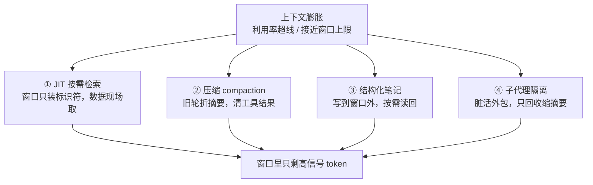

Agent上下文工程-注意力预算与四板斧
====

> 定位：第二章"生产深潜"第 9 篇。与 [llm基础·上下文工程](../llm基础/上下文工程-Context Engineering.md) 是姊妹篇分工：那篇管**单次 LLM 调用**的窗口预算配比与位置效应，本篇管 **agent 循环特有**的上下文问题——工具结果膨胀、长时程任务的连贯性、上下文污染。前接[手写最小循环](从零手写最小Agent-无框架的模型循环.md)（messages 就是全部状态）、[评测与可观测](Agent评测与可观测-guards与成本.md)（token 成本三巨头），旁通[多智能体编排](多智能体编排与框架选型.md)（子代理隔离）与 [MCP](MCP协议与企业落地.md)（工具集治理）。
>
> **内容来源**：本篇为学习整理，综合参考（版权归原作者所有）：
> - [Effective context engineering for AI agents — Anthropic Engineering（2025-09）](https://www.anthropic.com/engineering/effective-context-engineering-for-ai-agents)（本篇主要骨架：注意力预算、四板斧、Claude Code 实例）
> - [Context Engineering for AI Agents: A Practical Guide — The Daily Agent（dev.to）](https://dev.to/thedailyagent/context-engineering-for-ai-agents-a-practical-guide-5989)（预算测量、工具路由代码与监控指标）
> 表述与代码为本库原创加工（代码已精简重写），勘误以原文为准。

一、对象升级：从"写好一段指令"到"经营一个循环"
------

Anthropic 给的定义：上下文工程 = **在每次推理时，策展并维护最优 token 集合的一整套策略**（curating and maintaining the optimal set of tokens during LLM inference）。它不是提示词工程的同义词，而是后者的超集：

| | 提示词工程 | 上下文工程 |
|---|---|---|
| 优化对象 | 一段指令的措辞与组织 | 每次推理进入窗口的**全部** token：系统提示、工具定义、消息历史、检索内容、工具结果 |
| 工作形态 | 一次写好的离散任务 | 每轮循环前的**持续策展**——每次调模型前都要重做一遍 |
| 核心问题 | "怎么措辞模型才听懂" | "什么配置的上下文最可能引出期望行为" |
| 典型动作 | 改措辞、加约束、给格式 | 裁历史、筛检索、注工具、压结果、开子代理 |

为什么 agent 把这件事逼成了一等工程？agent = **LLM 在循环中自主使用工具**（Simon Willison 的定义，Anthropic 团队采用）。循环意味着：每一轮都是全量重建上下文、历史每轮全量重发——长轨迹的上下文是平方级压力（[评测篇](Agent评测与可观测-guards与成本.md)的 token 成本三巨头说的就是它的账单面）。一次性分类任务写好提示词就完了；跑 40 轮的 agent，窗口里堆的是 40 轮的系统提示 + 工具定义 + 历史 + 每一步的工具原始结果。

总纲一句（原文）：**找到能最大化期望结果的最小高信号 token 集合**（the smallest possible set of high-signal tokens）。注意是"高信号"不是"少"——砍掉关键信号省 token 是负优化。

二、context rot：窗口越大，注意力越摊薄
------

一个反直觉的事实：**窗口标称值越大，模型对窗口内容的平均 recall 越差**。Chroma 的 needle-in-a-haystack 系基准显示，随 token 数增加，所有模型的准确回忆都衰减（程度不同）——这个现象叫 **context rot（上下文腐烂）**。三个根源：

* **注意力是 n² 的**：n 个 token 两两交互产生 n² 个成对关系，上下文越长，捕捉关系的能力被摊得越薄；
* **训练分布偏短序列**：语料里短序列远多于长序列，模型对长程依赖的经验和专用参数更少；
* **位置编码是插值出来的**：外推到更长窗口靠插值等技术，对 token 位置的理解有损耗。

与之配套的心智模型是 **attention budget（注意力预算）**：类比人类的工作记忆——容量有限，每个新 token 都在消耗预算，塞得越多，单个 token 分到的注意力越少。衰减是**梯度不是悬崖**：长上下文下模型依然很强，但检索精度和长程推理在悄悄下滑。

工程推论两条：

* **等更大窗口不是解药**。任何尺寸的窗口都有 context pollution（无关信息污染），1M 窗口塞 900K 噪音照样 rot。解药是治理，不是扩容；
* **每 token 都要付租金**。工具定义没被调用也占预算，无关检索片段没被引用也稀释注意力——"放得下"从来不等于"用得好"。

三、先记账再动手：预算测量与 60% 红线
------

实操第一步不是压，是**量**。The Daily Agent 给的典型数字：系统提示 500–1,500 token，每个工具定义 200–500 token——一个带 10 个工具、20 轮历史的 agent，**用户还没说话，窗口可能已被占用 60–80%**。经验红线：用户输入前占用超过 60% 就必须动手治理。

```python
import tiktoken

enc = tiktoken.get_encoding("o200k_base")

def context_budget(model_limit: int, system_prompt: str,
                   tools: list, history: list, retrieved_docs: list) -> dict:
    """进模型前先记账：各账户占用 + 利用率，超 60% 告警。"""
    count = lambda x: len(enc.encode(str(x)))
    used = count(system_prompt) + sum(map(count, tools)) \
         + sum(map(count, history)) + sum(map(count, retrieved_docs))
    pct = used / model_limit * 100
    budget = {"system": count(system_prompt), "tools": sum(map(count, tools)),
              "history": sum(map(count, history)), "docs": sum(map(count, retrieved_docs)),
              "used": used, "utilization_pct": round(pct, 1)}
    if pct > 60:
        budget["warning"] = f"用户还没说话窗口已 {pct:.0f}% 满，先做四板斧"
    return budget
```

这笔账接上[评测篇](Agent评测与可观测-guards与成本.md)的指标三巨头：预算利用率是**设计与线上双用**的指标——设计期定配比，线上按 trace 监控每步占用趋势。

四、静态侧三件事：进循环之前
------

四板斧治的是"跑起来之后"的膨胀；跑之前有三件更便宜的事：

* **system prompt 找对"高度"**：在两个失败极端之间取 Goldilocks 区间——一端是硬编码 if-else 式的脆弱逻辑（维护地狱），另一端是空泛口号（"要专业要认真"，无信号）。组织上分区：`<background_information>` / `<instructions>` / `## Tool guidance` / `## Output description`，XML 标签或 Markdown 标题皆可（模型越强，具体格式越不重要）。起步姿势：**先用最强模型配最简提示词**，再按失败模式逐条加指令和示例——minimal ≠ short，是"没有一条不该在的"；
* **工具集最小化**：工具定义是 agent 与环境的契约，要自包含、抗错、用途清晰、功能重叠最小。判据一句话：**人类工程师说不清该用哪个工具时，agent 也做不到**——臃肿工具集让"选哪个"的决策点本身变模糊。这也是 [MCP 篇](MCP协议与企业落地.md)工具治理的预算面论据；
* **few-shot 精选**：示例是"值一千句话的图"，强烈建议给；但给的是**一组多样化的典范示例**，不是 edge case 规则清单（后者是 attention budget 的黑洞）。

五、动态侧四板斧：跑起来之后
------



**① JIT 按需检索（agentic search）**：窗口里不装数据本体，只装**轻量标识符**——文件路径、存好的查询语句、网页链接；运行时用工具现场取数。Claude Code 分析大数据库的做法：写定向查询、把结果存盘、用 `head`/`tail` 看局部——**从不把完整数据对象装进上下文**。人也是这么工作的：没人背下整个语料库，我们有文件系统、收件箱和书签。配套两个机制：

* **元数据即信号**：文件位置、命名约定、时间戳都在暗示用途——`test_utils.py` 放在 `tests/` 和放在 `src/core_logic/` 是两回事；
* **渐进式披露（progressive disclosure）**：先看文件大小/命名/时间戳这类元信息，再决定深入哪个，而不是一上来全量加载。

代价与补法：运行时探索比预计算检索**慢**；工具和启发式设计不好，agent 会走死胡同反而浪费上下文。所以实践多是**混合**：Claude Code 把 `CLAUDE.md` 预置进上下文（预热），`glob`/`grep` 原语按需导航（深潜）。内容较静态的领域（法律、金融）预取比例可以更高。对 RAG 侧同样成立：**检索与注入是两个独立决策**——召回 top50 不等于塞 top50，相关性过滤（相似度阈值 + 时效加权 + 来源优先级）之后再进窗口；经验上一个 2,000 token 的文档常只有 200 token 与当前步相关。

**② 压缩（compaction）**：对话逼近窗口上限时，把历史总结成摘要、以摘要重启新窗口——长程连贯的第一手段。Claude Code 的实现：让模型总结消息历史，**保留架构决策、未解决的 bug、实现细节，丢弃冗余的工具输出**，压缩后带着最近访问的五个文件继续。摘要提示词要钉死保留项（已做决策/已取数据/用户偏好/未完成任务），40 条消息约 20k token 的历史可压成 ~200 token 摘要 + 近 6 轮 ~3k 原文，每轮调用省约 17k：

```python
def manage_context(messages: list, system_prompt: str, keep_recent: int = 6) -> list:
    """近 N 轮保原文，旧轮折成摘要注入（摘要用便宜模型跑）。"""
    if len(messages) <= keep_recent:
        return [{"role": "system", "content": system_prompt}, *messages]
    summary = cheap_llm(
        system="200 token 内总结，必须保留：已做决策 / 已取数据 / 用户偏好 / 未完成任务",
        messages=messages[:-keep_recent])
    return [
        {"role": "system", "content": system_prompt},
        {"role": "system", "content": f"前情摘要：{summary}"},
        *messages[-keep_recent:],
    ]
```

调优次序：**先最大化摘要的召回，再提精度**（漏掉关键决策比多留废话贵）。最低垂的果实其实是**清除历史深处的工具调用原始结果**——第 3 轮那次 5K token 的查询返回，第 30 轮只需要"查到 3 笔异常交易"一句话；Claude Developer Platform 已把工具结果清除产品化为 context management 功能。滑窗/摘要/外置记忆的三级压缩谱系详见[llm基础姊妹篇](../llm基础/上下文工程-Context Engineering.md)。

**③ 结构化笔记（note-taking / agentic memory）**：agent 定期把笔记写到**窗口之外的持久存储**，之后按需读回。Claude Code 的 to-do list 是最小形态；自定义 agent 可以维护一份 `NOTES.md`。最生动的实例是 Claude 打宝可梦：agent 在数千步游戏里维持精确计数（"过去 1,234 步在 1 号道路练级，Pikachu 升了 8 级、目标 10 级"），自主建立已探索区域地图、成就清单、战斗策略笔记——**上下文重置后读自己的笔记接着干**。Sonnet 4.5 起官方提供了基于文件系统的 memory tool（可窗口外存取信息），把这套手工实践标准化了。

**④ 子代理隔离（sub-agent）**：主 agent 只持**高层计划**，把深度搜索/重活外包给专职子代理——子代理在**干净的上下文窗口**里工作，可以消耗数万 token，但只向主窗口返回 1,000–2,000 token 的浓缩结论。这是用架构换预算：污染被隔离在子窗口，主窗口永远清爽。拓扑与选型见[多智能体编排篇](多智能体编排与框架选型.md)，Anthropic 的 multi-agent research system 在复杂研究任务上因此显著优于单 agent。

三选一的判断（Anthropic 原文给的口径）：

| 手段 | 最适合 | 保留下来的是什么 |
|---|---|---|
| ② compaction | 大量来回、要维持对话流 | 对话语义骨架 |
| ③ note-taking | 有清晰里程碑的迭代开发 | 可结构化沉淀的事实 |
| ④ multi-agent | 可并行探索的研究分析 | 各路浓缩后的结论 |

六、落地顺序、监控与三者分工
------

按性价比排序的动手清单（The Daily Agent 的落地顺序，与四板斧互相咬合）：

1. **算预算**（第三节的计算器，先知道钱花哪了）；
2. **压历史**（compaction，性价比最高的一步）；
3. **滤检索**（相关性过滤后再注入，"检索到"≠"塞进去"）；
4. **动态注工具**：15+ 个工具的定义占 5,000–10,000 token 且稀释选具注意力。用便宜模型当**工具路由**，本步只注入相关子集——路由调用约 200 token（~$0.00003），主调用省 3,000–8,000 token（$0.007–0.02）：

```python
def select_tools(task: str, all_tools: list, max_tools: int = 5) -> list:
    """便宜模型当工具路由：20 个工具只注入本步相关的几个，省数千 token。"""
    names = [t["function"]["name"] for t in all_tools]
    picked = cheap_llm_json(
        f"任务：{task}\n候选工具：{names}\n"
        f"返回最相关的至多 {max_tools} 个工具名，JSON 数组，只返回数组")
    selected = [t for t in all_tools if t["function"]["name"] in picked]
    return selected or all_tools[:max_tools]   # 路由失败兜底：前 N 个
```

5. **压步骤结果**：每步只接收最小可用产物——搜索结果给标题 + URL + 一行摘要；API 响应只抽下一步引用的字段；数据库结果聚合/采样而非原始行；网页抓取去掉导航广告样板只留正文。

监控三指标（没有度量就没有治理）：**用户发言前利用率**（目标 <50%）、**每步 token 数趋势**（随轮数增长 = 历史或结果在膨胀的信号）、**多步任务准确率**（压缩是否压掉了关键信号的最终裁判）。

最后一张定位表，分清三个常被混用的东西：

| | 上下文工程 | Memory | RAG |
|---|---|---|---|
| 回答的问题 | 模型**这次调用**该看到什么？ | agent 该**跨会话**记住什么？ | 什么**外部知识**相关？ |
| 作用范围 | 单次 LLM 调用 | 跨会话长期 | 外部数据源 |
| 关系 | 总装：决定最终进窗口的内容 | 给上下文工程供给候选 | 给上下文工程供给候选 |

七、追问链
------

* 上下文工程和提示词工程什么关系？→ 包含与升级：提示词工程只管"指令怎么写"，上下文工程管**进窗口的全部 token**，且是每轮循环前的持续策展，不是一次性的；
* 窗口都 128K/1M 了还要裁吗？→ 要。context rot：注意力是 n² 的，窗口越长摊得越薄；无关 token 付租金还稀释信号，衰减是梯度不是悬崖。等扩容不解决污染；
* 四板斧怎么选？→ 维持对话流用 compaction；有里程碑的迭代用 note-taking；可并行的研究用子代理；数据量大到装不下用 JIT 按需检索。不互斥，Claude Code 是混合体（CLAUDE.md 预热 + grep 深潜 + compaction + todo）；
* 预算红线多少？→ 用户发言前占用超 60% 动手治理，线上目标压到 50% 以下；
* 最便宜的两刀砍在哪？→ 清历史深处的工具调用原始结果（已消费的输入）+ 裁从不被调用的工具定义（白交的租金）；
* 怎么验证压缩没压坏东西？→ 监控每步 token 趋势 + 多步任务准确率；摘要提示词先调召回再调精度——漏关键决策比多留废话贵；
* 总原则一句？→ **do the simplest thing that works**。模型越强需要的规定性工程越少、agent 自主性可越高，但"把上下文当珍贵有限资源"永远是可靠 agent 的底座。

一句话总结
------

**上下文是预算不是仓库：先记账（60% 红线），静态侧裁提示/工具/示例，动态侧四板斧——窗口只装标识符（JIT）、旧轮折摘要（compaction）、事实写窗外（note-taking）、脏活开子代理（sub-agent）。目标是每个 token 都在高信号区付租金。**

> 2026-11 新增（学习整理篇 · 素材来自 Anthropic Engineering 与 The Daily Agent 公开文章）。
