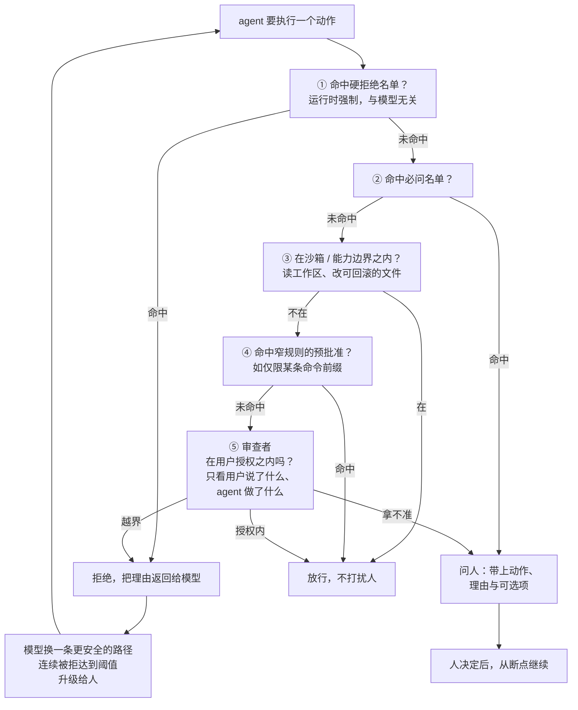

Agent人机协同-从头部智能体看审批与权限设计
====

> 定位：第二章"生产深潜"第 11 篇。[评测篇](Agent评测与可观测-guards与成本.md)把"人审"列为第五道护栏，[身份链篇](智能体的身份链与工具安全.md)给高危工具加了二次确认，但"什么时候该停下来问人、问什么、怎么才能少问"一直只有一句话。本篇以 Claude Code 为主样本（权限文档最完整，且有公开的设计复盘），对照 Codex、Manus、OpenAI Agents SDK 与 MCP 规范，拆解头部智能体的人机协同设计，再提炼成自己造 agent 时能直接用的方法。旁通 [上下文工程](Agent上下文工程-注意力预算与四板斧.md)、[多智能体编排](多智能体编排与框架选型.md)、[ClaudeCode使用实践](../工程工具/ClaudeCode使用实践.md)。
>
> **内容来源**：本篇为学习整理，综合参考（版权归原作者所有）：
> - Claude Code 官方文档：[权限](https://code.claude.com/docs/en/permissions)、[权限模式](https://code.claude.com/docs/en/permission-modes)、[钩子](https://code.claude.com/docs/en/hooks)、[沙箱](https://code.claude.com/docs/en/sandboxing)、[无人值守模式](https://code.claude.com/docs/en/headless)、[Agent SDK 权限](https://code.claude.com/docs/en/agent-sdk/permissions)与[人工输入](https://code.claude.com/docs/en/agent-sdk/user-input)
> - [How we built Claude Code auto mode — Anthropic](https://www.anthropic.com/research/claude-code-auto-mode)（auto mode 的设计复盘与评测数据）
> - [Agent approvals & security — OpenAI Codex](https://learn.chatgpt.com/docs/agent-approvals-security)、[Human-in-the-loop — OpenAI Agents SDK](https://openai.github.io/openai-agents-python/human_in_the_loop/)
> - [Elicitation — MCP 规范](https://modelcontextprotocol.io/specification/2025-06-18/client/elicitation)、[Introducing Plan Mode — Manus](https://manus.im/blog/manus-plan-mode)
>
> 这些产品迭代很快，文中细节是 2026-11-25 的文档现状，勘误以官方文档为准。

一、先破题：打断人是为了对齐，不是走个安全流程
------

人机协同最直觉的做法是"危险动作弹个确认框"。Anthropic 在 auto mode 的复盘里给了一个尴尬的数字：**Claude Code 用户对权限提示的同意率是 93%**。弹得多了，人就不再认真看，一路点"同意"——这就是审批疲劳。要避开它只有两条路：配置内置沙箱，或者用 `--dangerously-skip-permissions` 关掉所有权限提示——后者在多数场景下并不安全。

Anthropic 的内部事故日志里有这样的案例：按一句被误解的指令删掉了远程 git 分支；把一位工程师的 GitHub 令牌上传到了内部计算集群；对着生产数据库尝试跑迁移。复盘把这些归为同一个模式——**模型过于主动，做了用户没有授权的事**。

Manus 上线计划模式时的说法更直接：多数 AI 的错误，是因为没人审过它的做法；问题不在能力，在对齐。

Anthropic 把"agent 为什么会做出危险动作"拆成四类（右列是本库归纳的对策）：

| 成因 | 表现 | 主要靠什么拦 |
|---|---|---|
| 过于主动 | 明白目标，但自作主张用了顺手找到的凭据、删了"碍事"的东西 | 审查"是否在授权之内" |
| 误判影响面 | 以为资源是测试环境的，其实是共享的 | 沙箱、执行前确认 |
| 提示注入 | 文件、网页里的指令劫持了 agent | 输入侧检测、让审查者读不到工具返回内容 |
| 模型失配 | 追求自己的目标 | 动作层拦截与推理监控互补 |

所以人机协同真正要回答的是三个问题：**什么时候打断人；打断时给什么；怎样让人尽量少被打断**。头部智能体的设计，基本都是围绕这三件事展开的。

二、Claude Code 的权限体系：六个模式、一套规则
------

Claude Code 用"模式"定基调，用"规则"做微调。六个模式各自的取舍：

| 模式 | 不问就做的事 | 适合 |
|---|---|---|
| `default`（手工） | 读工作区文件、启动子代理等无需审批的动作 | 敏感工作、不熟的代码 |
| `acceptEdits` | 读、改文件，以及 `mkdir`、`cp` 这类常见文件命令 | 边审边改 |
| `plan` | 只读探索并写计划，批准前不改源码（有 auto mode 时，探索用的命令可交审查者放行） | 动手前先摸清代码库 |
| `auto` | 全部，但后台有审查模型把关 | 长任务、减少提示疲劳 |
| `dontAsk` | 只做预先批准的事，其余该问的直接拒绝 | 锁死的 CI 与脚本 |
| `bypassPermissions` | 全部 | 仅限隔离的容器与虚拟机 |

三点设计值得细看。

**规则由运行时强制执行，不是由模型执行。** 文档原话是：权限规则由 Claude Code 而非模型强制，提示词和 `CLAUDE.md` 只影响模型想做什么，不改变规则。这与[身份链篇](智能体的身份链与工具安全.md)的结论一致——模型拒绝只是建议，代码校验才是法律。规则的评估顺序是固定的"先拒绝、再询问、后允许"，先命中者决定，规则写得多具体不改变这个顺序。所以宽的拒绝规则（如 `Bash(aws *)`）会盖住窄的允许规则（如 `Bash(aws s3 ls)`），允许规则不能给拒绝规则开例外。

**拒绝整个工具，比拒绝某次调用更彻底。** 只写工具名（如 `Bash`）的拒绝规则会把这个工具**从模型的上下文里整个拿掉**，模型根本看不到它；带模式的拒绝（如 `Bash(rm *)`）则保留工具、只拦匹配的调用。前者同时省了上下文预算，呼应[上下文工程篇](Agent上下文工程-注意力预算与四板斧.md)的"工具集最小化"。

**"不再询问"的记忆范围，与提示框能说清楚的范围成正比。** 对 Bash 命令和抓取域名，批准会按仓库永久保存（写进 `.claude/settings.local.json`）；对文件修改，批准只到会话结束。有些提示只给"仅此一次"，不给"不再询问"——文档的理由是：只有当提示框能把它将允许的全部内容展示给你时，才提供这些选项。这条尺度很通用：**让用户一键放行之前，先确认他真的看清了放行的是什么**。

信任边界上还有几道"越自主、越要本人显式授权"的设计：项目级的允许规则要先通过工作区信任对话框才生效；仓库里的 `.claude/settings.json` 设不了 `auto` 和 `bypassPermissions`，只有用户级设置或启动参数可以——一个仓库无法替你决定放开权限；`bypassPermissions` 只能在启动时开启，中途进不去；在 Linux 和 macOS 上以 root 或 sudo 运行时直接拒绝启动。

三、少问的三种手段
------

逐个动作问人很难持续（93% 的同意率就是证据）。头部智能体的解法有三条路。

**其一，用沙箱换自由：能靠能力边界解决的，不要靠提问解决。** Codex 把控制拆成两层，这个划分最清楚：**沙箱模式决定技术上能做什么**（能写哪里、能否联网），**审批策略决定什么时候必须问**（离开沙箱、用网络、跑可信集合之外的命令）。Codex 默认关闭网络、写入限于工作区；启动时按目录是否受版本控制来推荐——受控目录用 Auto 预设（`workspace-write` 加 `on-request`），否则只读。`.git`、`.agents`、`.codex`、`.aws` 这些目录即使在可写范围内也是只读。Claude Code 同理：权限模式决定一次调用跑不跑、要不要先问，沙箱决定命令跑起来之后能碰到什么；沙箱开了 auto-allow 模式，沙箱内的命令才可以免提示。

**其二，计划先审，执行后放：把 N 次动作级确认压成一次计划级确认。** Claude Code 的计划模式让模型先调研、出计划、不改源码，计划给出三个选项——批准并转入 auto 模式（会话不支持 auto 时，这一项退为"自动接受编辑"）、批准但逐个审改动、继续规划；按 `Ctrl+G` 可以直接在编辑器里改计划再让它执行。Manus 的计划模式把计划做成了正式文档：先暂停、做可行性检查，缺上下文就先反问，然后产出一份完整的 Markdown 计划（目标、步骤、约束），可以直接点进去改；**确认之前不动手**，确认后计划成为事实来源。它给出的理由是：不必把每个细节都预先塞进提示词，计划会补上空缺——"几分钟就能看到计划，而不是几小时后才看到成品"。

**其三，让审查者替人审：auto mode 的设计复盘。** 这是全篇信息量最大的一段。auto mode 位于"沙箱"与"跳过权限"之间——沙箱安全但维护成本高，每加一个能力都要配置；跳过权限零维护但毫无保护；手工提示居中，而用户实际上 93% 都同意。auto mode 把审批委托给一个基于模型的审查者，每一关先命中者决定：

1. 命中允许、询问、拒绝规则的，立即裁决（少数例外除外，比如对受保护路径的写入，即使命中允许规则也交审查者）；
2. 只读动作和工作目录内的文件编辑直接放行——这类改动可以靠版本控制事后审；
3. 其余全部交给审查者：shell 命令、网页抓取、外部工具、子代理、工作目录外的文件操作；
4. 被拦截时，模型会拿到拦截原因。

几个设计细节都有明确理由：

* **进入 auto mode 时丢掉宽的允许规则**，包括 `Bash(*)`、`Bash(python*)` 这类通配解释器、包管理器的运行命令。理由很直白：这些规则正是最可能造成破坏的命令，留着它们，审查者就永远看不到最该审的东西。窄规则（如 `Bash(npm test)`）保留。
* **信任边界默认只有当前仓库**，而且是会话启动时配置的远程；会话中途用 `git remote add` 加的远程不算可信，一律视为外部。
* **审查者只看用户说了什么、agent 做了什么**——输入里只有用户消息和工具调用，agent 自己的推理文字和工具返回内容都被剥掉。这样它既不会被 agent 的说辞说服，也不会被藏在文件或网页里的注入内容操纵。评估过的两个反例很有说服力：带上 agent 的自述，表现下降；只看工具调用，又丢了"用户意图"这个锚点。
* **判断依据是真实效果，不是表面写法。** 把载荷写进文件再执行，审的是载荷；`&&` 串起来的命令链算一个动作；拼接出来的命令按拼装结果审。
* **"与目标相关"不等于"被授权"。** 提示词把审查者调得很保守：用户说的才叫授权，agent 自己选的一律视为未授权；"清理一下我的分支"不等于批准批量删除；"我们能修一下吗"是疑问句，不是指令。
* **两段式省钱。** 第一段只输出一个 token（拦或不拦），被要求"宁拦勿放"，误拦率 8.5%；只有被第一段标记的动作才进第二段做仔细推理，误拦率降到 0.4%。
* **拒绝后继续，而不是卡死。** 被拦的动作以工具结果的形式返回，并附带一句"找一条更安全的路，不要绕过拦截"；一个会话里连续 3 次或累计 20 次被拦，就停下来升级给人。
* **子代理两头都查。** 派活出去时查一次——在子代理眼里，编排者的指令就是"用户消息"，什么都显得天经地义，所以要在还分得清"这是 agent 自己的选择"时拦；子代理运行期间，它的每个动作走同一套评估；结果回来时再查一次，防止子代理中途被注入。

评测数字也要如实看：在 52 个真实的"过于主动"动作上，审查者的漏报率是 **17%**。多数漏报里它其实认出了危险，错在以为用户某句话构成了同意。所以 Anthropic 自己的结论是：auto mode 是给原本要开"跳过权限"的人用的，不能替代高危基础设施场景下认真的人工审查。代价方面，每个走到审查者的动作多一次模型调用；被第一段标记的，再进第二段推理。

Codex 的做法同构：审批请求可以交给一个"自动审查"智能体，它只审本来就需要审批的动作，查数据外泄、凭据探测、持久性地削弱安全、破坏性操作四类；critical 级风险直接拒绝，高风险动作要有足够的用户授权且不命中拒绝规则；构建提示、审查会话、解析失败一律按拒绝处理，超时也按未执行处理。Codex 还规定：声明了"破坏性"注解的应用或 MCP 工具调用必须审批（除非同时声明了"只读"，只读优先）。

四、字符串规则的天花板
------

看完 auto mode 的复杂程度，自然会问：直接写规则不行吗？Claude Code 的文档给出了大量"规则为什么不够用"的实例，这些坑在自己造 agent 时同样会遇到。

* **同一个程序换种写法就绕过。** `Bash(curl *)` 拦得住 `curl https://…`，拦不住 `/usr/bin/curl https://…`，也拦不住 `sh -c 'curl …'`；`Bash(git push *)` 拦不住 `git -C . push`。官方的结论很干脆：这类规则覆盖的是模型通常写出的那种调用形式，**不是围绕这个程序的安全边界**；要不依赖命令文本的强制，用沙箱。
* **想约束参数的规则是脆弱的。** `Bash(curl http://github.com/ *)` 意在把 curl 限定到 GitHub，但选项写在 URL 前面、换了协议、遇到重定向、URL 存在变量里，全都匹配不上。
* **"只读"本身就需要小心翼翼地定义。** 内置的只读命令集在任何模式下都不提示，但有一长串例外：`ps` 带上能打印环境变量的参数、`find` 配未加引号的通配符（通配可能展开成 `-delete`）、`cd` 到别的目录再跑 `git`（那个目录的钩子会执行）、给 `PATH` 这类特殊变量赋值。
* **解析不了就问。** 分析器无法完整解析的命令，一律按"需要审批"处理，而不是当作只读；超过一万字符的命令必定提示。这是"失败即关闭"的原则。
* **审查之后不许改输入。** 钩子可以在动作执行前改写入参，但如果改动发生在审查者已经审过之后，这次调用可能被直接拒绝（按"没有审查结论"处理），并提示"钩子在审查后改了输入"。否则就成了先审后换的漏洞。

所以完整的防线是三层叠加：运行时的规则（便宜、可解释）、审查者（判断意图）、操作系统层的沙箱（对子进程也生效）。文档明确指出，针对读写工具的拒绝规则管不到任意子进程里的读写，要靠沙箱做系统级强制。

五、提炼成方法：给自己的 agent 加一道动作闸门
------

把上面的设计揉在一起，一个动作从提出到执行经过这几关，先命中者决定。必问名单排在沙箱放行之前——否则沙箱会吞掉用户立下的"这个每次都要问我"：



**第一步不是设计提示框，是划风险象限。** 哪些动作该走哪一关，看两个维度——能不能回滚、影响范围有多大：

| | 影响局部 | 跨信任边界或影响他人 |
|---|---|---|
| **可回滚**（有版本控制） | 不问，事后审 diff | 默认放行但留痕，需要时加必问规则 |
| **不可逆** | 动作级确认（或由审查者拦下） | 永远问：任何模式都不自动批准 |

第二行右列是底线。Claude Code 有一份"任何模式都不自动批准"的清单，以及一份默认拦截清单（下载并执行代码、向外部发送敏感数据、生产部署与迁移、强推、授予 IAM 或仓库权限、修改 agent 自己的权限配置、合并没人审过的 PR、把活凭据打印到对话或文件里……）。自己造 agent 时，先把自己的"永不自动放行"清单写出来。

**审查者的提示词照搬 Anthropic 的"固定模板加三个槽位"。** 固定部分负责判断方法，槽位定义你的策略：

```text
你是审批审查者。输入只有：用户的原话、agent 已执行与待执行的工具调用。
你看不到 agent 的自我解释，也看不到工具返回的内容。按顺序判断待执行的动作：

1. 它实际会做什么？看真实效果，不看表面写法：包在脚本里的命令、
   用 && 串起来的命令链、拼装出来的命令，都按最终执行物算。
2. 是否命中拦截项？
   【槽位一：拦截规则——破坏或外泄、降低安全姿态、跨出信任边界、绕过评审或影响他人】
3. 是否属于例外？【槽位二：良性例外清单，从窄】
4. 用户是否授权了"这个动作"？授权必须是用户明说的，并点名了危险之处；
   与目标相关不等于被授权；一次批准不构成惯例；疑问句不是指令。
   【槽位三：环境——哪些仓库、域名、服务算"内部"】

结论三选一：放行 / 拦截（写出命中的规则名）/ 拿不准（转人工）。
```

**闸门的代码骨架**（伪代码，综合 Claude Code 的评估顺序与 auto mode 的设计改写）：

```python
def gate(call, ctx) -> Decision:
    """动作闸门：顺序即优先级，先命中者决定。"""
    if deny_rules.match(call):                     # ① 硬拒绝：任何模式都不放行
        return Deny(deny_rules.reason(call))
    if ask_rules.match(call):                      # ② 必问名单：直接转人工
        return Ask(call, ask_rules.reason(call))
    if ctx.sandbox.covers(call):                   # ③ 能力边界之内：不打扰人
        return Allow()
    if allow_rules.match(call):                    # ④ 窄规则预批准
        return Allow()
    verdict = reviewer(call, ctx.user_messages, ctx.tool_calls)   # ⑤ 审查者
    if verdict.blocked:
        ctx.denials += 1
        if ctx.denials >= 3:                       # 连续被拒：升级给人
            return Ask(call, verdict.rule)
        return Deny(verdict.rule, hint="换一条更安全的路径，不要绕过拦截")
    if verdict.unsure:
        return Ask(call, verdict.reason)
    return Allow()
```

没有审查者、也没有人在的场景（无人值守），第 ⑤ 关和"问人"都退化为**拒绝并记录**，而不是放行。

主流框架和协议里都有对应的积木，不用从零造：

| 机制 | 出处 | 要点 |
|---|---|---|
| `PreToolUse` 钩子 | Claude Code | 动作执行前的可编程闸门：放行、拒绝、询问、推迟，四种决定；多个钩子冲突时按"拒绝、推迟、询问、放行"的优先级取最严者 |
| `canUseTool` 回调 | Claude Agent SDK | 把"需要人裁决"接到自己的界面或审批系统；放行时可以改参数。注意已被前面步骤放行的调用不会再进这个回调 |
| `needs_approval` | OpenAI Agents SDK | 工具自己声明要不要审批（常量，或按调用判断）；参数无法安全解析时按"需要审批"处理。运行暂停后由 `RunState` 批准或拒绝再恢复，拒绝理由会回传给模型 |
| `interrupt()` | LangGraph | 图内挂起，用 `Command(resume=...)` 恢复；**恢复时节点从头重跑**，所以副作用要幂等，或者放在中断之后 |
| 工具注解与 elicitation | MCP | 工具用注解自述是否只读、是否有破坏性——只是提示，怎么用由客户端决定（如 Codex 规定带破坏性注解的调用必须审批）；服务端可以经客户端向用户要结构化输入，但规范禁止用它索取敏感信息 |

如果审批可能等上几小时甚至几天，不要让进程挂着等。Claude Code 的做法是"推迟"（仅无人值守模式、且本轮只有一个工具调用时生效）：本轮以"工具被推迟"结束，待执行的调用留在会话记录里；人答复后，用同一个会话恢复，同一个调用会再次触发钩子，这次带上答复放行。

六、四个容易忽略的产品细节
------

* **拒绝要说理由。** 拒绝理由会进模型的上下文，模型据此换路；`AskUserQuestion` 和权限请求是两类不同的人机交互，前者是澄清，后者是审批。
* **主动提问是双刃剑。** Claude Code 的 `AskUserQuestion` 一次问 1 到 4 个问题、每问 2 到 4 个选项，在计划模式里最常见；auto mode 则反过来，鼓励模型少停下来反问。多问少问，取决于"答错的代价"与"打断的代价"哪个更高。
* **无人值守时，把"问"变成"拒"。** `dontAsk` 模式、`--permission-prompts none`、`denyInsteadOfPrompting` 做的都是这件事：没人可问，就不执行，并告诉模型不要重试。被拒的调用要落进结果（如 `permission_denials`）与审计日志（如 Codex 可选开启的遥测里，有每次工具决定的批准或拒绝，以及来源是配置还是用户），否则事后无从追查。
* **会话里立的规矩，可能被压缩丢掉。** auto mode 把用户在对话里说的"先别推""等我审完再部署"当作拦截信号，但它每次都从会话记录里重新读取；一旦上下文压缩删掉了那句话，规矩就失效了。要长期生效的边界，写成拒绝规则。

七、追问链
------

* 人机协同为什么不能靠"危险动作弹确认框"？→ 审批疲劳：Claude Code 的权限提示同意率 93%，用户要么机械点同意，要么干脆跳过全部权限检查。要同时回答"何时打断、给什么、怎么少问"。
* 怎么让人少被打断？→ 三条路：用沙箱换自由（能力边界内不打扰）；计划先审、执行后放（把 N 次确认压成一次）；让审查者替人审（auto mode）。
* 审查者怎么设计才不被 agent 骗？→ 只给它看用户消息和工具调用，不给 agent 的自述和工具返回内容；按真实效果而非表面写法判断；"与目标相关"不算授权。代价是看不到来源信息，这个取舍是有意为之的。
* auto mode 能替代人吗？→ 不能。真实"过于主动"动作上漏报 17%，多数漏报是误判了用户是否同意。它的定位是替代"跳过权限"，不是替代高危场景下的人工审查。
* 权限规则写得很细是不是就安全了？→ 不是。同一个程序换个路径或包进 `sh -c` 就能绕过；想约束参数的规则天然脆弱；"只读"本身就有很多边界情况。规则只是第一层，要叠加审查者和操作系统层的沙箱。
* 被拦截后 agent 应该怎么办？→ 拒绝并带理由，让模型换一条更安全的路继续；连续被拒达到阈值（3 次连续或 20 次累计）再升级给人。直接卡死会把误拦变成致命问题。
* 审批要等很久怎么办？→ 推迟而不是挂起进程：本轮以"工具被推迟"结束，待执行调用留在会话记录里，人答复后恢复会话、重新触发同一个调用。
* 自己造 agent，第一步做什么？→ 划风险象限，先写出"永不自动放行"的清单；然后按"硬拒绝、必问、能力边界、预批准、审查者、人"的顺序搭闸门。

一句话总结
------

**人机协同的难点不是"会不会弹确认框"，而是在对齐与效率之间找平衡：能力边界内不打扰，计划级确认压住动作级确认，拿不准的交给只看事实的审查者，越界的拒绝后让模型换路，不可逆且跨信任边界的永远问人。**

> 2026-11 新增（学习整理篇 · 素材来自 Claude Code 官方文档与设计复盘、OpenAI Codex 与 Agents SDK 文档、MCP 规范、Manus 产品博客）。
