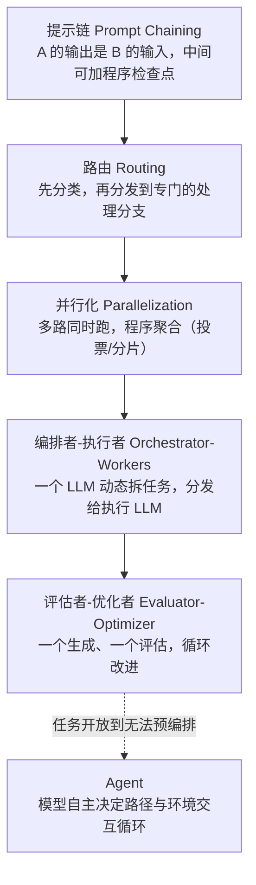

Agent 范式全景-workflow与agent的边界
====

> 定位：agent 目录"从零到一"主线的第一章。现有四篇（[ReAct 与 LangGraph](ReAct与LangGraph工程实践.md)、[MCP](MCP协议与企业落地.md)、[结构化输出](结构化输出工程-Pydantic与LLM.md)、[身份链与工具安全](智能体的身份链与工具安全.md)）都是"决定做了之后怎么做"，这一篇回答更前置的问题：**这个需求到底该不该用 agent、用哪种范式**——2025 年业界已有公论（Anthropic《Building Effective Agents》成为事实上的企业参考），先站在共识上再进深潜。
>
> **内容来源**：本篇为学习整理，综合参考（版权归原作者所有）：
> - [Building Effective Agents — Anthropic](https://www.anthropic.com/research/building-effective-agents)
> - [深入理解AI Agent：设计原理与工程实践 — 李博杰](https://github.com/bojieli/ai-agent-book)
> - [从零开始构建智能体 — Datawhale hello-agents](https://github.com/datawhalechina/hello-agents)
> 表述与案例编排为本库原创加工，勘误以原文为准。

一句话定义：agent 与 workflow 的分界
------

业界 2025 年收敛出的分界线非常干净（Anthropic 口径）：

* **workflow**：用**代码预先编排**好 LLM 与工具的执行路径——什么时候调模型、调几次、结果怎么流转，都是写死的；
* **agent**：LLM **自己决定**执行路径——模型看目标、看环境反馈，自主决定下一步调什么工具，循环直到完成。

一句话记忆：**流程写死的是 workflow，模型写流程的是 agent**。这个分界决定了后面一切工程属性：workflow 可预测、可审计、成本低；agent 灵活、能处理开放任务，但每一步都是概率性的。

五种 workflow 模式：从"不用 agent"到"接近 agent"
------

Anthropic 归纳的五种组合模式，按复杂度递增——**大部分企业需求在前四档就够**：

五种模式的**适用信号**各一句话：

| 模式 | 什么时候用 | 企业例子 |
|---|---|---|
| 提示链 | 任务能干净分解为固定步骤，每步有明确检查点 | 生成营销文案 → 翻译 → 合规检查 |
| 路由 | 输入类型多样，分开处理各自更准 | 客服工单分：退款/咨询/投诉 |
| 并行化 | 多视角独立评估能提质量，或分片提速 | 代码审查跑安全/性能/风格三路 |
| 编排者-执行者 | 子任务数量和内容**无法预知**（模型来拆） | 对多个文件做复杂改动 |
| 评估者-优化者 | 有明确评分标准但答案需要迭代打磨 | 文学翻译的译-评-改循环 |
| Agent | 任务开放、步数不可预知、环境要真交互 | 编码 agent 修一个复现条件复杂的 bug |

什么时候**不用** agent（同样重要的三问）
------

"上了 LLM 就要套 agent 框架"是 2024-2025 最贵的弯路。三个反问（Anthropic 原文精神的消化）：

* **能不能一个 prompt 加检索搞定？** 单次调用 + 好的上下文，能覆盖的远比想象多——能 workflow 不 agent，能单次不 workflow；
* **错了的代价是什么？** agent 自主行动意味着错误也是自主的——支付、删库、对外发邮件这类操作，agent 化前先问"错了能不能撤"；
* **可测试性要付出什么？** workflow 的每一步都能单元测试；agent 的评估要评整条轨迹（成本见[企业级评测篇](Agent评测与可观测-guards与成本.md)）。

落到 ai-service 的实证：体检报告解读链路用的是**提示链**（结构化抽取 → 行式渲染 → 解读生成，见[结构化输出篇](结构化输出工程-Pydantic与LLM.md)）——每步可测可审计，从未需要"自主决定下一步"。**生产里大多数"agent 需求"拆开看是三段 workflow**。

agent 的最小完备构件（后续各篇的总纲)
------

决定用 agent 之后，从零到一要凑齐的构件清单——也是本目录的书籍目录：

| 构件 | 职责 | 本库对应篇 |
|---|---|---|
| 模型循环 | 感知→决策→行动→观察的 while 循环 | [从零手写最小Agent](从零手写最小Agent-无框架的模型循环.md) |
| 工具调用 | 模型伸向环境的"手"（function calling/协议） | [MCP协议与企业落地](MCP协议与企业落地.md) |
| 上下文与记忆 | 窗口管理、跨轮记忆、会话隔离 | [ReAct与LangGraph工程实践](ReAct与LangGraph工程实践.md) |
| 结构化输出 | 模型输出接得住的契约 | [结构化输出工程](结构化输出工程-Pydantic与LLM.md) |
| 身份与安全 | 谁在调用、工具能碰什么 | [智能体的身份链与工具安全](智能体的身份链与工具安全.md) |
| 评测与可观测 | 上线前怎么测、上线后怎么看 | [Agent评测与可观测](Agent评测与可观测-guards与成本.md) |
| 编排与多代理 | 多个 agent 怎么协作 | [多智能体编排与框架选型](多智能体编排与框架选型.md) |

追问链
------

* workflow 和 agent 的本质分界？→ 流程写死 vs 模型写流程；为什么企业优先 workflow？→ 可预测可审计成本低，agent 的灵活性只在开放任务才有价值；
* 五种模式各自的信号？→ 见表；最容易误用的是哪个？→ 编排者-执行者——"模型拆任务"听着高级，子任务可枚举时写死路由更稳；
* 什么时候必须上 agent？→ 步数不可预知 + 环境真交互 + 错误可承受（可撤/有护栏），三者同时成立；
* "agent 框架是必须的吗"？→ 不是——agent 本质是模型+工具+循环，小抽象手写足够；框架的价值在状态管理和可观测，选型见[编排与框架选型篇](多智能体编排与框架选型.md)。

面试官视角小结
------

区分度在**克制**：能主动说"这个需求用提示链就够了，不用 agent"的候选人，是做过真实取舍的；张口就是"我们用多智能体协作"而答不出"为什么单 agent 不够"的，是把 buzzword 当架构。追问"五种模式你生产里用过哪种、踩了什么坑"，答得出具体权衡的才算下过场——本库 ai-service 的答案是"体检链路三段提示链，至今没用到第五档"，这个诚实本身就是加分项。

> 2026-11 新增（agent"从零到一"主线第一章；学习整理综合参考 Anthropic/李博杰/Datawhale，见文首来源块）。后续：[从零手写最小Agent](从零手写最小Agent-无框架的模型循环.md) → 专项深潜四篇 → [评测与可观测](Agent评测与可观测-guards与成本.md) → [多智能体编排与框架选型](多智能体编排与框架选型.md)。
