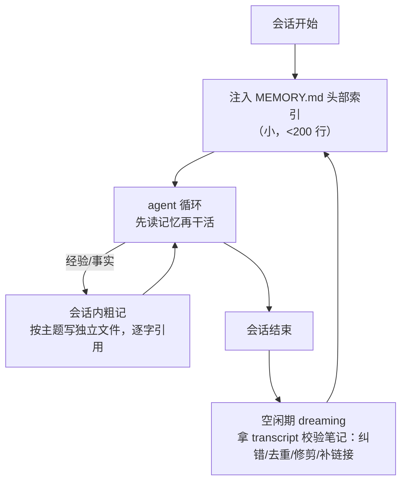

Agent记忆系统-从会话状态到跨会话记忆
====

> 定位：第二章"生产深潜"第 10 篇，也是 B 轨 README 规划里唯一空缺至今的篇目。与 [上下文工程篇](Agent上下文工程-注意力预算与四板斧.md) 是前后脚的姊妹篇：那篇管**单会话内**窗口怎么装（compaction/note-taking 是记忆的"写入前哨"），本篇管**跨会话**——agent 能不能从经验里学到东西并在下一次带回来。前接 [ReAct/LangGraph 篇](ReAct与LangGraph工程实践.md)（MemorySaver 是 checkpointer 不是记忆，本篇一、先掰清这个）、[llm基础·上下文工程](../llm基础/上下文工程-Context%20Engineering.md)（三级压缩的"外置记忆"一格），旁通 [多智能体编排](多智能体编排与框架选型.md)。
>
> **内容来源**：本篇为学习整理，综合参考（版权归原作者所有）：
> - [The components of agent memory — Anthropic（2026-11）](https://www.anthropic.com/research/components-of-agent-memory)（本篇主源：分层结构、指引策略、Pokémon/wiki/合同三组实验数据）
> - [Agent Memory: How to Build Agents That Learn — Letta](https://www.letta.com/blog/agent-memory)（工程分类：四层记忆栈与 memory blocks）
> - [Mem0 Research](https://mem0.ai/research)（提取式记忆路线与 LoCoMo 基准）
> 表述与案例编排为本库原创加工，勘误以原文为准。

一、记忆是什么、不是什么：先排除三个"近亲"
------

Anthropic 给的定义：**agent 记忆 = 从经验中获得、跨会话保留、之后能读回的上下文**（knowledge gained from experience, retained between sessions, saved as context it can read later）。用排除法最容易划清边界——三件事长得像记忆，但都不是：

| 近亲 | 为什么不是记忆 | 本库对应 |
|---|---|---|
| **权重更新** | 训练时改参数，推理时只读——agent 运行时碰不到 | —— |
| **in-context 学习** | 活在当前窗口里，会话结束就蒸发 | [上下文篇](Agent上下文工程-注意力预算与四板斧.md)的 few-shot |
| **compaction（压缩）** | 单会话内用摘要换空间，为了"继续干活"，不跨会话 | [llm基础三级压缩](../llm基础/上下文工程-Context%20Engineering.md) |

还有一个高频混淆要在库内掰清：**LangGraph 的 MemorySaver/checkpointer 是"断点续跑"**——按 thread_id 持久化图状态，让你明天接着今天的会话（见 [ReAct 篇](ReAct与LangGraph工程实践.md)）；它是会话状态的持久化，**不产生新知识**。记忆系统则要求 agent 把经验**加工成可复用的表示**，下次会话开始时就带着。前者是"存档"，后者是"学习"。

RAG 的位置（Letta 的口径）：**检索只是记忆的一种工具手段，RAG 本身不是记忆**——它没有"从交互中积累"的写入侧。把 RAG 当记忆用，等于只有读取没有学习。

Anthropic 画的完整分层（自底向上）：

```text
┌──────────────── 注入层（每会话预载，harness 控制，要小）────────────────┐
│  wiki / 互链知识页 —— dreamed 出来的结构化知识地图（可遍历、带链接）      │
│  dreaming（离线整理）—— 空闲期重组：去重/修剪/纠错/补链接              │
│  记忆笔记 memory notes —— 按主题写的文件（"PokéCenter 在市中心西侧"）  │
│  会话日志 transcript —— 即时捕捉的 ground truth（dreaming 的校验源）    │
└──────────────────────────────────────────────────────────────────┘
  越往上越"加工过"、越稳定、越贵；ground truth 永远在底层
```

二、工程分类：Letta 的四层记忆栈
------

Letta（MemGPT 论文的商业化后身）不套人类心理学的 episodic/semantic 分类，坚持"text-in/text-out"的工程视角，四层栈：

| 层 | 类比 MemGPT 的 OS 隐喻 | 生命周期 | 怎么进窗口 |
|---|---|---|---|
| **消息缓冲 message buffer** | —— | 当前会话 | 天然在窗口（单条 perpetual thread） |
| **核心记忆 core memory blocks** | RAM | 常驻 | harness 每次注入，agent 可自编辑 |
| **回忆记忆 recall memory** | 磁盘-日志 | 永久落盘 | 检索后拉回 |
| **归档记忆 archival memory** | 磁盘-库 | 永久 | 向量/图库查询后拉回 |

两个值得抄的机制设计：

* **memory block 四要素**：`label` + `description`（告诉 agent 这块是什么、何时用）+ `value`（实际进窗口的内容）+ **字符上限**（给每块分配窗口预算——把[上下文篇](Agent上下文工程-注意力预算与四板斧.md)的"预算表"落成了数据结构）。agent 用工具**重写自己的块**，也可以外包给专门的记忆 agent 管理；
* **eviction 只淘约 70%**：窗口满时被淘汰消息与旧摘要做**递归摘要**（越旧的消息对摘要影响越小），保留 30% 原文维持连续性——不是一刀切滑窗。

业界三条路线一张表（写入侧 × 读取侧）：

| 路线 | 写入侧 | 读取侧 |
|---|---|---|
| **Letta**（自编辑块 + 睡眠 agent） | agent 用工具改自己的 memory blocks；sleep-time agent 空闲期异步优化 | 常驻块自动注入 + recall/archival 检索 |
| **Mem0**（提取式） | 单次 LLM 调用做 **ADD-only 抽取**（永不覆写事实，抽取快约 2 倍） | 语义/关键词/实体三路并行打分，**只把 top 匹配注入 prompt**；LoCoMo 92.5 分、平均 ~7k token（全量上下文要 25k+） |
| **Claude Code**（文件系统） | 会话中写 `MEMORY.md` 与主题文件 | 每会话只加载 MEMORY.md **前 200 行/25KB 作索引**，正文按需读 |

三、写入与读回：五个工程决策（Anthropic 的实验结论）
------

**① 何时写：即时 vs 离线，是开放权衡**。会话内即时写（"capturing salience at the source"，趁热捕捉）结果立即可用；后台 dreaming 整理质量更高但不即时。实践中两者都上：会话内粗记，空闲期整理。

**② 写什么：指引"用途"，别规定"步骤"**。Anthropic 的对照实验：告诉 Claude"记忆是干嘛的"远优于规定怎么用——规定"只记录失败"（record only failures）反而让 Opus 5/4.7 **损失大部分收益**；而旧模型（Sonnet 4.6）需要更明确的提示（"先读记忆、显式验证理论"），分数近乎翻倍。新一代模型（Sonnet 5）十分之九会**自发先读记忆再用**——指引策略要随模型代际调整。

**③ 读回：注入层必须小**。两个理由：注入层每个会话都吃 token 预算；**错误笔记会被带进每一个后续会话并被信任**。且更长的指令文件会降低遵循度——所以 Claude Code 只把 MEMORY.md 的头部当索引进窗口，正文留在文件系统按需读（JIT，见[上下文篇](Agent上下文工程-注意力预算与四板斧.md)四板斧①）。

**④ 先读后写是分水岭**。CL-Bench 1.0 数据库任务上的代际演进很有代表性：Sonnet 3.7 生成零散未验证文件 → Sonnet 4.6 生成"理论"但不测试 → Sonnet 5 验证后打标、答错写纠正 → Opus 5 起**闭环**（规则 + 依据 + 陷阱警告一体）。记忆质量首先取决于 agent 会不会"用"记忆，其次才是存储结构。

**⑤ dreaming（离线整理）是纠错的主战场**。类比海马体-新皮层的睡眠固化：空闲期拿 **transcript 当 ground truth** 重新校验笔记——去重、修剪、纠错、补断链（一次二次 pass 补上 9 条失效链接、新增 3 页含索引）。没有整理的记忆系统会随时间漂移成噪音。

四、三个警示性实验：记忆的收益与代价都有数据
------

**Pokémon Red（约 10,000 步对照）——组织能力决定一切**：

* Sonnet 3.7：攒出 **413 个文件、225 个文件夹，只拿到 1 枚徽章**；第 10,000 步附近连续 17 步在"建 6 个删 9 个文件"，**零游戏动作**——记忆管理吞噬了行动本身；
* Fable 5：**2 个文件夹 9 个文件 + 一个 global.md，4 枚徽章**，笔记长这样："连续 3 次抛球失败就改变投掷时机"；Opus 5.5 用小记忆文件夹通关。

**Mt. Moon——记忆污染的真实代价**：一条错误记忆（"PokéCenter 在东侧"）让 Claude 三次绕回原地，最终写下 *"I'm going to stop rather than keep looping."* 主动认输；**dreaming 纠正该记忆后直达 Cerulean City**。错误记忆比没有记忆更糟——它带着"自己写的"信任光环。

**合同条款——写入策略决定事实存活率**：多 agent 共享一张表格互覆写，57 条事实只存活 41 条（72%）；反思失败原因后改为**每份合同独立一页 + 逐字引用**，57/57 全存活。另外两个数字：Stainless 语料（约 35 万文件、4.2 亿 token）建 wiki 后 25 题评估 13%→48%，wiki+搜索 61% vs 仅搜索 53%，且**每题省约 2 万 token**；但**单文档可检索的任务 wiki 无增益**，wiki 甚至可能长得比原文档还大（原文类比博尔赫斯《论科学的精确性》的地图帝国）。

五、落地：给 ai-service 式 agent 的最小记忆设计
------

先过决策表——多数团队要的其实是 checkpointer：

| 你的诉求 | 该用 | 本库对应 |
|---|---|---|
| 会话中断后续跑 / 多轮状态保持 | **checkpointer**（thread_id + 图状态持久化） | [ReAct 篇](ReAct与LangGraph工程实践.md) MemorySaver |
| 跨会话记住用户偏好/领域事实 | **记忆系统**（本篇） | —— |
| 只是历史太长塞不下 | **压缩**（compaction/摘要） | [上下文篇](Agent上下文工程-注意力预算与四板斧.md)板斧② |

确定要记忆系统，最小栈三件套（Claude Code 同款形态，无需引入框架）：



三条红线收口：

* **注入层要小**——索引进窗口，正文留在文件系统按需读（JIT 原则同样适用于自己的记忆）；
* **易变信息不进长期记忆**——Pokémon 的位置/HP 这类状态持续变化，详尽记录必然过时；记忆只收"稳定事实 + 已验证规则 + 陷阱警告"；
* **把记忆当可污染的缓存治理**——有 ground truth（transcript/原始文档）可校验、有定期整理、有删除出口；没有整理通道的记忆库就是慢性的错误放大器。

六、追问链
------

* 记忆系统和 checkpointer 什么关系？→ 存档 vs 学习：checkpointer 持久化会话状态供续跑，不产生新知识；记忆把经验加工成可复用表示、跨会话带回。LangGraph MemorySaver 属于前者；
* 记忆和 RAG 什么关系？→ RAG 只有读取侧没有"从交互中积累"的写入侧，是记忆的一种工具手段而非记忆本身；wiki 可以理解为"被 agent 持续整理过的 RAG 库"；
* 注入层该多大？→ 越小越好：索引（~200 行）进窗口，正文按需读。错误笔记会随注入层污染每个会话，长指令还会降低遵循度；
* 什么时候写记忆？→ 会话内粗记（趁热）+ 空闲期 dreaming 整理（纠错）双通道；指引"记忆是干嘛的"比规定"只记什么"有效——record-only-failures 是有数据反例的坑；
* 记忆出错了怎么办？→ 错误记忆比没有记忆更糟（自带信任光环，Mt. Moon 三次绕圈）。治理三件：transcript 做 ground truth 校验、dreaming 定期纠错、给记忆留删除/降级出口；
* 该用 Letta/Mem0 还是文件系统？→ 先用文件系统 + 索引 + 定期整理跑通（Claude Code 形态），需要多 agent 共享记忆/复杂检索再上框架；Mem0 的强项是把写入读取全托管（LoCoMo 92.5、省 3 倍 token），Letta 的强项是自编辑 memory blocks 和异步记忆 agent；
* 什么时候根本不该上记忆？→ 单文档可检索的任务 wiki 无增益（有数据）；任务间无累积效应、或事实高度易变的场景，记忆是负资产。

一句话总结
------

**记忆 = 跨会话能读回的上下文：transcript 当 ground truth，笔记按主题写，注入层只进索引，空闲期 dreaming 拿日志纠错——错误记忆比没有记忆更糟，所以整理通道和删除出口不是可选项。**

> 2026-11 新增（学习整理篇 · 素材来自 Anthropic Research、Letta、Mem0 公开文章，补上 B 轨规划中"记忆系统"空缺）。
