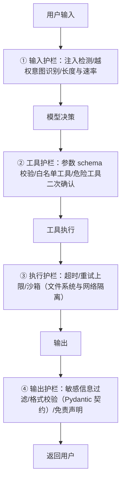

Agent评测与可观测-guards与成本
====

> 定位：agent"从零到一"主线第三章——**从"能跑"到"敢上线"**。前两篇解决了范式与构建（[范式全景](Agent范式全景-workflow与agent的边界.md)、[手写最小循环](从零手写最小Agent-无框架的模型循环.md)），专项机制见深潜四篇（[ReAct/LangGraph](ReAct与LangGraph工程实践.md)、[MCP](MCP协议与企业落地.md)、[结构化输出](结构化输出工程-Pydantic与LLM.md)、[身份链与工具安全](智能体的身份链与工具安全.md)）。这一篇是上线前的最后一关：agent 是概率性系统，**没评测就上线等于没测试就上线**——而 agent 的测试比传统单测难一个量级。
>
> **内容来源**：本篇为学习整理，综合参考（版权归原作者所有）：
> - [Demystifying evals for AI agents — Anthropic Engineering](https://www.anthropic.com/engineering/demystifying-evals-for-ai-agents)
> - [A Practical Guide to Building Agents — OpenAI](https://openai.com/business/guides-and-resources/a-practical-guide-to-building-ai-agents)（[中文译版](https://assets.jimmysong.io/books/a-practical-guide-to-building-agents-zh.pdf)）
> 表述与案例编排为本库原创加工，勘误以原文为准。

为什么 agent 评测比单测难
------

传统单测：输入确定 → 输出确定 → assert。agent 打破了这个前提的三面：

* **输出是自然语言**——同一个正确答案有一百种说法，字符串相等没法 assert；
* **路径不确定**——同一样任务，模型这次调 2 个工具、下次调 4 个，路径本身就是输出的一部分；
* **状态会变**——agent 执行中会改环境（写库、调 API），第 3 步的结果依赖第 1 步改了什么，测试要管环境搭建与清理。

所以 agent 评测的第一性原则：**别评输出文本，评"任务有没有完成"**——用端到端的判定器（grader），而不是逐字比对。

三层评测金字塔（从便宜到贵）
------

| 层 | 评什么 | 判定方式 | 成本 | 频率 |
|---|---|---|---|---|
| **单步评测** | 单个工具调用/单次生成的质量 | 精确/相似断言、LLM 当裁判打分 | 低 | 每次 prompt 改动跑全量 |
| **轨迹评测** | 中间步骤的合理性：调了哪些工具、顺序、参数 | 轨迹比对（期望工具序列的子集/超集）、LLM 裁判评轨迹 | 中 | 每日/每周回归 |
| **端到端评测** | 最终任务完成度 | 代码判定器（查 DB 断言/执行结果断言）或人工抽检 | 高 | 发布前 + 线上抽样 |

Anthropic 的三条工程经验（消化版）：

* **判定器自己也要被测**——LLM 当裁判（LLM-as-judge）时，先拿 50 个人工标注样本验证裁判的准确率，裁判不准整个评测体系是沙上城堡；
* **真实任务采样 > 人造用例**——从线上流量采真实任务（脱敏后）做评测集，人造用例的分布和线上差很远；
* **合成初态构造边界场景**——"工具返回空/返回错误/返回超长"这些边界初态靠线上流量等不到，人工合成初态直接测 agent 的韧性。

护栏（guards）：评测之外的运行时防线
------

评测是发布前的事，护栏是运行中每一轮的事。四道运行时防线（按拦截时机排序）：

对应到[身份链与工具安全篇](智能体的身份链与工具安全.md)的结论：**护栏的执行点全在你的运行时，不在模型**——模型拒绝越权是"建议"，代码校验才是"法律"。人审（HITL）是第五道：高危工具执行前挂起等确认，是 agent 与传统服务的最大运维差异。

可观测：轨迹必须落盘
------

agent 的每轮（模型输入/输出、工具点名、工具结果、耗时、token 数）都要结构化落盘——**线上排障的唯一依据**。三件套：

* **全轨迹日志**：按 session/trace 聚合，能重放一条完整决策链（本库 ai-service 的 SSE 事件流 + 服务端日志即此形态）；
* **指标三巨头**：任务完成率、平均轮数（步数失控的信号）、单任务 token 成本（预算失控的信号）；
* **采样回放**：线上抽样完整轨迹进评测集——评测集不更新的 agent 会随业务漂移悄悄变差。

成本与延迟：企业落地的硬约束
------

* **token 成本**：agent 的成本 = 轮数 × 每轮上下文——历史每轮都全量重发，长轨迹的上下文是平方级压力。手段：工具结果摘要、历史裁剪、便宜模型跑分类/路由（见[范式篇](Agent范式全景-workflow与agent的边界.md)路由模式）贵模型做主决策；
* **延迟**：多轮循环天然串行——能并行的工具调用让模型一次点多个（parallel tool calls），能 prefetch 的上下文提前拉；
* **降级链**：agent 不可用时降级到 workflow 或人工队列——agent 是能力增强，不是可用性依赖。

追问链
------

* agent 评测评什么？→ 端到端任务完成度（判 定器），不是输出文本相似度；轨迹评测评中间步骤的合理性；
* LLM-as-judge 可靠吗？→ 先用人工标注样本校准裁判，裁判准确率不达标就换代码判定器；
* 护栏放在哪一层？→ 全在运行时你的代码里：输入/工具参数/执行沙箱/输出四道，模型自身的拒绝是建议不是防线；
* token 成本怎么控？→ 历史裁剪 + 工具结果摘要 + 分级模型路由 + 轮数上限；最大的隐性成本是"步数失控"（指标三巨头之一）；
* agent 怎么灰度？→ 线上抽样轨迹进评测集 + 影子流量跑新版 agent 对比旧版轨迹差异 + 高危工具保持人工确认；
* 挂了怎么排障？→ 全轨迹结构化落盘可重放——没有轨迹落盘的 agent 出了事故等于黑盒。

面试官视角小结
------

评测题是 2025 之后 agent 岗的真正分水岭：能画出三层评测金字塔、知道"判定器要被测"、说出"护栏执行点在运行时不在模型"的，是体系化做过企业落地的；把"评测"等同于"随便问几个问题看回答"的，还没理解概率性系统的工程含义。最高分信号是主动报数字：任务完成率、平均轮数、单任务成本——agent 不可观测就不叫上线。

> 2026-11 新增（agent"从零到一"主线第三章；学习整理综合参考 Anthropic evals 工程文与 OpenAI 指南，见文首来源块）。上一篇：[从零手写最小Agent](从零手写最小Agent-无框架的模型循环.md)；下一篇：[多智能体编排与框架选型](多智能体编排与框架选型.md)。
