Agent长任务-进度状态与增量交付
====

> 定位：第三章「脚手架设计」第 5 篇（agent 系列第 16 篇）。[记忆系统篇](Agent记忆系统-从会话状态到跨会话记忆.md)讲跨会话记住"什么"，[验证回路篇](Agent验证回路-让智能体自己发现错了.md)讲每一轮怎么知道做对了。本篇回答把两者接起来的问题：一个要干几个小时甚至几天的任务，怎么跨过一次次上下文窗口的更替，稳定地往前推。主线是 Anthropic 的长任务脚手架实验，后半篇扩展到 2026-11 的"常驻智能体"。旁通 [多智能体编排篇](多智能体编排与框架选型.md)。
>
> **内容来源**：本篇为学习整理，综合参考（版权归原作者所有）：
> - [Effective harnesses for long-running agents — Anthropic](https://www.anthropic.com/engineering/effective-harnesses-for-long-running-agents)（2025-11，本篇主源）
> - [Building always-on agents — Anthropic](https://claude.com/blog/building-always-on-agents)（2026-11，五个原语）
> - Claude Code 官方文档：[Manage sessions](https://code.claude.com/docs/en/sessions)、[Checkpointing](https://code.claude.com/docs/en/checkpointing)、[Keep Claude working toward a goal](https://code.claude.com/docs/en/goal)、[Run prompts on a schedule](https://code.claude.com/docs/en/scheduled-tasks)、[Explore the context window](https://code.claude.com/docs/en/context-window)、[Best practices](https://code.claude.com/docs/en/best-practices)、[Dynamic workflows](https://code.claude.com/docs/en/workflows)、[Agent teams](https://code.claude.com/docs/en/agent-teams)
>
> 这些产品迭代很快，文中细节是 2026-11-25 的文档现状，勘误以官方文档为准。

一、问题：换班的人没有记忆
------

要让智能体稳定地跨过多个上下文窗口往前推进，目前仍是一个没有完全解决的问题。Anthropic 用一个比喻描述难点：这像一个全靠轮班运转的项目，每来一位新的工程师，都不记得上一班发生过什么。窗口有限，大多数复杂的项目又装不进一个窗口，中间需要一座桥。

他们的实验起点很能说明问题。即便用的是 Opus 4.5 这样的前沿模型，跑在 Claude Agent SDK 上、带自动压缩、在多个窗口间循环，如果只给一句"做一个 claude.ai 的克隆"，也做不出一个生产质量的网页应用。失败集中成两种模式：

* **一口气想做太多。** 模型总想一次把应用做完，常常在实现到一半时耗尽上下文，留给下一班的是一个做了一半、没有任何说明的功能。下一个智能体只能靠猜，还要花大量时间先把应用修到能跑。压缩也救不了，因为压缩并不总能给下一个智能体留下足够清晰的交代。
* **过早宣布完工。** 项目做了一部分之后，后来的智能体看一眼四周，发现已经有进展了，就宣布任务完成。

二、解法：把工作状态放到窗口外面
------

关键的一步是让新开窗口的智能体能迅速弄清工作的现状。Anthropic 的做法是两样东西：一份进度文件，加上 git 历史。

为此，第一个会话和后面的会话用不同的提示词。文档称它们为两个智能体，但脚注说得很清楚：系统提示、工具和整个脚手架完全相同，只是最初给的用户提示不一样。

**初始化智能体只在第一次运行。** 它负责搭好后续所有会话要用的环境：一个 `init.sh` 脚本，一份 `claude-progress.txt` 进度文件，一次初始的 git 提交。其中最有用的是一份**功能清单**：把用户最初的一句话展开成一份完整的需求文件。在克隆 claude.ai 的例子里有 200 多项，比如"用户可以打开一个新对话，输入查询，按回车，看到 AI 的回复"。每一项初始都标成"未通过"，这样后面的智能体一眼就知道完整的功能长什么样：

```json
{
  "category": "functional",
  "description": "New chat button creates a fresh conversation",
  "steps": [
    "Navigate to main interface",
    "Click the 'New Chat' button",
    "Verify a new conversation is created",
    "Check that chat area shows welcome state",
    "Verify conversation appears in sidebar"
  ],
  "passes": false
}
```

**编码智能体负责之后的每一次会话。** 规则有三条：

* **一次只做一个功能。** 这一条被证明是纠正"贪多"的关键。
* **只允许改功能清单里的通过状态。** 提示词用很强硬的措辞禁止删除或修改测试项。清单用 JSON 而不是 Markdown，是因为实验中模型更不会去不当地改动或覆盖 JSON 文件。
* **收工前留下干净的现场。** 做完一个功能就提交到 git，提交信息要写清楚，并把进展写进进度文件。这样做还有一个附带的好处：模型可以用 git 回退掉糟糕的改动，恢复到能工作的状态。"干净"的标准是代码可以直接合进主干：没有大 bug，有条理，有文档，下一个人不用先收拾别人的烂摊子。

**每次会话开始都先认路。** 先 `pwd` 看自己在哪个目录；读 git 日志和进度文件；读功能清单，挑优先级最高的未完成项；最后跑一遍 `init.sh` 和一个基本的端到端测试，确认应用没坏再动手。如果跳过最后这一步直接做新功能，很可能把问题越做越大。

四种常见的失败，各有对应的解法：

| 失败模式 | 初始化时 | 每次会话时 |
|---|---|---|
| 过早宣布整个项目完成 | 写功能清单 | 开场读清单，选定一个功能 |
| 留下一个有 bug、没有交代的环境 | 建 git 仓库和进度文件 | 开场读进度和提交记录，跑一遍基本测试；收工时提交并更新进度 |
| 过早把某个功能标成完成 | 写功能清单 | 仔细测试之后才标通过 |
| 花时间弄清怎么把应用跑起来 | 写 `init.sh` | 开场读它 |

三、Claude Code 里对应的部件
------

上面这套做法，在 Claude Code 里大多有现成的对应物，自己搭脚手架时可以照着做：

* **会话恢复。** 会话以明文记录存在本地，恢复时找回对话历史、模型、权限模式、没完成的目标和定时任务。两个边界要记住：进程结束时还在跑的工具调用不会重跑；后台任务没做完的，恢复后只留一条说明。
* **检查点。** 每个开启新回合的提示之前，Claude Code 都会给文件拍快照，默认保留最近 100 个。回退菜单可以只还原代码、只还原对话、两者都还原，或者从某个点开始把对话压缩成摘要。它只覆盖 Claude 用文件编辑工具做的改动，只用 Bash 改过的文件不在内，官方也明说它不替代版本控制。
* **目标（`/goal`）。** 设一个完成条件，每轮结束后由另一个小模型判定是否达成，没达成就自动开始下一轮。它管的是"别半途停下"，对没人看着的后台任务尤其有用。有两种保护：连续几轮只动嘴不调工具，循环会停下并交还控制权；后台任务拖了 30 分钟没结束，会触发一次"询问进度"。
* **循环（`/loop`）。** 按间隔重复跑一个提示。间隔可以固定，也可以让模型根据上一轮的观察自己定，在一分钟到一小时之间。不带提示时跑的是内置的"维护"流程：先接着做没完成的事，再照看当前分支的 PR（评审意见、失败的 CI、合并冲突），都没事了做一轮清理。
* **压缩时保留什么。** 根目录的 `CLAUDE.md`、计划模式下写的计划会被重新注入；最近改过的文件会重新读最多五个；技能正文按预算重挂。还可以挂一个压缩前的钩子，把它的输出当作这次摘要的指令——想保住什么，可以在那里说清楚。

把任务交给没人看着的智能体之前，文档建议过一遍五个问题：它知道什么叫做完了吗？它能检查自己的工作吗？它被允许碰什么？什么会让它停下来？结果交到哪里、谁签字？

四、从长任务到常驻：五个原语
------

2026 年 11 月，Anthropic 把这套经验推广成一篇"常驻智能体"的指南。先纠正一个说法：常驻智能体并不是真的常驻，那只是用户的感受。它大部分时间在睡，被事件或定时器唤醒，干一段活（称为一次运行），把发生的事存下来，接着睡。一次运行发生在一个会话里，会话就是消息和工具调用的记录。

围绕这个循环，脚手架由五个原语搭成：

| 原语 | 作用 | 要点 |
|---|---|---|
| 事件收件箱 | 各种来源的事件先进一个持久化的列表，再由工作进程来取 | 收件箱是唯一事实来源；同一时间只有一个活动的工作进程；把积压的事件合并处理 |
| 定时器 | 让智能体不等用户也能主动 | 分两种：自己给自己设的跟进期限，和按固定节奏重复的计划 |
| 记忆 | 跨越不相连续的运行 | 只存查不到的东西，别处已有的只存指针 |
| 权限 | 无人值守时的风险都在这里 | 凭据由智能体环境之外的代理注入；高危动作交给审查者；拿不准的调用推迟，等用户的答复作为新事件回来 |
| 发件箱 | 把结果送给用户 | 用户要的是结果，不是全过程；宁可一开始话少，再逐步赢得注意力 |

```mermaid
flowchart TD
    E["事件或定时器"] --> I["收件箱<br/>按来源标识去重"]
    I --> R["一次运行<br/>读记忆 / 干活 / 写记忆"]
    R --> O["发件箱"]
    O --> U["用户"]
    U -.->|回复成为新事件| E
    R -.->|设一个定时器| T["定时器存储"]
    T -.-> E
```



两点与长任务直接相通。其一，记忆分四类：用户的指令、对用户的了解、对用户说过的消息、任务的进度——最后这一类就是前面那份进度文件。其二，每次运行的开始都要加载系统提示、工具定义和记忆文件，这部分开销每次都付，所以要压到最小，并用上提示缓存。

五、多智能体不是第一步
------

任务一长，很容易想到"多派几个智能体"。三个层次的并行各有位置：

| 对比项 | 子代理 | 智能体团队 | 工作流 |
|---|---|---|---|
| 谁决定下一步 | 模型，逐轮决定 | 领队智能体，逐轮决定 | 脚本 |
| 中间结果放在哪 | 模型的上下文窗口 | 共享的任务清单 | 脚本变量 |
| 适合的规模 | 一轮里派出几个 | 几个长时间并行的同伴 | 一次运行几十到上百个 |
| 中断之后 | 这一轮重来 | 同伴继续跑 | 可以在同一会话里续跑 |

Claude Code 的文档对团队的态度很克制：它是实验性的，会增加协调开销，token 消耗也明显高于单个会话；建议从 3 到 5 个同伴起步，"三个专注的同伴常常好过五个散的"；两个同伴改同一个文件会互相覆盖；让一个团队长时间无人看管，会放大无效工作的风险。

Anthropic 自己在长任务那篇文章的结尾也说，单个通用的编码智能体和多智能体架构哪个更好，还没有结论。比较稳妥的顺序是：先把单个智能体的进度状态和验证回路做扎实，再考虑并行。

六、追问链
------

* 一个任务要跨好几个上下文窗口，怎么保证不跑偏？→ 把工作状态放到窗口外面：进度文件加 git 历史，让新开的窗口能迅速认清现状。
* 智能体总想一口气做完怎么办？→ 给它一份展开后的功能清单，一次只做一个功能，每个功能做完就提交。
* 智能体过早宣布完工怎么办？→ 清单里的每一项初始都标成未通过，只有仔细测过才能改；每次会话开场先读清单。
* 为什么清单用 JSON？→ 实验中模型更不会去不当地改动或覆盖 JSON，Markdown 更容易被改写。
* Claude Code 里有哪些现成的对应物？→ 会话恢复、检查点、`/goal`、`/loop`，以及压缩时对 `CLAUDE.md` 和计划的重注入。
* 常驻智能体怎么搭？→ 五个原语：事件收件箱、定时器、记忆、权限、发件箱。它不是真的常驻，而是被事件唤醒、干一段、再睡。
* 长任务要不要上多智能体？→ 不急。先做扎实单个智能体的进度状态和验证回路；团队会增加协调开销和 token 消耗。

一句话总结
------

**长任务的关键不是让窗口更大，而是让每个新开的窗口都能迅速认出现状：初始化时备好脚本、进度文件和一份全标未通过的功能清单，之后一次只做一个功能、做完就提交，开场先认路再动手——常驻智能体只是把这套循环扩展成事件、定时器、记忆、权限、发件箱五个原语。**

> 2026-11 新增（学习整理篇 · 第三章「脚手架设计」第 5 篇 · 素材来自 Anthropic 工程文章与 Claude Code 官方文档）。
