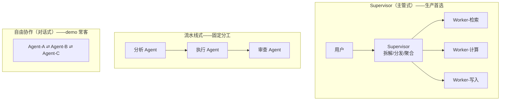

多智能体编排与框架选型
====

> 定位：agent"从零到一"主线的收官章。范式（[全景篇](Agent范式全景-workflow与agent的边界.md)）、构建（[手写循环](从零手写最小Agent-无框架的模型循环.md)）、深潜四篇（[ReAct/LangGraph](ReAct与LangGraph工程实践.md)、[MCP](MCP协议与企业落地.md)、[结构化输出](结构化输出工程-Pydantic与LLM.md)、[身份链与工具安全](智能体的身份链与工具安全.md)）、评测上线（[评测与可观测](Agent评测与可观测-guards与成本.md)）都走完，这一篇回答最后两问：**什么时候需要多个 agent**、**框架怎么选**。
>
> **内容来源**：本篇为学习整理，综合参考（版权归原作者所有）：
> - [从零开始构建智能体 — Datawhale hello-agents](https://github.com/datawhalechina/hello-agents)
> - [深入理解AI Agent：设计原理与工程实践 — 李博杰](https://github.com/bojieli/ai-agent-book)
> - [Building Effective Agents — Anthropic](https://www.anthropic.com/research/building-effective-agents)（多代理模式的克制警告）
> 表述与案例编排为本库原创加工，勘误以原文为准。

先泼冷水：多智能体的适用面比博客窄得多
------

Anthropic 在 BEA 里反复警告的那句话值得贴在墙上：**能用单 agent + 合适工具解决的，不要上多智能体**。多代理的真实代价清单：

* 上下文分裂：A agent 看不到 B 的完整推理过程，信息在交接时必然有损；
* 错误放大：上游的误判在下游被"认真执行"，误差沿链复利；
* 成本翻倍：每个 agent 都是一份完整的 prompt + 循环 + 重试预算；
* 调试难度指数级：单 agent 的轨迹已经难排，多 agent 的交互轨迹是排障地狱。

**多智能体的真实信号只有一个：单一上下文装不下**——要么工具太多（几十个工具挤一个 prompt，模型选不准），要么职责割裂（代码生成与代码审查需要对立视角），要么物理隔离（不同 agent 不同权限级别，见[身份链篇](智能体的身份链与工具安全.md)）。三个信号都不满足，就单 agent。

三种多代理拓扑（按可控性递减）
------

| 拓扑 | 协调方式 | 适用 | 风险 |
|---|---|---|---|
| Supervisor | 一个主 agent 持全局状态，分发/回收 | 大多数企业场景（工具多/需权限分级） | Supervisor 成为单点瓶颈，prompt 膨胀 |
| 流水线 | 固定顺序交接，接口即契约 | 步骤可枚举的流水作业（生成→审查→修复） | 接口设计僵化，中间态不可逆 |
| 自由对话 | agent 互发消息自组织 | 探索性研究、头脑风暴 demo | **不可控不收敛，生产慎用** |

企业落地的默认答案是 **Supervisor**：它保留了"模型拆任务"的灵活性，又把全局状态、权限边界、成本预算收在一个可控点——与[范式篇](Agent范式全景-workflow与agent的边界.md)的编排者-执行者 workflow 是同一思想的 agent 化。

框架选型：一张决策表
------

2025 年的框架生态已经收敛出清晰的分层（选型依据=团队语言栈+控制粒度需求）：

| 框架 | 语言 | 抽象层级 | 亮点 | 什么时候选它 |
|---|---|---|---|---|
| **自研循环** | 任意 | 零抽象（[60 行](从零手写最小Agent-无框架的模型循环.md)） | 完全可控、零学习成本 | 单 agent + 线性循环 + 强合规审计要求 |
| **LangGraph** | Python/JS | 状态图（节点+边+检查点） | checkpointer 人工介入、状态机语义、生产案例多 | 需要人工审批/中断恢复/复杂分支（本库 ai-service 同栈） |
| **OpenAI Agents SDK** | Python/TS | 手写循环 + handoff 原语 | 轻量（OpenAI 官方明确反对重框架）、guarded loop 内置 | OpenAI 栈 + Supervisor 拓扑 |
| **CrewAI** | Python | 角色扮演协作 | 上手快、角色隐喻直观 | 原型验证、内容生成类流水线 |
| **AutoGen** | Python | 对话式多代理 | 研究型多代理对话 | 研究探索，生产慎用 |
| **Spring AI Alibaba** | Java | Spring 生态集成 | Java 团队零栈迁移 | Java 微服务企业（star-site 同栈的候选） |

选型的两条硬纪律（本库 ai-service 的实际路径印证）：

1. **先手写再框架**：60 行循环跑通了业务的 POC，再决定要不要框架——跳过手写直接上框架，团队永远不知道框架在替你做什么，出了问题只能整链丢弃；
2. **框架的退出成本在选型时评估**：LangGraph 的状态图绑定深，CrewAI 的角色抽象绑定浅——选型时问一句"半年后想换掉它要改多少"。

与本库 ai-service 的对照（实战反哺）
------

ai-service 的[ReAct 与 LangGraph 实践](ReAct与LangGraph工程实践.md)是"单 agent + 状态机"形态：MemorySaver 按会话隔离记忆、SSE 流式吐事件、ContextVar 注入身份——**没有上多代理**，因为体检解读链路的子任务可枚举（提示链就够，见[范式篇](Agent范式全景-workflow与agent的边界.md)的三问）。框架选的是 LangGraph 而非手写，因为**人工介入与检查点**两个信号真实存在（医生复核报告解读的中间态）。这条路径完整走过了"手写判断 → 信号出现 → 引框架"的正确顺序，本身就是选型篇的活案例。

追问链
------

* 什么时候需要多智能体？→ 单一上下文装不下：工具过多/职责对立视角/物理权限隔离——三信号同时评估，缺一个都先单 agent；
* Supervisor 和流水线怎么选？→ 子任务动态未知选 Supervisor（模型拆）；步骤固定选流水线（接口即契约）；
* 多代理的信息损失怎么缓解？→ 交接载荷结构化（Pydantic 契约）+ 全局轨迹日志（每个 agent 的输入输出落盘可回放）+ Supervisor 持全局摘要；
* 框架选型最先问什么？→ 团队语言栈 + 三个信号（检查点/图编排/多 agent 状态）——不是比 star 数；
* 多代理的成本怎么算？→ 每 agent 一份循环预算叠加 + 交接损耗；Supervisor 的 prompt 膨胀是最常见的失控点；
* 为什么说"自由对话式"不适合生产？→ 无收敛保证、无全局状态、轨迹不可审计——与[评测篇](Agent评测与可观测-guards与成本.md)的"轨迹必须可回放"直接冲突。

面试官视角小结
------

多智能体题是 2025-2026 的重灾区，区分度全在**克制**：主动说"我们评估过多代理最后用了单 agent"的候选人，是做过真决策的；一开口"CrewA AM 多角色协作很成熟"的，是把 demo 当了生产。追问"你的多代理怎么排障"——答得出全局轨迹回放和交接契约的，是趟过生产；答"看各自日志"的，是没上线过。终极题是"手写 vs LangGraph"——能讲清三个引入信号与退出成本的，框架观就成熟了。

> 2026-11 新增（agent"从零到一"主线收官章；学习整理综合参考 hello-agents/李博杰书/Anthropic BEA，见文首来源块；ai-service 选型路径实战反哺）。本篇是主线终点——回到[范式全景](Agent范式全景-workflow与agent的边界.md)可以把整条线串成一遍。
