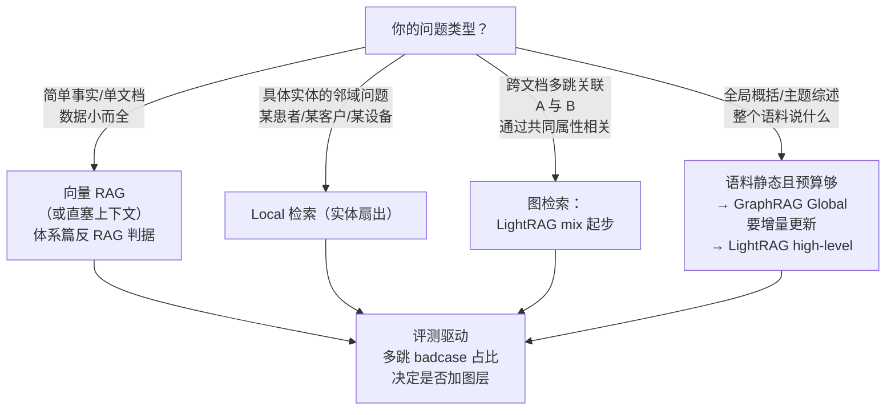

GraphRAG与知识图谱检索-多跳问题的解法
====

> 定位：rag 专题第 4 篇，[RAG体系与项目定位](RAG体系与项目定位.md)的进阶续作。体系篇给了五段工程与"反 RAG 判据"，本篇回答它留下的下一个问题：**向量检索天生连不上"点"——多跳关联与全局概括问题怎么解**。前接 [向量检索选型](向量检索选型-pgvector-Redis-Milvus-Qdrant.md)（ANN 是块级相似）、[RAG切分策略实战](RAG切分策略实战.md)，旁通 agent 侧的 [上下文工程](../上下文工程/Agent上下文工程-注意力预算与四板斧.md)（JIT 检索）与 [记忆系统](../上下文工程/Agent记忆系统-从会话状态到跨会话记忆.md)（图库做 archival 记忆）。
>
> **内容来源**：本篇为学习整理，综合参考（版权归原作者所有）：
> - [GraphRAG 官方文档 — Microsoft](https://microsoft.github.io/graphrag/)（索引管线与四种查询模式，论文 [arXiv:2404.16130](https://arxiv.org/abs/2404.16130)）
> - [LightRAG — HKUDS/LightRAG](https://github.com/HKUDS/LightRAG)（双层检索、增量更新与评测胜率表，论文 arXiv:2410.05779）
> 表述与案例编排为本库原创加工，勘误以原文为准。

一、向量 RAG 的结构性短板：相似度连不上"点"
------

[体系篇](RAG体系与项目定位.md)的五段工程里，检索 = ANN 粗召回 + 重排 + 混合检索补词法——但这个架构有一个**结构性**的限制：检索单元是"与 query 相似的块"。Microsoft GraphRAG 文档点出 baseline 向量 RAG 的两类失败：

* **连不上点（connect the dots）**：多跳问题的答案分散在多个片段里，靠"共同属性"关联。文档 A 说"转氨酶 X 偏高常见于脂肪肝"，文档 B 说"某患者的转氨酶 X 连续三年偏高且 BMI 超标"——**A 和 B 彼此并不相似**（一个讲病理、一个讲病例），任何以 query 相似度为信号的检索都召回不全。向量嵌入度量的是"局部相似"，而多跳要的是"关系遍历"；
* **全局概括（query-focused summarization）**："这批体检报告整体反映出什么共性问题？"——答案需要对**整个语料集合**做综合，而不是取 top-k 个相似块。

用体检域打个比方（衔接[体系篇](RAG体系与项目定位.md)第四节的"历年对比"升级路径）：单份报告解读用 SQL 直取就行；**跨年份、跨文档**地问"哪些指标的异常组合在逐年指向同一风险"——这就是向量 RAG 连不上点的场景。

解法思路：把检索单元从"相似块"升级为**"实体—关系—结构"**：LLM 把语料抽成知识图谱，检索在图上走。两条代表路线：Microsoft GraphRAG（社区摘要派）与 LightRAG（轻量增量派）。

二、Microsoft GraphRAG：把语料变成一张"社区地图"
------

索引管线五步（一次性的离线构建，LLM 调用是大头）：

```text
语料 → ① 切成 TextUnits（分析单元 + 细粒度引用锚点）
     → ② LLM 抽取实体/关系/关键声明（人/地/组织/指标…及其关系）
     → ③ Leiden 算法做层次化社区检测（图聚类，多层）
     → ④ 自底向上逐层生成社区摘要（community summaries）
     → ⑤ 查询时按问题类型选择检索方式
```

四种查询模式（官方文档口径）：

| 模式 | 检索机制 | 适合 |
|---|---|---|
| **Basic** | 普通 top-k 向量检索（baseline 保留） | 简单事实查询——图谱不取代向量 |
| **Local** | 从命中实体向邻居与关联概念**扇出** | 具体实体的问题（"某患者的指标关联"） |
| **Global** | 遍历**社区摘要**做 map-reduce 式汇总 | 全局概括（"整个语料反映出什么"） |
| **DRIFT** | Local 扇出 + 社区信息叠加 | 兼顾局部细节与全局语境 |

工程上必须看清的两个代价：

* **索引 token 成本高**：实体抽取 + 逐社区摘要全走 LLM，官方明确建议先做 prompt tuning 再上生产（默认 prompt 未必最优）；
* **增量更新弱**：新文档进来，社区结构理论上要重算——文档没有提供增量方案，大版本间还要靠迁移 notebook 避免全量重建。**适合相对静态的语料**（研究报告、商业文档、内部沉淀），不适合高频变更的数据。

三、LightRAG：轻量路线（增量更新 + 双层检索）
------

LightRAG 对 GraphRAG 的定位是"高效替代"，两个关键取舍：

* **砍掉社区报告与图上多跳遍历**——不靠"昂贵的社区检测 + 摘要生成"，索引和查询的 LLM 调用次数大幅下降；
* **双层检索补回综合能力**：
  * **low-level（实体层）**：检索候选实体及其直接关联属性——细节事实、精确匹配；
  * **high-level（关系层）**：检索覆盖宏观主题的**关系链**——跨文档推理、抽象概念；
  * 两层结果合并，同时召回"具体事实 + 抽象主题"。

增量更新是它最实在的生产优势：**新文档只需插入节点和关系，不重建全图**；删除文档时用索引期建立的 **LLM 缓存**只重建受影响的实体和关系，还配套治理工具（`kg_integrity_repair` 审计恢复锚点、`gc_llm_cache` 清理孤儿缓存）。

五种查询模式：`naive`（纯向量）/ `local` / `global` / `hybrid`（local+global）/ `mix`（三路合并，**默认且通常最佳**，reranker 已默认内建）。论文的四领域胜率（Overall，LightRAG 对各基线）：

| 基线 | Agriculture | CS | Legal | Mix |
|---|---|---|---|---|
| NaiveRAG | 67.6% | 61.2% | 84.8% | 60.0% |
| HyDE | 75.2% | 58.4% | 73.6% | 57.6% |
| **GraphRAG** | 54.8% | 52.0% | 52.8% | 49.6% |

注意读法：对 NaiveRAG/HyDE 优势显著；**对 Microsoft GraphRAG 全胜但差距最小（法务仅略胜）**——结构性强、全局概括需求重的领域，社区摘要仍有它的价值。第三方实测也一致：多跳场景图谱系胜出，**简单问答传统向量 RAG 反而更优**，融合方案约 +6.4%。

部署形态（生产可用的信号）：四类存储（KV/向量/图/文档状态）可全包在 **PostgreSQL**（官方推荐），也可专用组合（Milvus/Qdrant 做向量、Neo4j/Memgraph 做图）；Docker Compose/K8s/离线部署齐备。模型按角色分工是成本工程的好样板：**EXTRACT 用快模型**（Haiku/mini 级）、**QUERY 用强长上下文模型**、KEYWORD 用轻量模型、embedding 低维快速、reranker 本地 bge——与 [模型选型篇](../llm基础/2026-10模型生态与选型-没有全能冠军.md)的分级路由同构。

四、选型决策：什么时候上图谱
------



成本阶梯与三条决策线：

* **成本阶梯**：naive 向量 < LightRAG（增量、无社区报告）< GraphRAG（全量社区摘要）。图谱是**更贵的检索**，索引侧的 LLM 消耗是主要增量；
* **数据变更频率线**：高频变更 → LightRAG（增量插入 + 缓存重建）；静态沉淀 → GraphRAG 社区摘要才划算；
* **反 RAG 判据依然优先**：[体系篇](RAG体系与项目定位.md)三判据（数据小而全/结构化权威/答案是渲染不是综合）命中就别上 RAG，更别上图谱——图谱解决的是"向量 RAG 都不够"的场景，不是"要不要 RAG"的场景。

与库内其他篇的连接：agent 侧 [记忆系统](../上下文工程/Agent记忆系统-从会话状态到跨会话记忆.md)里 Letta 的 archival memory、Mem0 的实体信号检索，本质都是"图/实体作为知识的组织形态"——**知识图谱是跨会话记忆与跨文档检索的公共底座**。

五、落地清单：企业知识库视角
------

* **先向量后图谱，评测驱动升级**：先用五段工程跑通，统计 badcase 里"多跳关联"与"全局概括"的占比——占比不高就别上图谱（第三方实测：简单问答向量 RAG 更优）；
* **摄入质量决定图质量**：文档解析用 MinerU/Docling（LightRAG 已内置，v1.5 起处理图像/表格/公式），切分策略含语义/段落级——坏解析进图谱就是坏实体坏关系；
* **图谱治理三件事**：实体对齐（同一实体不同叫法，LLM 抽取最易漂移的点）、抽取幻觉（用原文引用锚点校验，TextUnits 的细粒度引用就是为此）、一致性维护（`kg_integrity_repair` 类工具常态化跑）；
* **检索质量评测**：图谱路线的检索层评测与向量 RAG 同构（召回率@k、上下文精度），生成层看忠实度——评测指标体系是 rag 目录的下一块空白，留待专篇。

六、追问链
------

* GraphRAG 和向量 RAG 的本质区别？→ 检索单元变了：从"与 query 相似的块"变成"实体—关系—社区结构"。相似度是局部信号，多跳要关系遍历，全局概括要结构化摘要；
* 为什么多跳问题向量检索必败？→ 多跳答案的各片段靠共同属性关联，彼此不相似——任何以 query 相似度为信号的检索都召回不全，这是结构性限制不是调参能救的；
* LightRAG 为什么比 GraphRAG 便宜？→ 砍了社区报告与图上多跳遍历，双层检索（实体层+关系层）补回综合能力；增量更新只补节点关系不重建全图；
* 那 GraphRAG 还有存在价值吗？→ 有：全局概括/主题综述类问题，社区摘要的 map-reduce 是正解（法务领域 LightRAG 也仅略胜）；语料静态、一次性索引成本可接受时是好选择；
* 什么时候不该上图谱？→ 简单事实查询（向量够）、数据小而全/结构化（体系篇反 RAG 判据）、高频变更且预算紧（索引 LLM 成本）。默认从向量起步，多跳 badcase 占比说话；
* 图谱的质量坑在哪？→ LLM 抽取的实体对齐（同名异写）与幻觉。解法：原文引用锚点校验 + kg_integrity 类一致性工具 + 抽取用快模型但要有治理通道；
* 和传统知识图谱（KG）什么关系？→ LLM 抽取取代了人工 schema 与标注，但老问题没变：实体对齐、更新、质量治理——图谱工程的经验全部适用，只是"建图成本"降了一个量级。

一句话总结
------

**向量检索连不上"点"：多跳靠关系遍历、全局靠结构摘要。Microsoft GraphRAG 用社区摘要换全局理解（贵、静态），LightRAG 用双层检索+增量更新换落地性（便宜、动态）——先向量起步、按多跳 badcase 占比决定是否上图，反 RAG 判据永远优先于"更高级的检索"。**

面试官视角小结
------

GraphRAG 这道题，及格线是知道向量检索的短板：多跳问题要的是关系，全局概括要的是结构，两样都不在"最相似的几段"里。最大的区分度在克制。上过生产的人会先说成本——全量社区摘要要为整个语料跑一遍模型，也不好增量更新——再说"我们按多跳 badcase 的占比决定上不上"；一上来就讲"GraphRAG 比向量检索先进"的，多半只跑过 demo。追问两条路线怎么选，能按"语料静不静态、要不要增量更新、预算够不够"来答的，是真比较过。最高分信号是主动提反 RAG 判据：数据小而全、结构化程度高的时候，不该上检索，更不该上图谱。

> 2026-11 新增（学习整理篇 · 素材来自 Microsoft GraphRAG 官方文档与 HKUDS/LightRAG 论文仓库）。
