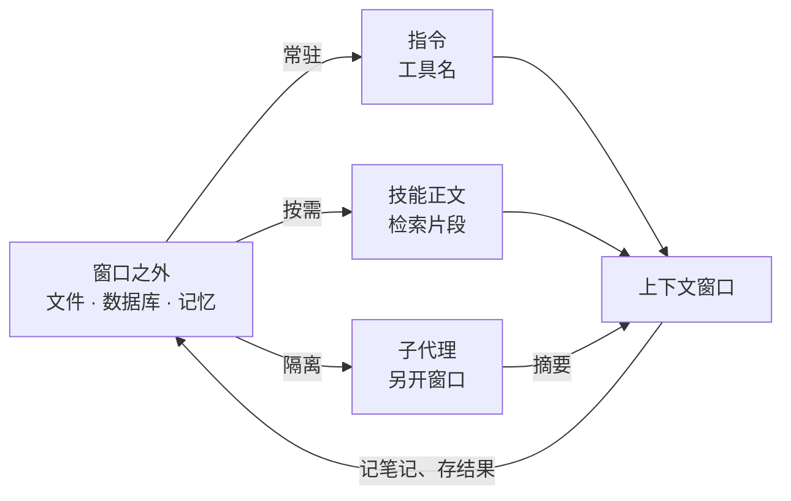

上下文工程总览-窗口里该放什么
====

> 定位：「上下文工程」系列第 1 篇，全系列的地图。先把四个容易混用的词分清——窗口、上下文、记忆、缓存——再给一个统一模型：进窗口的每样东西都要回答四个问题（放什么、何时放、留多久、多少钱），后面五篇各展开一处。读完这篇不用记细节，知道遇到什么问题该翻哪一篇就够了。
>
> **内容来源**：本篇是导览，事实与数字都出自后面各篇引用过的材料（Anthropic 的工程文章与研究、Claude Code 官方文档、各家模型的缓存文档），出处见各篇头部。"四个问题"的划分和"桌面与仓库"的比方是本文的归纳，不是哪份文档的原话。

一、四个词：窗口、上下文、记忆、缓存
------

这四个词经常换着用，工程上却各管一件事：

| 词 | 是什么 | 它关心的是 |
|---|---|---|
| 上下文窗口 | 模型一次调用能看到的 token 上限，输入和输出共用 | 装不装得下 |
| 上下文 | 这次调用实际进窗口的全部内容：系统提示、工具定义、对话历史、检索片段、工具结果 | 里面放了什么 |
| 记忆 | 从经验里得到、跨会话保留、之后能读回的内容 | 什么值得带到下一次 |
| 缓存 | 对已经处理过的那部分上下文保留的计算结果 | 同样的内容要不要重算一遍 |

用桌面打比方：**窗口是桌面的大小，上下文是此刻摊在桌面上的东西，记忆是书架和文件柜，缓存是已经切配好、不用重做的半成品**。

三句话把关系说清：

* **窗口是容量，上下文是内容。** 窗口标称多少万 token，说的是桌面有多大；上下文工程管的是桌上摊什么、什么时候摊、什么时候收。
* **记忆在窗口外面。** 记忆平时存在文件或数据库里，每次会话只取一小部分进上下文；会话结束，上下文清空，记忆留下。上下文是从仓库里取出来摊在桌面上的那部分，记忆是仓库。
* **缓存不改变模型看到什么，只改变这次调用的价钱和等待时间。** 它对上下文工程的影响是间接的：缓存按前缀匹配，开头一段没变才命中，所以内容的先后顺序、改动的方式都要为它着想。

二、一个模型：每样东西回答四个问题
------

上下文工程，Anthropic 的定义是在每次推理时策展并维护最优的 token 集合。落到工程上，就是进窗口的每样东西都要答得出下面四个问题。

**放什么。** 总纲是找"能最大化期望结果的最小高信号 token 集合"。两个方向都要管：少了缺信号，多了是噪音和账单——没被调用的工具定义照样占预算，没被引用的检索片段照样稀释注意力。

**何时放。** 不是所有东西一开始就放进去。Claude Code 分三层供给：常驻层每个请求都带，按需层用到才进，隔离层另开窗口。它的示例会话里（文档给的示意数字），用户开口之前常驻层已经占了约 7,850 个 token，其中项目指令文件的 1,800 是最大的一项可配置开销——常驻的东西，每个字都贵。

**留多久。** 历史每一轮都在变长。用过的工具结果、读完的文件，该折成摘要的折，该挪出去的挪出去。单次调用的上下文工程是配比问题，循环里的是生命周期问题：进窗口的东西都要答得出"它对第 N 轮还有用吗，什么时候退役"；值得带到下一次会话的，另存成记忆。

**多少钱。** 模型不记得上一轮，每一轮脚手架都要把全部上下文重发一遍，每个 token 每一轮都重新计费。所以上下文工程有一半是成本工程：同样的内容排得靠前、不轻易改动，才能命中缓存。

三、窗口里的五类内容
------

按"多久变一次"给窗口里的东西分类，四个问题的答案就有规律可循：

| 内容 | 例子 | 多久变一次 | 何时放 | 留多久 |
|---|---|---|---|---|
| 指令 | 系统提示、常驻指令文件 | 基本不变 | 会话一开始，放最前 | 整个会话 |
| 工具定义 | 工具的名称与参数、技能的描述 | 工具集合变了才变 | 紧跟指令；多到一定程度，改成搜到才展开 | 整个会话 |
| 知识 | 检索片段、读进来的文件、技能正文 | 因任务而异 | 用到才进 | 用完就可以走 |
| 历史 | 对话消息、工具结果 | 每一轮都在长 | 追加在最后 | 及时压缩 |
| 记忆 | 用户偏好、领域事实 | 会话之间才变 | 会话开始时只进索引 | 平时在窗口外 |

这张表从上到下，变化越来越快。变化慢的排前面，是缓存的要求；变化快的放后面、及时清理，是压缩和按需加载的要求。两头合起来，就是"少变的在前、易变的在后"。

下面这张图是同一件事的另一种画法：东西从窗口之外经三条路进窗口，用完的大块内容再以文件和笔记的形式回到窗口之外，窗口里只留摘要。

四、五篇各管哪一段
------

| # | 篇目 | 范围 | 一句话 |
|---|---|---|---|
| 2 | [上下文工程-Context Engineering](上下文工程-Context%20Engineering.md) | 一次调用 | 窗口是预算表：五个账户怎么配比，长对话怎么压缩，内容放在哪里更管用 |
| 3 | [Agent上下文工程-注意力预算与四板斧](Agent上下文工程-注意力预算与四板斧.md) | 一个循环 | 先记账再动手：按需检索、压缩、记笔记、派子代理 |
| 4 | [Agent上下文分层-常驻按需与工具太多怎么办](Agent上下文分层-常驻按需与工具太多怎么办.md) | 整个脚手架 | 常驻的写小，其余按需加载，大块的交给子代理，顺序为缓存安排好 |
| 5 | [Agent记忆系统-从会话状态到跨会话记忆](Agent记忆系统-从会话状态到跨会话记忆.md) | 跨会话 | 经验加工成读得回的笔记，只进索引，空闲期整理纠错 |
| 6 | [提示词缓存-让重复的上下文变便宜](提示词缓存-让重复的上下文变便宜.md) | 成本 | 重复的前缀为什么便宜，什么会打断它，怎么看命中率 |

范围由内到外：一次调用、一个循环、整个脚手架、跨会话。成本贯穿始终，所以缓存放在最后。

五、按症状找篇目
------

| 遇到的问题 | 先去哪一篇 | 一句话提示 |
|---|---|---|
| 多轮对话越来越慢、越来越贵 | 第 2 篇、[第 6 篇](提示词缓存-让重复的上下文变便宜.md) | 先看历史占了多少，再看缓存命中了多少 |
| 改了一个工具定义、换了个模型，下一轮突然变慢变贵 | [第 6 篇](提示词缓存-让重复的上下文变便宜.md) | 前缀变了一处，后面全部重算；把这类改动放在任务的间隙 |
| 用户早先说的约束，后面忘了 | 第 2 篇 | 先判断是"不在窗口里"还是"在窗口里但没用上"，两种病两种药 |
| 工具返回的结果把窗口撑爆 | 第 3 篇 | 工具结果进历史之前先压缩，明细留在窗口外 |
| 长任务做到一半接不上 | 第 3 篇 | 把进度写成窗口外的笔记，每一步都能从笔记接着干 |
| 工具一多就选错、填错 | 第 4 篇 | 定义延迟加载，搜到才展开 |
| 常驻指令越写越长，却不怎么管用 | 第 4 篇 | 只写模型自己查不到的，控制在 200 行以内 |
| 想让智能体记住用户偏好 | 第 5 篇 | 先分清要的是断点续跑还是记忆 |
| 记住的东西是错的 | 第 5 篇 | 拿会话日志当依据，空闲期整理，留删除出口 |

六、三个常见误解
------

**"窗口够大，就不用管了。"** 不对，但反过来说也不对。一方面，窗口越长，模型对内容的平均回忆越差，无关内容既花钱又是噪音；另一方面，Claude Code 的文档已经把"激进地管理窗口"列进了可以停做的旧建议，因为多数在用的模型窗口够大、还会自动压缩。两边合起来，问题就从"怎么塞得下"变成了"什么时候让模型看到什么"。

**"记忆就是把对话历史存下来。"** 存下来的对话历史是会话状态，用来断点续跑；记忆是把经验加工成下次用得上的东西。LangGraph 的 checkpointer 属于前者。把两者混为一谈，要么做出一个只会回放的存档，要么把一份会过期的日志当成了知识。

**"上下文工程就是提示词工程换个说法。"** 提示词工程优化一段指令的措辞；上下文工程管进窗口的全部内容，而且在循环里每一轮都要重新策展。前者是后者的子集。

七、和相邻系列怎么接
------

* [agent 系列](../agent/)是部件清单：范式、手写循环、评测、编排、ReAct、MCP、结构化输出、身份链、人机协同。上下文工程是从里面单拎出来的一条线；
* [脚手架设计系列](../脚手架设计/)讲把这些做法做成产品：上下文怎么分层只是其中一块，另外还有工具、验证、长任务、技能和 MCP；
* [rag 系列](../rag/)是知识的来源：检索到什么、怎么切、怎么选向量库。检索和注入是两个独立的决策，召回了多少不等于要塞进去多少；
* [推理与部署篇](../推理与部署/自托管LLM推理-vLLM与SGLang.md)是缓存的服务端视角：自托管时 KV cache 怎么占用显存、怎么调度。

八、追问链
------

* 你说说上下文工程是什么？→ 管每次调用进窗口的全部内容。拆开是四个问题：放什么、何时放、留多久、多少钱；
* 窗口、上下文、记忆、缓存怎么区分？→ 窗口是容量，上下文是这次装进去的内容，记忆在窗口外面、用时取，缓存管的是同样的内容要不要重算；
* 这几篇为什么按这个顺序排？→ 范围由内到外：一次调用、一个循环、整个脚手架、跨会话。成本贯穿始终，所以缓存放最后；
* 上下文和记忆是什么关系？→ 记忆是仓库，上下文是从仓库取出来摊在桌面上的那部分。所以记忆的注入层要小，只进索引；
* 缓存对上下文的安排有什么要求？→ 缓存按前缀匹配，所以少变的放前面，按需的内容追加在后面，不改写开头；
* 上手第一步做什么？→ 先记账：系统提示、工具定义、历史、检索片段各占多少，用户开口之前窗口已经被占了百分之几。

一句话总结
------

**窗口是桌面不是仓库：进窗口的每样东西都要答得出放什么、何时放、留多久、多少钱——少变的排在前面，用得上的才进来，用完的及时收走，值得带走的存成记忆。**

面试官视角小结
------

上下文工程这道题，区分度在有没有整体观。一上来就把窗口当成预算、从"放什么、何时放、留多久、多少钱"几个维度展开的，是有体系的；直接跳进去讲"我会做摘要压缩"的，是只做过单点优化。往下挖：常驻、按需、隔离三层供给能讲清的，是研究过成熟产品；能分清"记忆"和"会话状态持久化"、说出"错误记忆比没有记忆更糟"的，是真正做过记忆。最高分信号是主动谈成本——每一轮都重发全部上下文，所以顺序和改动方式都要为缓存着想，很多人答到这里就停了。

> 2026-11 新增（导览篇 · 「上下文工程」系列第 1 篇 · 归纳自本系列各篇）。
