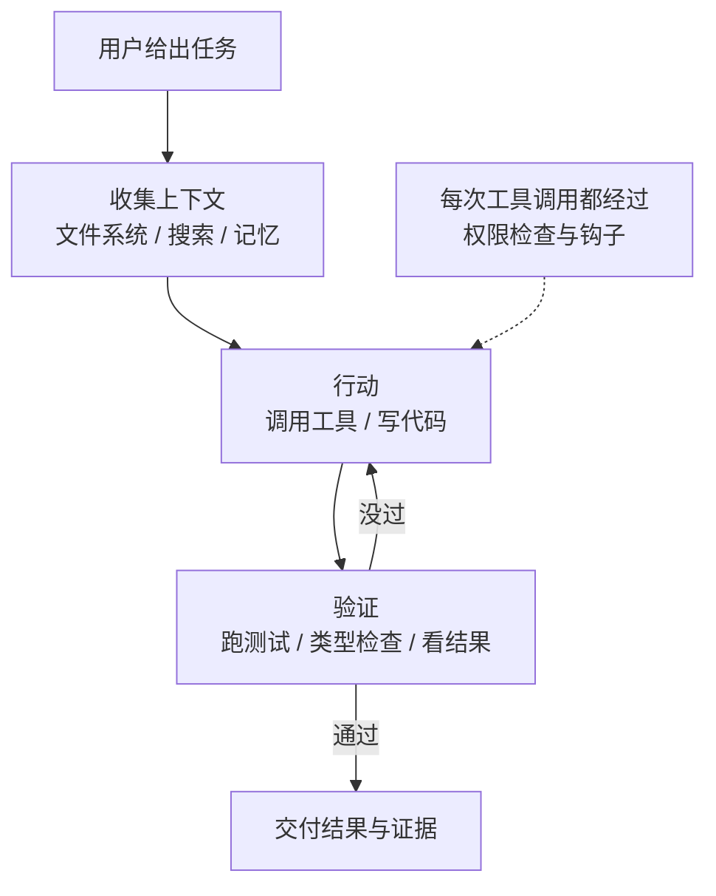

Agent脚手架总览-ClaudeCode好用在模型之外
====

> 定位：「脚手架设计」系列第 1 篇。本系列是 agent 系列的延伸：[手写最小 Agent](../agent/从零手写最小Agent-无框架的模型循环.md)给出了六十行的模型循环，[上下文工程](../agent/Agent上下文工程-注意力预算与四板斧.md)、[记忆系统](../agent/Agent记忆系统-从会话状态到跨会话记忆.md)、[人机协同](../agent/Agent人机协同-从头部智能体看审批与权限设计.md)各讲了一个部件。这一系列换个问法：同一个模型，为什么放进 Claude Code 就好用，自己拼出来的就不行？答案在模型之外的那一层。本篇是全系列的地图：先给"脚手架"下定义，再拆 Claude Code 的脚手架由什么组成，后面五篇各展开一块。旁通 [ClaudeCode使用实践](../工程工具/ClaudeCode使用实践.md)（使用者视角的配置资产）。
>
> **内容来源**：本篇为学习整理，综合参考（版权归原作者所有）：
> - Claude Code 官方文档：[How Claude Code works](https://code.claude.com/docs/en/how-claude-code-works)、[Extend Claude Code](https://code.claude.com/docs/en/features-overview)、[Best practices](https://code.claude.com/docs/en/best-practices)
> - [Building agents with the Claude Agent SDK — Anthropic](https://claude.com/blog/building-agents-with-the-claude-agent-sdk)（2025-09）
> - [Harness engineering: leveraging Codex in an agent-first world — OpenAI](https://openai.com/index/harness-engineering/)（2026-02）
>
> 这些产品迭代很快，文中细节是 2026-11-25 的文档现状，勘误以官方文档为准。

一、脚手架是什么：模型之外、管工具和上下文的那一层
------

Claude Code 文档里有一句话可以直接当定义：Claude Code 是模型外面的一层，负责提供工具、管理模型看到的上下文；这一层就叫 agentic harness（脚手架）。

这句话把问题分成了两半。模型负责推理，换一个更强的模型，这一半就变强了。另一半是脚手架自己要回答的：模型能看到什么（上下文），能做什么（工具），做完之后谁来确认（验证），哪些事绝不能做（护栏）。同一个模型，这两半的做工不同，用起来就是两个产品。

两家厂商都说过这一层的分量。Anthropic 这边的说法是：Claude Code 最初是为内部提效做的编码工具，后来"几乎支撑了我们所有主要的智能体循环"，于是把驱动它的脚手架做成了通用 SDK——原来的 Claude Code SDK 因此更名为 Claude Agent SDK。OpenAI 的一个团队用 Codex 从空仓库开始写了约一百万行代码，他们的总结是：写软件仍然需要纪律，只是纪律越来越多地落在脚手架上，而不是代码里。

二、脚手架的基本形状：一个三段循环
------

Claude Code 把自己的工作方式概括为三个阶段：**收集上下文、采取行动、验证结果**。三个阶段混在一起，靠工具贯穿：搜文件是收集，改代码是行动，跑测试是验证。修一个 bug 会把三个阶段来回走很多遍；文档的描述是，模型根据上一步学到的东西，把几十个动作串起来，边走边纠偏。

脚手架的每个部件，都可以挂到这个循环的某个位置上：

| 位置 | 要解决的问题 | Claude Code 里的部件 | 本系列哪篇展开 |
|---|---|---|---|
| 收集上下文 | 让模型看得到该看的，又不被淹没 | 文件系统、搜索、`CLAUDE.md`、记忆、子代理 | 第 3 篇 |
| 行动 | 给模型一双手 | 内置工具、Bash、MCP、技能 | 第 2 篇 |
| 验证 | 让它自己知道做完没做对 | 测试、类型检查、钩子、审查 | 第 4 篇 |
| 跨会话 | 换了窗口还能接着干 | 会话恢复、检查点、`/goal` | 第 5 篇 |
| 护栏 | 不该发生的绝不发生 | 权限模式、沙箱、拒绝规则 | [人机协同篇](../agent/Agent人机协同-从头部智能体看审批与权限设计.md) |

这个循环不只在终端里成立。Claude Code 可以在本地、云端和远程控制三种环境里跑，入口有终端、桌面端、IDE 插件、网页和 CI；文档的说法是入口决定了怎么交互，底层的循环是同一个。自己造智能体时也一样：先把循环做对，界面是后话。

三、Claude Code 的脚手架里有什么
------

**工具是让它"能做事"的部分。** 内置工具分五类：文件操作（读、改、建、重命名）、搜索（按文件名、按内容、探索代码库）、执行（跑命令、起服务、跑测试、用 git）、网络（搜索、取文档、查报错）、代码智能（改完后看类型错误、跳定义、找引用）。除此之外还有负责编排的工具：派生子代理、向用户提问。

**扩展是挂在循环上的五种部件。** 每种各管一件事：

| 部件 | 管什么 | 什么时候起作用 |
|---|---|---|
| `CLAUDE.md` | 常驻的项目指令 | 每次会话、每个请求 |
| 技能（Skills） | 可复用的知识和流程 | 需要时才加载正文 |
| MCP | 连接外部服务 | 工具名常驻，完整定义按需取 |
| 子代理 | 隔离的执行上下文 | 派活时另开一个窗口 |
| 钩子（Hooks） | 确定性的自动化 | 命中生命周期事件时触发 |

文档特意强调它们是互补的：`CLAUDE.md` 管常驻上下文，技能管按需知识，MCP 管外部连接，子代理管隔离，钩子管自动化。插件则是把这几样打包分发的容器。

**上下文管理是后台一直在做的事。** 对话逼近上限时自动压缩；MCP 工具的定义默认不全量加载，用到才取；子代理在自己的窗口里干活，只把摘要带回来。这三件事用户平时感觉不到，但它们决定了长会话还能不能好好干活。

**安全是两道机制。** 检查点让文件改动可以撤回；权限模式决定哪些动作不用问。这一块本系列不重复，见[人机协同篇](../agent/Agent人机协同-从头部智能体看审批与权限设计.md)。

四、谁来保证：让模型决定，还是由脚手架强制
------

Claude Code 的最佳实践把给它的每条指令分成两种。一种是**非确定性的**：你写下指令，模型读了再决定怎么做——提示词、`CLAUDE.md`、技能都属于这一种，模型通常会照做，但没有保证。另一种是**确定性的**：你配置好，脚手架必须执行——钩子、拒绝规则、托管设置，每次都生效，不管模型怎么想。

同一个问题往往两种形式都有：

| 要约束的事 | 让模型决定 | 由脚手架强制 |
|---|---|---|
| 做什么 | 提示词、`CLAUDE.md`、模型自己挑的技能 | 钩子，以及只允许你本人启动的技能 |
| 能碰什么 | auto 模式的审查者 | 拒绝规则、严格模式的沙箱、托管设置 |
| 何时算做完 | 要求给出证据、`/goal`、代码审查 | 测试、类型检查、Stop 钩子、CI |
| 花多少 | 推理强度、模型自己的节奏 | 轮数上限、预算上限、消费限额 |
| 谁有最终发言权 | 模型对自己所做工作的总结 | 分支保护、批准合并的那个人 |

原则是：**大多数时候让模型决定**。几乎没有哪条准则没有例外，而模型看着眼前的代码，通常比你事先写下的规则更会判断这条准则适不适用。确定性的那一类留给"必须每次发生"或"绝不能发生"的事，可以很小众，比如"永远不要改 `src/gen/` 下生成的客户端"。

文档给了两条互相镜像的判断方法。如果一行 `CLAUDE.md` 你反复加"重要"却还是被忽略，说明它该进钩子。反过来，如果你为一些只是偏好之类的事写了钩子，那就删掉，让模型自己决定。

五、默认值也是脚手架：四种症状对四种缺件
------

Claude Code 的新会话几乎不用配置就能正常工作：交互式会话默认在 auto 模式，独立的活默认交给子代理并行，上下文快满时自动压缩。文档说，会话不如预期时基本是下面四种情况之一，每种对应一块脚手架：

* **做出来的和你想的不一样，或者每次开会话都要重新交代一遍**——它缺了从代码里读不到的信息。办法是把模型自己查不到的东西写下来。
* **说做完了，其实没做完**——它没办法检查自己的工作。办法是给它一个能跑出通过或失败的检查。
* **做了绝不该做的事，或者跳过了必须做的步骤**——提示词保证不了这两件事。办法是用钩子或拒绝规则强制。
* **做对了，但花的时间、token 或确认次数不值这个任务**——默认配置不合适，需要调整。

这四种症状，正好是后面几篇的主题：第 3 篇管信息，第 4 篇管验证和强制，第 2 篇管工具的成本。

六、别照搬：模型在进步，脚手架要跟着减
------

脚手架是围绕"模型不擅长什么"搭的。模型进步了，有些部件就从助力变成累赘。Claude Code 文档专门列了一张"可以停止做的旧建议"表，挑几条与本系列相关的：

| 旧建议 | 为什么过时了 |
|---|---|
| 上下文窗口是主要约束，要激进地管理 | 多数在用模型有 100 万 token 窗口且自动压缩，很少会真的用完。任务之间 `/clear` 仍然值得，因为聚焦的上下文答得更好、也更省 |
| 指令被忽略就加"重要"或全大写 | 当前的模型照着平实的一行就会做，反复强调反而让它过度套用这条规则。不能有例外的规则改成钩子；一行话在长文件里被淹没，说明文件该短了 |
| 派子代理是为了"答得更好" | 同一个任务交给子代理，答案不会更好。新的审查者确实有帮助，因为它没看过你的推理——那是另一回事 |
| 在提示词里写"继续，做到完成为止，别偷懒" | 这类话更容易让它过度工作。给它一个要通过的检查是不同的，仍然值得做 |

这张表针对的是当前这批模型。换用较弱的模型，有些旧建议可能仍然成立——这一点是我的判断，文档没有这么说。对造智能体的人来说，实际的含义是：脚手架要跟着模型版本一起评估，旧部件该删就删。

七、追问链
------

* 为什么同一个模型，Claude Code 好用而我做的不好用？→ 差别在模型之外的那一层：脚手架管着模型看到什么、能做什么、谁确认做完、什么不能做。
* 脚手架具体指什么？→ 官方的说法是模型外面的一层，提供工具并管理模型看到的上下文。基本形状是"收集上下文、行动、验证"的循环。
* Claude Code 的脚手架由什么组成？→ 内置工具、五种扩展部件（`CLAUDE.md`、技能、MCP、子代理、钩子）、后台的上下文管理，以及检查点和权限两道安全机制。
* 规则应该写在提示词里还是做成钩子？→ 分两种指令：让模型决定的，和由脚手架强制的。多数时候让模型决定；必须每次发生或绝不能发生的，才用钩子或拒绝规则。
* 智能体说做完了但没做好，是哪块出了问题？→ 它没有一个能跑出通过或失败的检查。四种常见症状各对应一块脚手架：缺信息、没法自检、规则没被强制、默认配置不合适。
* 以前学的技巧还有用吗？→ 要重新评估。模型进步后，一些绕路的做法成了累赘，比如反复强调指令、靠子代理保护窗口、在提示词里催它别停。

一句话总结
------

**Claude Code 好用，不是因为模型被调得更巧，而是因为模型外面有一层做工扎实的脚手架：它让模型按"收集上下文、行动、验证"的循环干活，用工具和按需加载控制模型看到什么，用可运行的检查回答"做完没有"，用钩子守住所剩无几的硬规则——并且随着模型变强，不断把多余的部件拆掉。**

> 2026-11 新增（学习整理篇 · 「脚手架设计」系列第 1 篇 · 素材来自 Claude Code 官方文档、Anthropic 与 OpenAI 的工程文章）。
