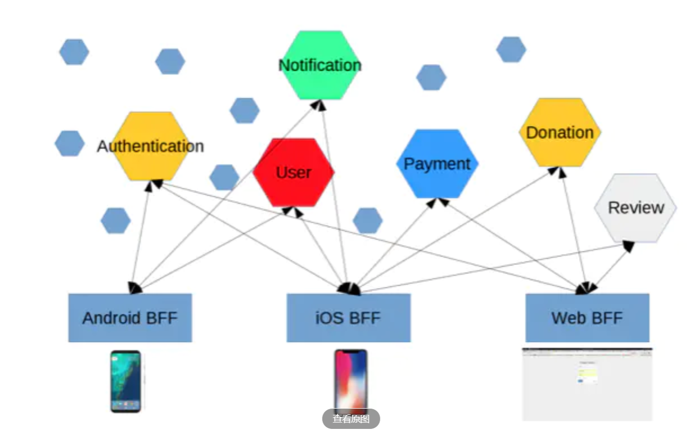
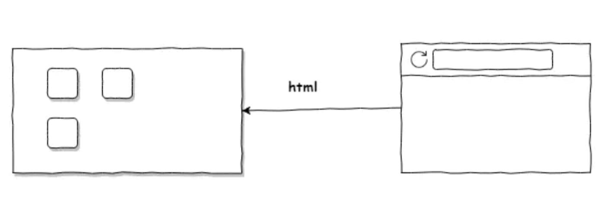
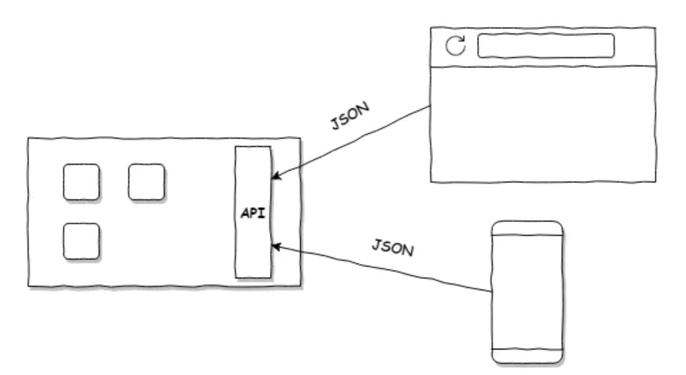
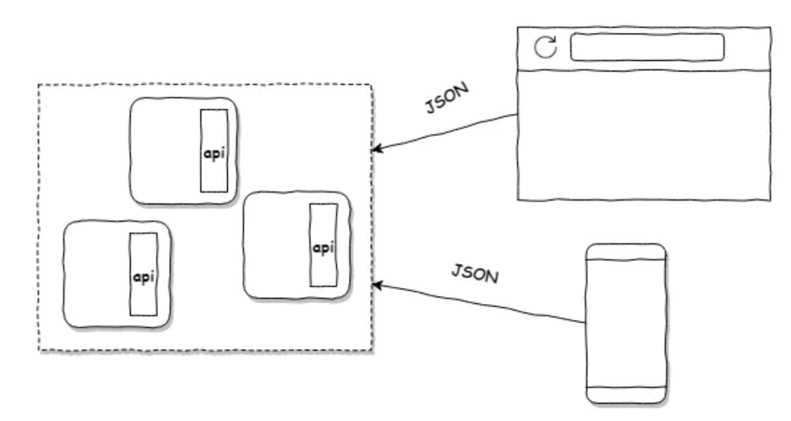
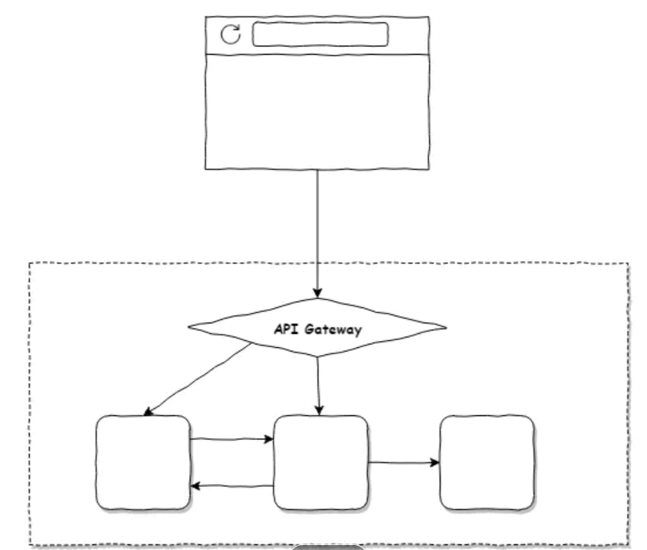
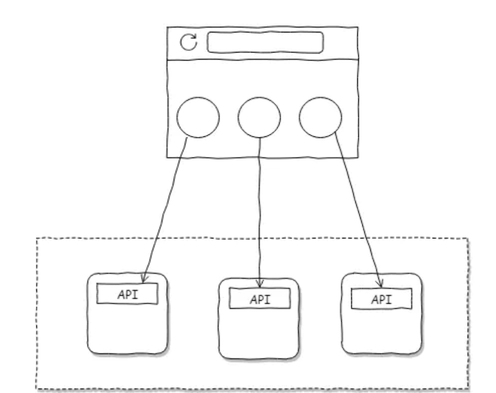
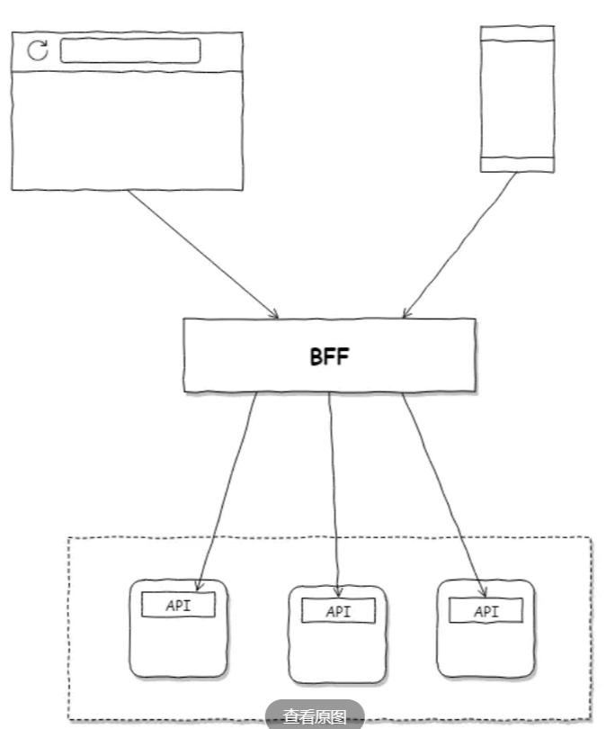
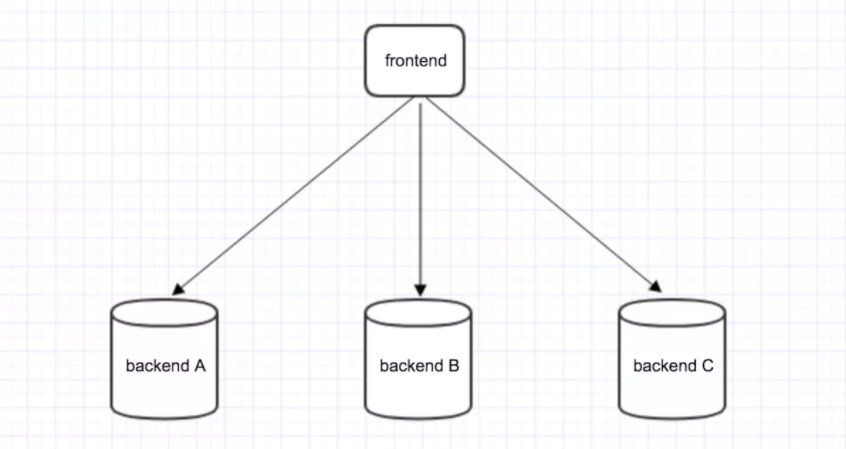
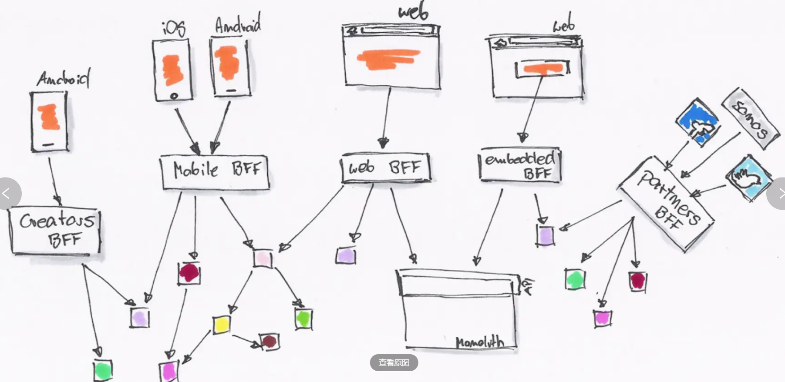
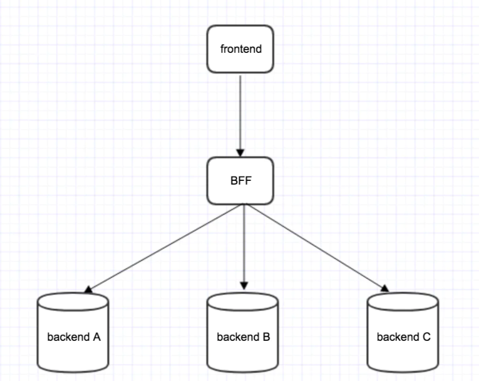

BFF 概念：是什么与解决什么
====

> 定位：BFF（Backend For Frontend）概念篇，讲"是什么/从哪来/解决什么/怎么用"。工程侧的网关分界、聚合裁剪、鉴权下沉见 [BFF模式与网关层设计](BFF模式与网关层设计.md)。本篇由两篇旧概念文合并而成，来源：
>
> * [BFF —— Backend For Frontend（简书）](https://www.jianshu.com/p/eb1875c62ad3)
> * [BFF——服务于前端的后端（简书）](https://www.jianshu.com/p/9cca72f9e93c)

一、BFF 是什么
------

BFF，即 Backend For Frontend（服务于前端的后端）。服务器设计 API 时会考虑前端的使用，并在服务端直接处理业务逻辑，又称为**用户体验适配器**。BFF 只是一种逻辑分层，而非一种技术。虽然 BFF 是一个新名词，但它的理念由来已久（就是经典的中间层概念）。

二、从哪里来：前端与后端的演化史
------

**Web 1.0：纯后端渲染**

第一代 Web 架构很简单：客户端每次向服务器请求，返回的都是一个特定的 HTML 页面，JS 派不上大用场。JSP 就属于这个范畴，更原始的还有用字符串拼接 HTML 的动态渲染技术。

**Web 2.0：前后端解耦**

智能手机业务开始蓬勃发展后，受限于网络传输。由后端反复送 HTML 到前端（后端渲染）的技术很难适应新的业务场景。业界转而把数据格式化为 JSON，通过 API 调用提供给前端使用——**前后端解耦**。此后 JS 前端框架方兴未艾，前后端技术正式分离，Web 交互空前丰富。

**微服务时代：客户端与微服务交互成为新考量**

前端在剧烈演进，后端也悄然变化：微服务、中台战略充斥在各类技术架构中。

应对客户端与微服务交互的常见方案有两种：

* **方案一：API Gateway**。比较直观，利用 API 网关分发请求。

* **方案二：CORS**。前端跨域请求：前端分别向不同微服务发出请求，再将回调数据在 Flux 层处理后反映在 DOM 上。

这两种方案在业务权责上有明显偏重——**看数据的组装、聚合、裁剪放在哪一块就知道了**：

* 方案一里，后端有时需要准备粒度很细的数据返回，要求前后端频繁沟通。另一些场景下后端又要构造各种级联表单，以致微服务之间调度频繁。而微服务的本质是清晰的限界上下文，某些场景下这种设计会导致领域建模变得复杂。
* 方案二里，后端只提供粗粒度的 API 交由前端酌情处理。代价是传输负载可能较大，且多平台开发时各平台需要重复组织数据，显得冗余。

三、BFF 解决什么问题
------

将上面"组装、聚合、裁剪"这部分业务单独拎出来，组成一个叫 Backend For Frontend 的中间层。这就是两种方案的折衷解法。所谓"没有什么问题是加一个中间层解决不了的"——BFF 正是演进到这一步的自然结果。

一个典型场景：前端页面时常需要向 backend A、backend B、backend C……分别发送请求。不同服务的返回值用于渲染页面中不同的 component——一个页面存在很多请求：

此时每次访问该页面都要发送 3 个请求。同时为了保障 Android、iOS、Web 端的不同需求，需要为不同平台写不同的 API 接口，值发生变化时三端都要改。再如对一个字符串做"限定 140 个字符"这类处理，需要在每个客户端分别实现一遍，代价相当大。

引入 BFF 中间件后，业务逻辑处理（聚合、裁剪、适配）都发生在这一层：

有了 BFF 层，就不需要为系统后端的迁移操心——后端发生的变化都可以在 BFF 层做相应修改。原本每次访问发送 3 个请求的页面，变成一个请求：

四、使用 BFF 的正确姿势
------

* **多端应用**

  设计 API 时考虑到不同设备的需求，为不同设备提供不同的 API。它们可能实现相同的功能，但不同设备各有特殊性，对服务端 API 的访问也各有特点，需要区别处理。

* **服务聚合**

  随着微服务的兴起，原本在同一个进程内运行的业务流程被拆分到不同的服务中。这在增加业务灵活性的同时，也让前端的调用变得更复杂。BFF 为前端应用提供了一个对业务服务调用的聚合点：它屏蔽了复杂的服务调用链。让前端聚焦在所需要的数据上，而不用关注底层提供这些数据的服务。

* **非必要，莫新增**

  BFF 带来好处的同时，也带来代码重复和工作量增加的问题。如果与已有 BFF 功能类似、展现数据的要求也相近，必须谨慎对待新增 BFF 的行为。**非必要，莫新增**。

五、实战中的玩法
------

* **访问控制**：例如服务中的权限控制。将所有服务的权限控制集中在 BFF 层，使下层服务更加纯粹和独立。

* **应用缓存**：项目中时常存在需要缓存的临时数据。BFF 作为业务的汇聚点，距离用户请求最近，适合把这类缓存操作放在 BFF 层。

* **第三方入口**：业务需要与第三方交互时，将交互放在 BFF 层。只暴露必要信息给第三方，便于控制第三方的访问。

六、BFF 的优缺点与适用时机
------

**优点**：

* 前后端彻底分离，即便后期有微服务迁移，也不需改动前端代码；
* 业务更向前靠拢，琐碎的 API 由前端开发自己决定，更适配前端框架；
* BFF 可以自开 mock，插件也能生成 API 文档，比后端单开这类服务更方便；
* 留给后端更清晰的服务边界，只需要提供粗粒度的接口即可；
* 多应用场景里，BFF 共享后端是优雅的中台设计。

**缺点**——增加了系统复杂度，并带来一系列连锁反应：

* 中间层转发会增加请求延迟；
* 需要保证端到端测试；
* 必须随时准备好处理后端异常请求；
* BFF 拆分会增加开发成本。

**落地形态**：实现上没有太大限制，常见就是一层 Node.js，做请求转发和数据转化即可。Node.js 既配合了前端技术栈，也更适应向微服务的并发请求。可以在 Node 上跑 GraphQL 服务；也可以做成对前 RESTful、对后 RPC 的实现；还可以在 BFF 上加 cache、鉴权，按自身需求改造。实践中也有团队把 BFF 与前端一起从后端仓库分离出来，独立开发独立部署。

**一个反模式教训**：有团队从两三个单体应用出发。约一年里逐步完成前后端分离、微服务、BFF 分层转型。结果开发效率不升反降——开发者本地要同时开 frontend、BFF、各后端、本地 DB。跨应用交互还要再开一套前端和 BFF。复盘出两条：

1. **系统分层了，但人的职责没有分层**——违反康威定律（见 [康威定律与团队拓扑](../../DDD与方法论/方法论/康威定律与团队拓扑.md)）。三五个开发的团队甚至该考虑服务合并；
2. **没有形成技术共识**——经历过拆分的"元老"相继离职后。新成员很难体会当中的曲折。

所以说系统设计还是要依据奥卡姆剃刀原则——**若无必要，勿增实体**。

**适用时机**：BFF 是系统不断演进的结果，采用时应正确把握演进步调。比较适合放在系统重构阶段。例如采用绞杀者模式（strangler pattern）迁移系统，在遗留代码外添加新功能做成微服务。此时 BFF 既可以扮演旧系统的代理，也可以为新功能提供新形式的接口。

> 工程侧展开（网关职责分界、并行 fan-out、超时预算、鉴权下沉、何时引入）见 [BFF模式与网关层设计](BFF模式与网关层设计.md)。
